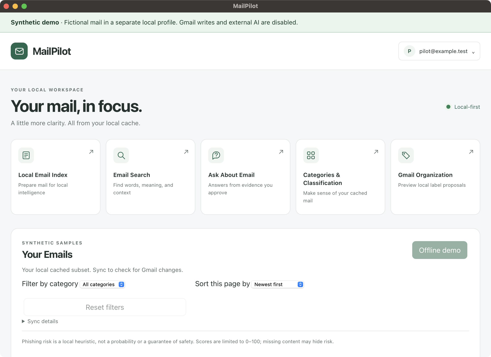
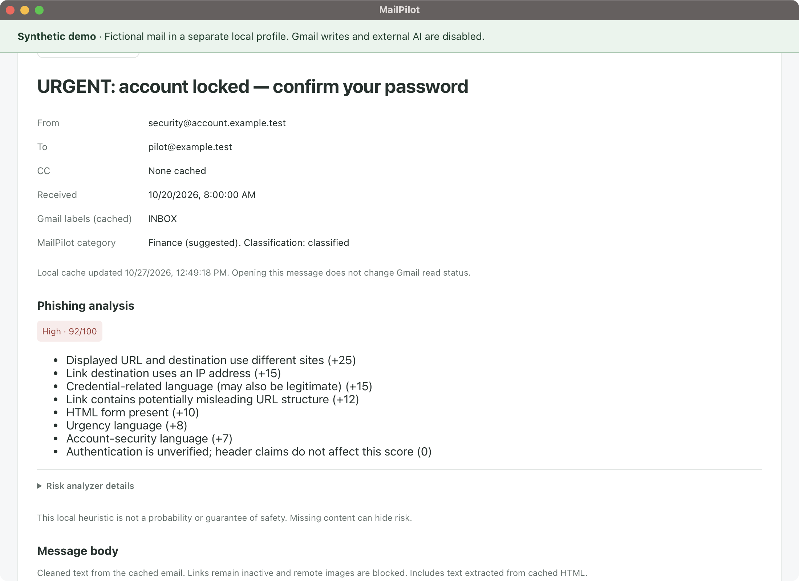
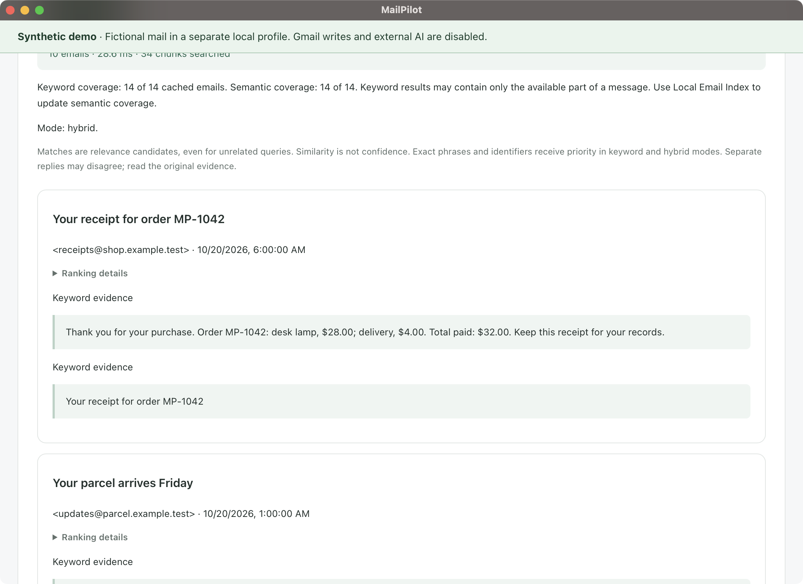
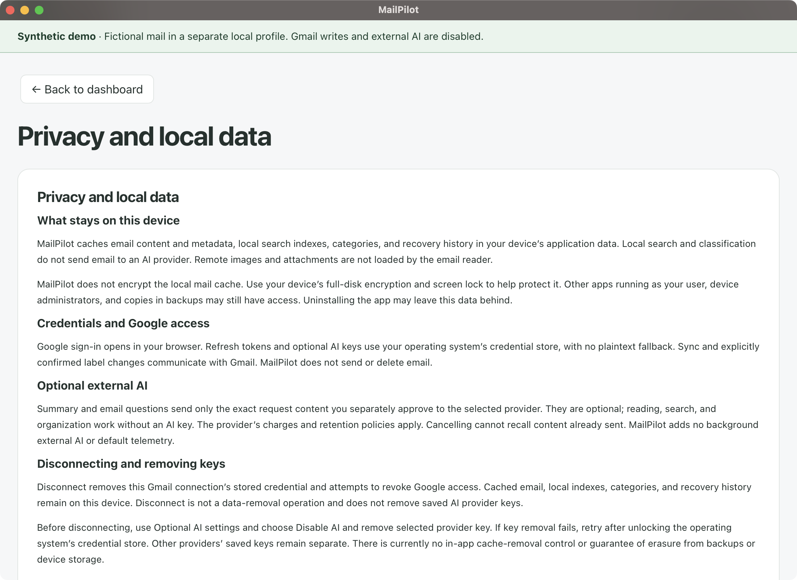
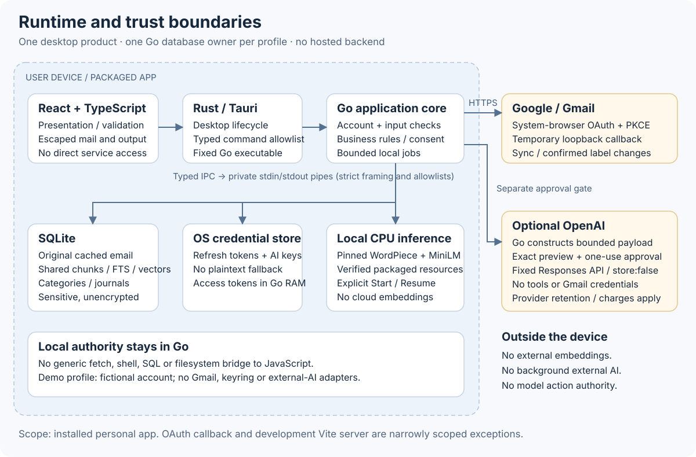

# MailPilot

A local-first Gmail desktop app built with **Go, React, TypeScript, Tauri and
SQLite**. Search cached email by keyword or meaning, review category suggestions
and phishing indicators, and preview Gmail label changes before confirming them.
One shared local mail-processing and embedding pipeline powers the intelligent
features. Optional OpenAI summaries and evidence-based answers require approval
for each request.

**Try it without credentials:** `npm run dev:demo` opens an isolated fictional
mailbox. **Use your own Gmail:** supply a Google Desktop OAuth JSON to
`dev:personal` or `build:personal`. Both routes are explained below.

**Status — 2026-10-27:** working developer/portfolio application, qualified on
Apple Silicon macOS. The mail cache is **unencrypted**. Developer ID signing,
notarization and public Google OAuth verification are unfinished; there is no
verified consumer download. Ordinary local features need no external AI account.

## Contents

- [Quick demonstration](#quick-demonstration)
- [Screenshots](#screenshots)
- [Implemented features](#implemented-features)
- [Prerequisites](#prerequisites)
- [Use your own Gmail](#use-your-own-gmail)
- [Optional OpenAI setup](#optional-openai-setup)
- [Architecture and design](#architecture-and-design)
- [Security and privacy](#security-and-privacy)
- [Configuration and local storage](#configuration-and-local-storage)
- [Evaluation](#evaluation)
- [Development and verification](#development-and-verification)
- [Troubleshooting](#troubleshooting)
- [Release status and documentation](#release-status-and-documentation)

## Quick demonstration

Install the [prerequisites](#prerequisites), then run these commands from the
repository root:

```sh
npm ci
npm run dev:demo
```

The native window opens with a persistent **Synthetic demo** banner and
`pilot@example.test`. Vite listens at `http://127.0.0.1:1420` during development;
keep the terminal open and stop it with Ctrl+C. The first build downloads build
dependencies and prepares pinned model resources. The installed app needs no
runtime model download, Python installation or external service.

A short walkthrough:

1. Scroll to **Your Emails**. Open a receipt or one of the clearly labeled
   fictional phishing messages. Inspect the risk score and its individual reasons.
2. Open **Email Search**, choose Keyword and search `MP-1042` or `Atlas`.
   Open a result to read the original cached sample.
3. Open **Local Email Index** and explicitly start indexing. The bundled MiniLM
   provider computes real vectors and category assessments. Before this, Keyword
   works, Hybrid discloses keyword fallback, and Semantic is unavailable.
4. After indexing completes, try Hybrid search for `flight reservation`, then
   review **Categories & Classification** or a local **Gmail Organization** preview.
5. Open the account menu → **Privacy and local data**. External AI, Google sign-in
   and Gmail writes are disabled in the demo, including in Go.

The demo now contains **14 fictional messages**, including two whose original
plain-text/HTML signals produce HIGH risk through the normal deterministic
analyzer. Scores and vectors are computed by the app; they are not fixture values.
The links use reserved example domains and documentation IP addresses. The reader
renders escaped text and never opens the embedded forms or remote content.

To build a Finder-launchable demo on Apple Silicon macOS:

```sh
npm run build:demo
codesign --force --deep --sign - "src-tauri/target/release/bundle/macos/MailPilot Demo.app"
codesign --verify --deep --strict "src-tauri/target/release/bundle/macos/MailPilot Demo.app"
open "src-tauri/target/release/bundle/macos/MailPilot Demo.app"
```

This is an ad-hoc local signature. Quit an existing demo before opening a rebuilt
copy. The demo has its own app identifier and fixed profile, separate from ordinary
MailPilot. To restore the bundled messages, quit it and run `npm run demo:reset`.
That restores known samples while retaining category edits, compatible indexes
and immutable journals; it does not purge data. See the [demo guide](docs/DEMO.md).

## Screenshots

These are genuine native-app captures from the isolated synthetic profile.
All addresses and messages are fictional. No Google or AI credentials were used.
See [capture provenance and reproduction](docs/assets/README.md).



_Dashboard: one shared desktop workspace for cached mail and local intelligence._



_Reader: explained phishing indicators are heuristic evidence, not a probability or
proof that a message is malicious._



_Search: real local hybrid retrieval after explicit indexing; source excerpts open the cached original._



_Privacy: retention and credential handling are visible inside the app._

## Implemented features

| Capability                | Current behavior                                                                                                          | Practical limit                                                                                                                                 |
| ------------------------- | ------------------------------------------------------------------------------------------------------------------------- | ----------------------------------------------------------------------------------------------------------------------------------------------- |
| Gmail connection and sync | Browser OAuth with PKCE/state; OS-stored refresh tokens; manual Inbox snapshot and incremental history                    | One account; default 500 Inbox messages plus a separate bounded maintenance allowance, configurable to 10,000 each; no complete-mailbox promise |
| Cached reader             | Paged, escaped readable text, metadata and source navigation                                                              | No rich HTML, remote images or attachment download/execution; cold-start session restoration verifies Gmail online                              |
| Local indexing            | Explicit Start/Pause/Resume/Cancel/Rebuild; durable progress and restart recovery                                         | Bundled CPU MiniLM; macOS 13.4+ on the qualified Apple Silicon target; no automatic startup inference                                           |
| Search                    | Keyword, exact semantic and hybrid search; sender, UTC date and assigned-category filters                                 | Semantic needs compatible vectors; hybrid can fall back to keywords; top-K results are not exhaustive evidence                                  |
| Categories                | Editable definitions, shared prototypes, explicitly confirmed examples, rule/semantic suggestions and primary preferences | Suggestions require review; held-out precision and negative-case abstention need improvement                                                    |
| Phishing explanations     | Independent local feature extraction, versioned scores and signed point contributions                                     | No link visits, DNS lookup, trusted authentication verification or safety guarantee                                                             |
| Gmail organization        | Bounded preview, separate confirmation, journal-before-dispatch, reconciliation and verified best-effort undo             | Label additions only; preserves unrelated labels and reports partial/uncertain outcomes; demo is preview-only                                   |
| Optional external AI      | Selected-email Summary and answers from separately approved bounded excerpts, with validated citations                    | OpenAI is the only shipped functional adapter; no hidden evidence expansion, tools, background AI or automatic paid retries                     |
| Historical recovery       | Read/reconcile existing journal outcomes and GET-only historical draft matching                                           | No new drafts, composition, sending or remote draft deletion                                                                                    |

MailPilot does not expose sending, deletion, archive, mark-as-read, autonomous
mailbox changes, attachments/OCR, Chrome integration or additional email providers.
English and approximately 10,000 cached messages are the qualification baseline.

## Prerequisites

These are **source-build** requirements. A complete installed bundle includes its
Go executable, model and native runtime.

| Requirement                            | Qualified environment / purpose                                                   |
| -------------------------------------- | --------------------------------------------------------------------------------- |
| Apple Silicon Mac                      | Native build/smoke target; macOS 13.0 app baseline, **13.4+ for local inference** |
| Go **1.27.3+**                         | Backend and patched TLS toolchain required by `backend/go.mod`                    |
| Node.js **24.13.1+**, npm              | Verified with Node 24.13.1 / npm 11.8.0; package engine floor is 22.12            |
| Rust **1.99+**, Cargo, rustfmt, Clippy | Native Tauri host; install through [rustup](https://rustup.rs/)                   |
| Xcode Command Line Tools               | Run `xcode-select --install` if missing; needed for native/CGO compilation        |

See [Tauri prerequisites](https://v2.tauri.app/start/prerequisites/). Windows,
Linux and other architectures have not received equivalent native qualification;
the local embedding adapter is unavailable there. Build on the target host;
the sidecar script rejects cross-compilation. The launchers locate Cargo in the
standard Rust installation when it is absent from PATH. For direct Cargo commands,
load `source "$HOME/.cargo/env"` in your shell if needed.

## Use your own Gmail

Use a dedicated test account while evaluating this developer build.

1. Create/select a [Google Cloud project](https://console.cloud.google.com/) and
   enable **Gmail API**.
2. Configure **Google Auth Platform** with External audience, **Testing** status
   and your Gmail account under **Test users**.
3. Add `https://www.googleapis.com/auth/gmail.modify` in Data Access. It permits
   body reads and reviewed label changes. Google's scope also grants broader
   capabilities, including sending; MailPilot exposes none of those operations.
4. Create a **Desktop app** OAuth client. Download its JSON when created and save
   it outside the repository. No purchased domain or public callback is needed.
5. Install dependencies once with `npm ci`, then launch from the repository root:

```sh
npm run dev:personal -- --google-client-json "/absolute/path/outside-repo/client.json"
```

Replace the example with your own external JSON path. The helper validates the
file and embeds only Desktop client configuration in Go. Click **Connect Gmail**,
sign in through your system browser, and review consent for your own project.
MailPilot receives the result through a temporary loopback callback. Successful
connection shows your account; **Sync inbox** explicitly imports cached mail and
prepares keyword passages without inference or Gmail writes.

For a personal app you can open without a terminal:

```sh
npm run build:personal -- --google-client-json "/absolute/path/outside-repo/client.json"
codesign --force --deep --sign - .local/personal/MailPilot.app
codesign --verify --deep --strict .local/personal/MailPilot.app
open .local/personal/MailPilot.app
```

The private ignored output is `.local/personal/MailPilot.app`. Keep the complete
bundle intact; a rebuild replaces that output. Quit any running ordinary copy
before launching it. Desktop client configuration is extractable public-client
configuration; **user tokens and AI keys are never packaged**. This personal
workflow does not issue a production key or bypass verification. Testing-mode
Gmail refresh tokens normally expire after seven days: reconnect when prompted.

The [Gmail setup guide](docs/GMAIL_SETUP.md) covers the JSON download button,
consent, troubleshooting, configuration precedence and cleanup.

## Optional OpenAI setup

Skip this for the synthetic demo and all ordinary local features.

1. Create/select an [OpenAI Platform](https://platform.openai.com/) project,
   check its API billing and model access, and create your own project API key.
2. In connected MailPilot, open the account menu → **Optional AI settings**.
   Select `openai` and enter an accessible Responses API text model ID; for
   example, `gpt-4.1-mini` if your project has access.
3. Enter the key in **Provider API key** and choose **Save AI settings**.
   The input clears and the key uses OS credential storage. Saving makes no paid
   validation call and does not establish model access.
4. Only if desired, prepare a selected-email Summary or **Ask About Email**
   request. Inspect the exact content/provider/model disclosure, then approve
   that individual request. Summary permission does not approve email questions.

Approved requests may incur provider charges. The adapter sends bounded text to
OpenAI's fixed Responses endpoint with `store:false`; this does not promise zero
retention. Cancellation cannot recall content already sent. Remove the saved key
with **Disable AI and remove selected provider key** before disconnecting Gmail;
retry removal after unlocking the OS store if it fails.

See [OpenAI setup](docs/OPENAI_SETUP.md) for current official account/model links,
request compatibility, billing, retention and troubleshooting. No paid-model
quality qualification is claimed.

## Architecture and design



_The installed app has no hosted backend or generic frontend fetch/SQL/shell bridge.
The browser callback exists only during OAuth. Demo startup omits external adapters._


_Original mail remains separate from derived text. Model, preprocessing, account,
source revision and generation checks keep incompatible or stale work ineligible._

The main engineering choices are deliberate:

- **One Go owner and one SQLite database per profile.** Business policy,
  credentials and transactions stay out of React. Rust owns desktop lifecycle and
  a typed command allowlist; private pipes connect it to the fixed Go executable.
- **One shared chunk/vector pipeline.** The reader and chunker reuse readable
  sections. Pinned WordPiece tokenization and a packaged MiniLM CPU provider serve
  indexing, category prototypes and queries; classification reuses mail vectors.
  FTS searches those same passages without requiring inference.
- **Exact retrieval before another index system.** Cosine search is auditable and
  simple at the evaluated scale, but dense hybrid scans still miss the latency
  target. No ANN database or cloud embedding service is hidden behind the UI.
- **Explicit work and consent.** Manual sync does no inference. Indexing is
  bounded, cancellable and resumable. Gmail writes require reviewed plans;
  external AI has a separate expiring, one-use approval tied to the exact request.
- **Versioned publication and durable recovery.** Source/checkpoint changes are
  transactional; workers recheck revisions/generations before publishing. Immutable
  migrations and operation journals preserve recovery across model/code changes.

### Repository layout

```text
backend/cmd/mailpilot-core/   Trusted Go composition and lifecycle
backend/internal/app/         Reader, sync/index/search, organization and AI policy
backend/internal/mail/        Shared readable sections, chunker and WordPiece
backend/internal/embedding/   Packaged native CPU inference adapter
backend/internal/retrieval/   Keyword, exact semantic and hybrid retrieval
backend/internal/classification/  Shared category assessment
backend/internal/risk/        Independent phishing observations and scoring
backend/internal/ai/          Provider-neutral boundary and OpenAI adapter
backend/internal/store/sqlite/    Repositories and immutable migrations 001–021
backend/internal/demo/        Isolated synthetic profile and original sample mail
frontend/src/                React presentation and validated TypeScript IPC
src-tauri/src/               Rust desktop lifecycle and narrow command bridge
contracts/                  IPC contracts and synthetic compatibility fixtures
scripts/                    Existing build, resource and native smoke helpers
docs/                       Guides, contracts, evaluation and visual assets
```

## Security and privacy

| Data / action                           | Current handling                                                                                                                                                                             |
| --------------------------------------- | -------------------------------------------------------------------------------------------------------------------------------------------------------------------------------------------- |
| Gmail authorization                     | System browser, PKCE/state, bounded loopback listener and serialized refresh; never a Gmail password                                                                                         |
| Refresh tokens / AI keys                | OS credential store only; no file, SQL, browser, argument or environment fallback; access tokens stay in Go memory                                                                           |
| Mail, chunks, vectors, FTS and journals | Sensitive **unencrypted** local SQLite data; private Unix permissions, sidecar/link checks, memory query temporaries and ordinary secure-delete reduce exposure without guaranteeing erasure |
| Untrusted mail / model output           | Escaped reader text and validated output/citations; no remote content, attachment execution or model action privileges                                                                       |
| Gmail label changes                     | Separate bounded preview and confirmation, durable evidence, reconciliation before uncertain retries, verified partial undo                                                                  |
| External AI                             | Exact bounded request approval; no cloud embeddings, background generation, default telemetry or persistent answer history                                                                   |
| Disconnect / uninstall                  | Disconnect removes Gmail credentials and attempts revocation; **cache, categories, recovery records and AI keys remain**. Uninstall may retain data                                          |

Use device encryption, screen lock and a private OS account. Another program
running as your user, administrators, backups and OS swap remain outside these
application protections. There is no in-app cache-removal control or forensic-erasure
claim. Detailed behavior and reporting are in [Privacy](docs/PRIVACY.md) and
[SECURITY.md](SECURITY.md).

## Configuration and local storage

The app does not load `.env` files automatically. Personal helpers accept an
external Desktop JSON; standard builds exclude the embedded personal default.
Direct launches support a complete `MAILPILOT_GOOGLE_CLIENT_ID` /
`MAILPILOT_GOOGLE_CLIENT_SECRET` override pair; partial overrides fail and two
explicit empty values disable OAuth. See [configuration precedence](docs/GMAIL_SETUP.md#configuration-precedence-and-standard-builds).
These settings are developer client configuration, never user tokens or API keys.

| Setting               | Default / override                                                                                                            |
| --------------------- | ----------------------------------------------------------------------------------------------------------------------------- |
| Data directory        | OS app-data directory for `com.mailpilot.desktop`; override with absolute dedicated `MAILPILOT_DATA_DIR` or core `--data-dir` |
| Log level             | `info`; `MAILPILOT_LOG_LEVEL` or core `--log-level`: `debug`, `info`, `warn`, `error`                                         |
| Manual sync allowance | 500 Inbox messages plus 500 maintenance observations; `MAILPILOT_SYNC_LIMIT=1..10000` sets each allowance                     |

Core flags take precedence over environment, then defaults. Demo mode forces its
own fixed profile and rejects custom paths. Default ordinary database locations:

- macOS: `~/Library/Application Support/com.mailpilot.desktop/mailpilot.db`
- Windows: `%APPDATA%\com.mailpilot.desktop\mailpilot.db` (unqualified platform)
- Linux: `${XDG_DATA_HOME:-~/.local/share}/com.mailpilot.desktop/mailpilot.db` (unqualified platform)

SQLite uses one pooled connection, foreign keys, WAL, FULL synchronization and
checksummed transactional migrations. Structured backend diagnostics use fixed
safe events/codes rather than email, keys or tokens. Never publish app-data files,
backups or mailbox-bearing development captures.

## Evaluation

The **2026-10-21** evaluation used synthetic mail and real offline MiniLM on an
Apple M2, eight logical CPUs, 8 GiB RAM, macOS 13.4. Later security/personal/demo
checks are dated separately. These are reproducible engineering observations,
not production-mailbox accuracy or release certification.

| Observation                       | Measured result and denominator                                                                                                 | Limit                                                                                                                                     |
| --------------------------------- | ------------------------------------------------------------------------------------------------------------------------------- | ----------------------------------------------------------------------------------------------------------------------------------------- |
| Hybrid retrieval                  | Macro Recall@10 **0.9545**, nDCG@10 **0.8872**, MRR@10 **0.8652** over 22 answerable queries, 72 searched messages / 145 chunks | Small frozen synthetic fixture; both unrelated queries still returned candidates; eight exact-identifier cases had no hybrid top-one miss |
| Category suggestions, definitions | **34/56 correct suggestions (60.71%)**, recall 34/37 (91.89%), abstention 0/45 original held-out messages                       | Below the 90% precision target; all eight negative cases received suggestions                                                             |
| With six confirmed examples       | **35/53 (66.04%)** precision, recall 35/37 (94.59%) on the same held-out split                                                  | Some categories worsened; forwarded variants are paired derivatives, not independent cases                                                |
| Large-corpus persistence          | **10,000 messages / 39,517 vectors**, six category prototypes and 10,000 assessments                                            | English template corpus; not real mailbox diversity                                                                                       |
| Indexing phases                   | Source/vector completion observed at **27 min 21 s**; optimized remaining 9,983 assessments **140.826 s**                       | Intentional interruption/resume; these are separate phases, not a fresh uninterrupted final-source run                                    |
| Dense scan latency                | Semantic p95 **644.2 ms**, Hybrid p95 **1,150 ms**                                                                              | 20 warm scans per mode over 50,000 stored vectors, fixed query vector; excludes query embedding; both exceed the proposed 500 ms target   |

[Evaluation](docs/EVALUATION.md) defines metrics and retains negative results;
[performance evidence](docs/PERFORMANCE.md) records exact commands, corpus hashes,
hardware, memory and timing boundaries. The **2026-10-26** follow-up records
security patches and remaining platform warnings. **2026-10-27** records the
credential-free demo's synthetic/native qualification. No live Gmail mutation,
paid-provider evaluation or public-distribution approval is implied by those runs.

## Development and verification

After `npm ci`, ordinary `npm run dev` launches the unconfigured app; use the demo
or personal route above for a useful session. Go changes require stopping and
restarting development to rebuild the sidecar. React hot reloads; Tauri rebuilds
Rust changes. Quit joins local work and closes SQLite; restart retains committed
work and requires explicit Resume for interrupted indexing.

These existing commands are the regression workflow, **not a claim that editing
this README reran every suite**:

```sh
cd backend
go vet ./...
go test ./...
go test -race ./...
cd ..
npm run typecheck
npm run lint
npm test
npm run build:frontend
cargo fmt --manifest-path src-tauri/Cargo.toml -- --check
cargo clippy --manifest-path src-tauri/Cargo.toml --all-targets -- -D warnings
cargo test --manifest-path src-tauri/Cargo.toml
```

Build and sign the intended package before its native checks. `npm run test:demo:native`
qualifies the synthetic demo with backend network denied and real packaged inference.
Run native checks sequentially in a graphical macOS session with existing demo
windows closed. Ordinary/personal package checks and resource signing/offline
requirements are documented through the [documentation index](docs/README.md).

## Troubleshooting

| Symptom                                     | Next step                                                                                                                                                                          |
| ------------------------------------------- | ---------------------------------------------------------------------------------------------------------------------------------------------------------------------------------- |
| First build is slow / resources unavailable | Let dependency/resource preparation finish with network available; check [native resource requirements](docs/LOCAL_EMBEDDING.md). Do not download an arbitrary replacement model   |
| Port 1420 is busy                           | Stop the previous development session with Ctrl+C before starting another                                                                                                          |
| Rebuilt app shows an older window           | Quit the running copy; the single-instance host otherwise focuses it                                                                                                               |
| Demo shows incomplete semantic coverage     | Explicitly Start/Resume indexing after adding/restoring messages; Keyword still works                                                                                              |
| New phishing samples are absent             | Rebuild the demo, quit the old copy and relaunch; new IDs seed automatically without wiping the profile                                                                            |
| Can't find Google JSON / invalid client     | Create a **Desktop app** client and download JSON in its creation dialog; follow [Gmail setup](docs/GMAIL_SETUP.md)                                                                |
| Google blocks sign-in / requires reconnect  | Check test-user membership, project scope/API and Workspace restrictions; testing refresh tokens normally expire after seven days. Review warnings only for your own known project |
| Credential store is locked                  | Unlock/allow the OS store and retry; MailPilot fails closed without plaintext fallback                                                                                             |
| AI settings saved but request fails         | Saving validates no paid access; check API billing, project model permissions and [adapter compatibility](docs/OPENAI_SETUP.md#model-and-request-compatibility)                    |

## Release status and documentation

Source builds, a separately identified offline demo and owner-configured personal
macOS bundles are available. Local ad-hoc signatures do not establish a trusted
public release. Developer ID signing/notarization, public Google OAuth verification
and applicable assessment remain unfinished. Cache encryption/removal controls,
classification precision/abstention and dense-scan latency remain open work.
Windows/Linux native qualification and paid-model evaluation have not been completed.

Start with these guides; the [documentation index](docs/README.md) routes detailed
contracts and historical evidence:

- [Demo walkthrough](docs/DEMO.md) — credential-free presentation and sample restoration.
- [Gmail setup](docs/GMAIL_SETUP.md) and [OpenAI setup](docs/OPENAI_SETUP.md) — separate personal and optional AI routes.
- [Architecture](docs/ARCHITECTURE.md) — ownership, shared storage and lifecycle.
- [Privacy](docs/PRIVACY.md) / [Security](SECURITY.md) — data handling, threat model and reporting.
- [Evaluation](docs/EVALUATION.md) — dated evidence, denominators and unresolved findings.
