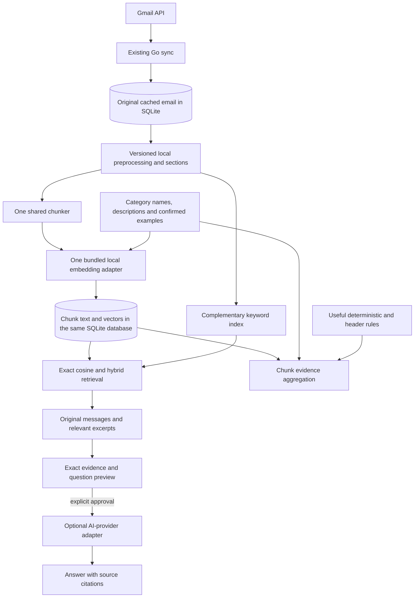

# MailPilot architecture

Updated 2026-10-19 for the shared local retrieval direction. This document is the
technical authority; [PRODUCT_PLAN.md](PRODUCT_PLAN.md) is the sole scope/milestone
plan. [AGENTS.md](../AGENTS.md) is the concise engineering contract. The later
authorized persistence/chunking slices add migrations 015–016, typed storage and
bounded cached source projection during manual sync. Inference, embedding scheduling,
retrieval and new IPC remain planned. Historical plans are under [archive](archive/LEGACY_FEATURES.md).

[VECTOR_ARCHITECTURE_PLAN.md](VECTOR_ARCHITECTURE_PLAN.md) is the detailed technical
supplement for the same scope: exact source reuse/disabled paths, logical shared
schema, interfaces, revision lifecycle, proposed native model choice and migration/
recovery incompatibilities. It adds no second product roadmap or implementation
permission. Where this overview leaves alternatives open, use that plan's single
proposed baseline and qualification gates.

## 1. Verified implementation baseline

Status is based on the current working tree, including uncommitted/untracked
application changes. It is source inspection, not a clean-commit release or a new
claim that all tests/builds passed. Preserve that work when implementing later.

| Area | Implemented now | Planned or limited |
| --- | --- | --- |
| Runtime | React/TypeScript in Tauri, one fixed bundled Go sidecar, private JSON-RPC pipes, health/SQLite startup and graceful lifecycle. | A cached chunker runs within manual sync; no inference runtime/helper or retrieval service is composed. |
| Gmail | System-browser OAuth/keyring; one account; manual bounded initial Inbox and incremental history sync; normalized local cache. | No complete mailbox/Sent/attachment coverage, background scheduling or second email provider. Thread retrieval returns unsupported. |
| Reader | `mail.read` returns revision-checked paged escaped text; HTML-only bodies use HTML-to-text extraction; metadata and phishing explanations are shown. | No rich HTML sanitizer/renderer, remote content or attachment download. Cold-start restoration checks Gmail online. |
| Categories | Editable definitions, local assignment repository and deterministic review with conservative 0.60 rule gate; stale assessments are checked. | No active semantic classifier, automatic full-cache assessment, confirmed-example workflow or user-facing primary-override system. |
| Gmail organization | Preview/dry run, explicit confirmation, namespaced label additions, durable journal, reconciliation and verified best-effort undo. | No automatic labels or other mailbox actions. |
| Phishing | Offline bounded feature extraction plus versioned scoring/persistence/display. Authentication header provenance remains unverified. | Risk scores are explanations, not probabilities, authentication verification or safety guarantees. |
| AI | `ai.settings`, provider-scoped OS keys and one approved cached-email Summary through `SummarizeEmail`; OpenAI is the only installed functional adapter. | No evidence-question operation, retrieved context, tools, replies, new drafts or general chat. |
| Search/storage | SQLite migrations 001–016, deterministic cached chunk production/persistence, source invalidation and historical derived-row compatibility; tests probe FTS5 availability. | Neither keyword search nor semantic search/indexing is an active product service. Old vector schemas are inert. |
| Historical recovery | GET-only Gmail draft matching and local status/reconcile/resolve/cancel for old journal actions. | No draft creation, resending, remote deletion or reactivation of historical previews. |

Composition is in [main.go](../backend/cmd/mailpilot-core/main.go). Actual command
allowlists and strict fixtures are documented in [contracts](../contracts/README.md).
Old `ask.manage`/`search.semantic` operations remain rejected. Do not reactivate
an archived command or trust an old vector merely because a schema/fixture exists.

## 2. Runtime and package ownership

The installed runtime remains one desktop product. Rust owns windows, packaged
process lifecycle, app-data paths and narrow typed commands. It starts a fixed Go
executable without a shell or frontend-controlled path/arguments. Go owns application
policy, account authorization, SQLite, credentials, Gmail, local indexing/retrieval
and external-provider calls. React has no direct database, keyring, Gmail or AI access.

Private newline-delimited JSON-RPC uses handshake/protocol validation, string IDs,
strict method/field allowlists and 64 KiB frames. The current dispatcher executes
one request at a time; long workflows use bounded application jobs and polling,
not a generic job/RPC framework. Most Go calls have a five-second deadline and
classification review has 30 seconds; the native bridge has matching longer waits.
No generic SQL, URL fetch, filesystem or shell bridge; no product HTTP server.
The temporary OAuth callback and development Vite server are separate from this
packaged trust boundary. Parent EOF/shutdown cancels/joins work before SQLite closes;
a crashed sidecar disables actions rather than replaying uncertain writes.

| Existing package/path | Responsibility |
| --- | --- |
| `backend/cmd/mailpilot-core` | Trusted composition, configuration and shutdown ordering. |
| `backend/internal/domain` | Provider-neutral typed account/message/category identities and data; no SDK/SQL/transport types. |
| `backend/internal/app` | Authorized reader/category/review/organization/AI use cases, bounded jobs and consent. Organization logic already lives here; do not invent a parallel package. |
| `backend/internal/auth`, `credentials` | OAuth sessions, serialized refresh, keyring-only tokens/keys and redacted secret handling. |
| `backend/internal/provider/gmail`, `sync` | Gmail translation, bounded network calls, import/history and checkpoint consistency. |
| `backend/internal/mail` | Bounded MIME/charset/text utilities, shared source projections/sections/chunks and pinned offline MiniLM WordPiece tokenizer. No inference/network access. |
| `backend/internal/repository`, `store/sqlite` | SQL-free consumer contracts, explicit SQL, embedded immutable migrations and transactional data lifecycle. |
| `backend/internal/classification`, `risk` | Category decisions and independent deterministic risk analysis. |
| `backend/internal/ai`, `ai/openai` | Shared optional generation/consent/settings and isolated provider-specific transport. Local embedding inference is a distinct narrow adapter. |
| `backend/internal/ipc`, `src-tauri/src`, `frontend/src/lib/ipc` | Strict Go/native/TypeScript wire boundaries and response validation. |
| `frontend/src/features`, `scripts` | Accessible presentation; existing build/native smoke preparation. |

Introduce only the small embedding/retrieval components required by an implemented
slice. Transport/adapters depend on application/domain contracts; no service locator,
generic CRUD framework, parallel processing framework, second SQLite owner or
hypothetical multi-provider mailbox abstraction. A fixed inference-only helper is
an option only if native feasibility requires it; it cannot own data or network.

## 3. Intended shared local pipeline (planned)

The diagram describes the target, not current composed services:

Keep a single chunk/source representation and compatible embedding space across
search, classification and evidence retrieval. Category descriptions/examples use
the same adapter/conventions; they are additional source types, not another model
system. External generation is optional and separate from local inference. Email
composition, model-controlled search agents and Chrome are not consumers in this scope.

## 4. Source preservation and chunk contract

Original decoded plain text, HTML, ordered headers, completeness and provider/source
identity remain in cached mail. Never replace them with cleaned text. Reading needs
full quotes/signatures; retrieval needs unique relevant evidence even in forwards;
classification may weight authored/subject sections differently. These are versioned
projections of one source pipeline, not unrelated preprocessing implementations.

`mail.CleanBody` currently strips conventional quotes/signatures and stops at some
forward markers. Reusing it unchanged could erase the only evidence in a forwarded
message. `mail.HTMLText` extracts text but is not an HTML sanitizer. Shared source
preparation must preserve meaningful paragraphs, mark quote/signature/forward
sections, avoid duplicate MIME alternatives and keep offset/source mapping.
No attachment download or hidden body fetch is introduced by local processing.

Source/chunk requirements:

- Account ID, source email ID and composite FK, source/content revision and
  preprocessing version. Provider IDs remain opaque and account-scoped.
- Stable chunk order and section kind/order; offsets into an identified versioned
  text representation. Distinguish decoded plain text from HTML-extracted text.
- Original selected passage text. If embedding normalization changes it, retain
  mapping to the selected passage and distinguish normalized model input. This
  does not replace the cached original body, HTML and header evidence.
- Text/content hash and completeness/omission metadata.
- Model/tokenizer/encoding fingerprint, dimension and associated finite vector.

The implemented chunker budgets 256 total MiniLM WordPiece tokens including
CLS/SEP and bounded subject/section context, with about 32 passage tokens overlap
adjusted to whole words. Paragraph/sentence boundaries are preferred when practical.
Include prefixes within model token limits. Do not split UTF-8, silently truncate
coverage, drop unique quoted content or treat overlapping chunks as corroboration.
Missing/oversized/unsupported mail remains visibly partial or unavailable.

## 5. Local model and exact retrieval (planned)

Use one English-first retrieval-capable model and tokenizer bundled in the installer,
with reviewed redistribution license and pinned artifact/runtime hashes. No user
Python, arbitrary interpreter/model paths, remote code, inference endpoint or
post-install download. Loading can be lazy after local semantic enablement. Choose
one viable native runtime design. The [concrete vector plan](VECTOR_ARCHITECTURE_PLAN.md#6-embedding-modelruntime-decision-and-packaging)
proposes all-MiniLM-L6-v2 ONNX with one in-process Go/CPU runtime and compatible
tokenizer, gated on parity/quality/native packaging. It requires a future explicit
CGO/native-library change because the current sidecar build forces CGO off. No
helper, second runtime or model artifact is added here; a failed qualification gate
requires revisiting that single design before implementation.

Fingerprint tokenizer, input prefixes, pooling, normalization, dimensions and model/
runtime versions. Encode queries/passages/categories according to that model's
compatible conventions. Reject invalid dimensions, non-finite values and zero norms.
Do not compare new query vectors with an old generation or mix category spaces.
Corrupt/missing model resources produce an unavailable/repair state while basic
features continue; never silently switch to a cloud embedding service.

Start with exact cosine similarity over account/model-filtered SQLite vectors.
Stream bounded batches and retain bounded top-K results rather than loading the
entire corpus. Approximately 10,000 cached emails is the initial target, not a
maximum chunk count. Measure real chunk counts, latency, throughput, RSS, disk and
installer size. Add ANN/vector extensions only after a demonstrated performance
need, dependency review and deletion/account/version-consistency design.

## 6. SQLite, revisions and index lifecycle

### Implemented persistence and immutable history

SQLite is the only database. The Go store uses one pooled connection, foreign keys
on every connection, WAL, FULL synchronization and a five-second busy timeout.
Numbered migrations are checked for sequence/checksum and applied transactionally;
future/altered/incomplete histories reject. SQL/driver handles stay private to the
store. IDs are opaque, account ownership is explicit, and composite FKs protect
message/category/label relationships. UTC timestamps use epoch milliseconds.

Current source-of-truth DDL is [the migrations directory](../backend/internal/store/sqlite/migrations):

| Migrations | Durable responsibility |
| --- | --- |
| 001–003 | Settings, normalized accounts/mail/labels/categories/analysis/journal foundation, cache completeness and provider content identity. |
| 004–007 | Category metadata/defaults, classification review evidence, organization plans/membership recovery and phishing-label compatibility. |
| 008–010 | Historical email/category embedding caches, semantic assessment metadata and vector scan index. |
| 011 | Immutable historical draft journal/source evidence. |
| 012 | Incremental sync checkpoints and confirmed-deletion visibility. |
| 013 | Historical passage-vector/retrieval-index identities. |
| 014 | Selected provider in non-secret historical `reply_ai_settings`; existing OpenAI settings/key identity retained. |
| 015 | Shared `email_chunks`, model-versioned `chunk_embeddings`, per-email `index_state`, composite ownership and atomic source/deletion invalidation triggers. |
| 016 | Named source projections, section indices/spans, bounded context prefix and independent projected-content coverage; existing unknown mappings preserved. |

The historical `email_embeddings`, `category_embeddings`, `email_passage_vectors`
and `email_retrieval_indexes` have no active inference/retrieval consumers.
Migration 013 stores vector/input-hash identities but no complete chunk text,
ordinal, section or source-offset representation. It is not the new chunk index.
Preserve migrations byte-for-byte and keep necessary invalidation/trigger behavior.
New schemas require new numbered checksummed migrations after the actual maximum.

### Implemented chunk persistence

`Store.Chunks()` implements the SQL-free `repository.ChunkRepository`: atomic
snapshot replacement, account-scoped paged reads, source/model/generation-bound
embedding batches and index state. It reuses valid unchanged inputs, including moved
chunks, and rejects stale work. Source changes retain inaccessible old chunks only
until refresh for cache reuse; confirmed deletion removes them. Vector BLOBs are
little-endian float32 with dimension/length checks plus Go finite/nonzero validation.
Unknown or unavailable bodies remain partial; an empty projection is unavailable.
Manual sync wires `app.CachedChunker` to the shared `mail.Chunker` before sync
for bounded cache backfill and after each cache/checkpoint commit. Processing errors
retain source mail/checkpoints, report `chunking_failed`, and leave old chunks stale.
Backfill skips current recipes and retries missing/stale work on later manual sync.
It scans at most 10,000 cached summaries and attempts at most the configured sync
limit per run; no full-cache completion is implied. No inference, embedding scheduler
or retrieval consumer is wired. See the
[implemented schema and lifecycle](VECTOR_ARCHITECTURE_PLAN.md#implemented-minimal-shared-index-records)
for exact fields, statuses, bounds and timestamp semantics. Historical vectors are
never read as current chunks; no migrations, assignments or journals are rewritten.

### Planned logical additions and publication rules

Extend the implemented chunk/vector/state records only as needed for indexing
coordination, FTS mapping, category examples/prototypes and assessment/override provenance.
Reuse compatible existing category assignments; preserve conflicting legacy data
until explicit resolution rather than deleting extra assignments to force a new rule.
Those future services and category/keyword schemas are not implemented by the persistence slice.

`repository.EmailContentHash` already covers normalized mail evidence excluding IDs,
labels and local categories. Current `classification.InputHash` covers rules' inputs
but excludes recipients/most headers. New fingerprints must cover every consumed
feature and category/example revision without rewriting historical evidence formats.

| Event | Required derived-data behavior |
| --- | --- |
| New/changed source | In the source/checkpoint transaction invalidate affected active state, update FTS and queue/coalesce local indexing. |
| Unchanged reimport | Reuse compatible derived state; do not re-embed. |
| Label/metadata-only change | Refresh filters and consumed classifier features; retain unchanged body vectors when their actual input is unchanged. |
| Category/example/correction edit | Invalidate affected prototypes/assessments and new-write previews, not unchanged mail chunks. |
| Model/preprocessing change | Build a separate compatible generation; never expose mixed spaces. |
| Confirmed deletion/authorized purge | Hide/remove active derived data and cancel work atomically with source visibility; preserve journal-required evidence. |
| Pause/disable/disconnect | Stop/revoke appropriate work and sensitive UI/consent; show current/partial/stale/unavailable states truthfully. |

Workers read immutable snapshots, compute outside transactions and publish in short
transactions only after source/model/preprocessing revisions and authorization are
rechecked. A deleted/changed source cannot be resurrected by a late worker. Publish
ready message generations only when required chunks/vectors are complete; incomplete
work is explicitly partial. Bound batches, memory, CPU, retries and cancellation;
resume durable work after crashes without a generic scheduler framework. Enabling
semantic processing permits local work on the cache, not remote generation/uploads.
Never infer remote deletion from incomplete Gmail listings.

## 7. Search and classification consumers (planned)

### Semantic search with complementary keyword search

Validate account, bounded query, filters and pagination in Go. Embed nonempty queries
locally, compare only current compatible chunks, return original email identities
and relevant source passages. Add transactional SQLite full-text search for literal
terms/identifiers and fallback. An FTS capability probe is not that implementation.

Hybrid ranking may merge lexical/semantic ranks, initially evaluating reciprocal
rank fusion; do not add raw BM25 and cosine scores. Group chunks by message,
deduplicate overlaps/repeated quotes, keep stable tie-breaks and revision-bound
excerpts/cursors. Apply account/sender/date/label/category filters correctly and
separate assigned from suggested categories. Empty queries allow filtered browsing.
Show mode, cache/index coverage and missing bodies. Top-K is not exhaustive evidence
for aggregate claims. No generative API/key is needed for local retrieval.

### Intelligent classification and local review

Embed category names/descriptions and optional confirmed examples with the shared
adapter. Aggregate bounded chunk-level evidence into one primary suggestion, with
section/subject weighting so a long quoted chain or duplicate chunk cannot dominate.
Use a category description when examples are absent. Tune minimum score and margin
against the runner-up on synthetic tuning data; evaluate separately on held-out mail.
The existing 0.60 rule gate is not a cosine threshold or calibrated probability.

Explicit local corrections take precedence; decisive useful rules/header evidence
can constrain semantic decisions. Conflicting explicit destinations abstain rather
than being silently resolved by a model. Header claims are untrusted organizational
hints, never verified sender/authentication/safety claims. Explanations identify rule,
category/example and semantic evidence/version. Keep uncertain messages unclassified.

A correction does not automatically become an example or change a Gmail label.
Do not self-train on unreviewed predictions or feedback from MailPilot-created labels.
Track source/category/example/model/algorithm and override revisions. Assess the
eligible cache through bounded enabled local jobs, not external classification.
Keep risk extraction/scoring independent of this pipeline.

## 8. Optional retrieval-augmented answers (planned)

The immediate external-AI workflow answers questions about email information.
Go retrieves through the shared local search and constructs a bounded evidence
bundle; users inspect/select exact excerpts and approve the exact question,
metadata/policy/provider/model/destination/expiry before disclosure. No unapproved
mail, attachment content, hidden threads, prior conversation or automatic expansion.

Use a narrow provider-neutral evidence-answer contract; a name such as
`AnswerWithEvidence` is a design sketch, not an implemented method. Isolate provider
SDK/wire types inside adapters, preserve provider-scoped OS keys and list only
functional adapters. Multiple AI providers do not mean multiple email providers.
No provider has mailbox/search tools, Gmail credentials, generic prompts/agent
execution, background access or action rights. No reply/composition operation is planned.

Approval is single-use and expiring, bound to account/profile/client session, exact
question/evidence/order/bytes, selected source revisions, policy and provider/model/
settings/key identity. Recheck before dispatch and display. Source/context/settings
changes revoke relevant approvals; unrelated sync cannot mutate approved evidence.
Cancellation suppresses late results but cannot recall already transmitted content.
Use bounded deadlines/output, no automatic generation retry and fresh approval for
retry. Preview/status/settings make no provider request.

Answers reference only Go-issued approved evidence IDs; validate IDs, bounds and
verbatim quotes when supplied. This proves reference provenance, not entailment or
truth. Preserve uncertainty, conflicting dates/claims and insufficient-evidence
responses. Render escaped text/source links and keep output/consent memory-only
initially. Source revisions and coverage remain visible to users.

The current `AIProvider` exposes only `SummarizeEmail`; current approved input is
6,000 UTF-8 bytes for one cached message. It cannot perform RAG today. Preserve its
settings/keyring/redaction/transport foundations and independent historical draft
recovery. Transition Summary only in a later tested implementation, with fresh
feature acknowledgment/consent; neither existing enablement nor old tokens authorize
multi-message disclosure. [GENERATIVE_AI.md](GENERATIVE_AI.md) documents both statuses.

## 9. Preserve Gmail, risk and reading boundaries

### Gmail authentication, sync and modifications

Keep system-browser OAuth with PKCE/state, bounded loopback callback, required-scope
validation and serialized refresh. Tokens/AI keys are OS-store-only with no fallback.
Developer desktop OAuth client configuration is distinct from user tokens; see
[GMAIL_SETUP.md](GMAIL_SETUP.md). Current restore refreshes credentials and checks the
Gmail profile before establishing a session. Local cache reads in an existing session
are network-free; cold-start offline unlock is a separate design/test gap.

Sync checkpoints and source visibility remain atomic; missing/incomplete listings
never establish deletion. Keep provider pagination opaque, bounded network calls,
cancellation and safe errors. Reading/search/classification never authorize Gmail
writes, sending, archive/delete or mark-as-read.

Preserve organization preview/dry run and separate confirmation before any label
creation/addition. Journal immutable plans and before-state before dispatch. Recheck
source/category/model/example/label evidence before new writes; reject stale previews.
Reconcile uncertain outcomes rather than blindly retry; verified additions alone
confer undo ownership. Undo is compensating/best-effort with partial/conflict reporting,
not a distributed transaction or attribution guarantee. Preserve unrelated labels.
Existing journals recover from saved evidence independently of new model availability.
Historical drafts remain GET-only recovery under [REPLY_DRAFTING.md](REPLY_DRAFTING.md).

### Independent phishing explanations

Keep existing risk feature extraction and scoring, persistence and UI. Header
Authentication-Results/Received-SPF claims remain unverified and contribute no
verified authentication conclusion. Version weights/input hashes; missing data and
parser limits are limitations, never a safe verdict. Default score bands are 30/60;
use existing configuration, not semantic categories or a generative safety judgment.
See [PHISHING_FEATURES.md](PHISHING_FEATURES.md) for exact feature/limit behavior.

### Reader maintenance and optional formatting improvement

Preserve current paged escaped reading, complete quotes/signatures and explicit
body/metadata limits. Search/classifier cleanup must not overwrite display content.
A later formatted reader must use maintained bounded HTML sanitation plus parsed
CSS/resource policy, complete revision-bound assembly, an isolated capability-free
frame, restrictive CSP and packaged native navigation/network tests. No raw HTML
in the main React DOM or partially streamed HTML rendering. Keep text fallback,
keyboard/focus access, safe spacing/tables and visible blocked-image/unsupported
states. No scripts/forms/native bridge, remote/CID attachment loads or pixel-identical
Gmail promise. This supporting work is not a prerequisite for the core chunk contract.

## 10. Privacy, validation and implementation entry point

SQLite/mail/chunks/vectors/FTS/examples and WAL/backups are sensitive unencrypted
local data. Restrict app-data permissions and log only safe operational metadata.
No telemetry, email contents, keys, tokens or callback queries in logs. Clear submitted
key inputs/sensitive session state. Keep cache-clear, disconnect and Gmail deletion
distinct; disclose retained journal evidence and no forensic-erasure guarantee.
No user data, model binaries or generated build outputs are committed.

Future implementation checks must cover account/source/model isolation, source and
category invalidation, immutable migration/legacy-plan upgrades, crash/stale-worker
publication, zero hidden AI disclosure, citation/injection/disabled-AI cases, local
model corruption/cancellation, safe native rendering, partial Gmail writes/recovery
and undo. Run relevant Go test/vet/race, TS typecheck/lint/tests/build and Rust
fmt/clippy/tests, plus native lifecycle/package smoke for affected boundaries.
Use synthetic fixtures/fake providers; live writes need explicit action authorization.
Measure English search quality/category abstention, 10,000-message performance and
installer resources; publish denominators and misses. Targets are in the product
plan and remain unmeasured here.

The source/chunk slice is implemented in `internal/mail` and `app.CachedChunker`.
Next qualify one packaged local inference runtime against the pinned tokenizer and
model recipe, then extend the existing coordinator/store only as required. Preserve
reading, risk and rules' existing cleanup. Do not revive old Ask, add an AI editor
or replace the application architecture. The sole milestone authority is
[PRODUCT_PLAN.md](PRODUCT_PLAN.md); further services require explicit authorization.
