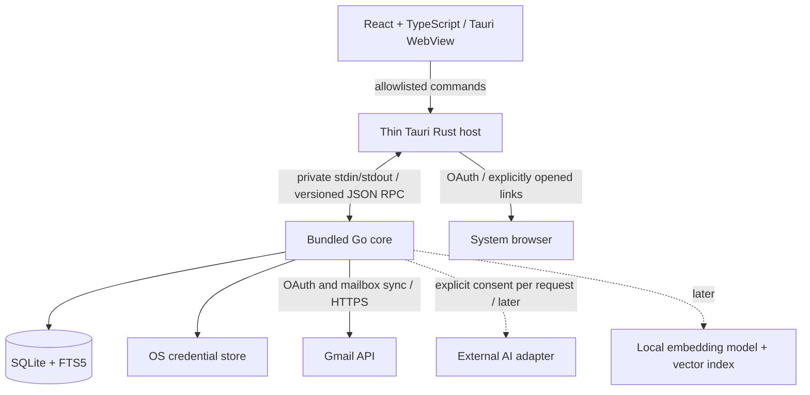

# MailPilot architecture

Status: implementation baseline, initially proposed on 2026-10-10. The desktop bootstrap is now authorized and implemented; later product phases below remain planned.

### Bootstrap implementation status

The current code implements the Go entry point, requested internal package boundaries, non-secret configuration, structured stderr logging, React status UI, native Tauri lifecycle, bounded private JSON-RPC handshake/health/shutdown, and SQLite initialization. `config` and `logging` are small supporting packages added to the target layout. Future feature packages contain documentation only, as requested for this bootstrap; they do not implement Gmail or other mailbox behavior.

The subsequent domain phase implements provider-neutral email values and an account-bound `EmailProvider` contract with validation and tests (section 4). Concrete adapters and mailbox behavior remain unimplemented.

Schema migration 1 creates only the migration ledger and non-secret settings table. The full mailbox schema in section 6 remains a plan for the local-data phase; it is not installed prematurely. Database health is a real query. The frontend rechecks health periodically and exposes failures.

The thin Rust host uses `std::process` for its fixed bundled sidecar, avoiding a shell plugin entirely. Only the main window's `health` command is permitted. A single-instance plugin controls desktop ownership; standalone Go runs are development tools and should use a separate data directory when running beside the desktop app. The bounded bootstrap protocol is sequential and does not yet implement jobs, streaming notifications or cancellation APIs. See `contracts/README.md` for the versioned wire contract.

Implemented dependencies and native build instructions are in `README.md` and locked manifests. Unneeded provider, credential, AI, vector, HTML, query-cache and browser-automation dependencies are deferred. Generated icons come from a checked-in SVG. Native smoke mode exercises the real WebView-to-SQLite path using a disposable profile and graceful shutdown. Public signing, notarization, installers beyond the tested macOS app bundle, and Windows/Linux qualification remain release work.

## 1. Product and MVP boundary

MailPilot is one local desktop application for reading cached email, organizing it through labels, searching locally, and understanding phishing risk. Gmail is the first provider. AI is optional and must never become a prerequisite for ordinary use.

The MVP includes one connected Gmail account in the UI; secure OAuth; bounded initial import and incremental synchronization; offline reading of downloaded plain-text messages; label browsing; local keyword search; deterministic organization suggestions; explained phishing scores; and explicit preview, apply, and best-effort undo for label changes. Risk analysis only changes local records. Applying a risk label in Gmail requires the same preview and confirmation as other changes.

Non-negotiable behavior:

- Never request or store Gmail passwords. Never persist tokens or AI keys outside OS-secure credential storage.
- Never automatically delete suspected phishing messages or automatically send generated email.
- No message sending, trashing, deletion, archiving, mark-as-read, or attachment execution in the MVP. Opening a message does not change its Gmail read status.
- Mail content stays local except provider synchronization and a later, intentional external AI request showing exactly what will leave the device.
- No cloud backend, microservices, telemetry by default, or background AI uploads.
- Mailbox writes are user-approved, journaled, scoped, and reversible where the provider permits. Undo is a compensating action, not a transactional guarantee across Gmail and SQLite.

## 2. Runtime and trust boundaries



Tauri requires a small Rust host. It owns windows, native menus, application data paths, packaged sidecar startup/shutdown, and a narrow command bridge. All product rules and persistence live in Go. This is one installed desktop product with a child process, not a network service. [Tauri supports bundled sidecars](https://v2.tauri.app/develop/sidecar/); build one Go binary per supported OS/architecture and bundle it with the matching host.

Use inherited stdin/stdout pipes, not a localhost HTTP application server. Only the temporary OAuth callback uses a loopback listener. Rust launches a fixed packaged executable, with no frontend-controlled executable path or arbitrary arguments. No secret goes in arguments or environment variables. Standard output is protocol-only; bounded, redacted diagnostics use standard error. Go exits on parent-pipe EOF; the host requests graceful shutdown, then terminates an unresponsive child. A single-instance host prevents competing owners of the local database. Sidecar crashes disable actions and prompt recovery; they never silently replay uncertain mailbox writes.

Use newline-delimited JSON-RPC 2.0 messages over pipes: protocol handshake, string request IDs, method allowlist, typed params/results, error codes, and notifications for job progress. Define maximum frame sizes, request deadlines, cancellation, bounded concurrent requests, and backpressure. Readers must support frames split across reads. Large lists are paginated; bodies have explicit size limits and truncation indicators. Reject incompatible protocol versions before opening mailbox data. No arbitrary SQL, file path, URL fetch, shell command, or Go method can be invoked from the WebView.

The frontend has no direct database, credential store, Gmail, or external AI access. Apply a restrictive CSP and [Tauri capabilities](https://v2.tauri.app/security/capabilities/) for the main window only, with explicit custom-command permissions. Do not grant generic shell, filesystem, SQL, or network plugins to JavaScript. Treat UI inputs as untrusted even with these controls. Native commands validate payloads again; Go enforces account ownership and application policy.

## 3. Repository and module responsibilities

Create directories only as their phase starts; this is the target layout, not scaffolding to generate immediately.

```text
MailPilot/
├── AGENTS.md
├── README.md
├── docs/
│   └── ARCHITECTURE.md
├── contracts/                  # Versioned wire schemas and sanitized examples
├── backend/                    # One Go module
│   ├── go.mod
│   ├── cmd/mailpilot-core/      # Composition root, lifecycle, dependency wiring
│   └── internal/
│       ├── domain/             # Provider-neutral values and errors
│       ├── app/                # Use cases and small consumer-owned interfaces
│       ├── ipc/                # Framing, dispatch, DTO validation, cancellation
│       ├── auth/               # OAuth sessions, refresh coordination, revocation
│       ├── credentials/        # OS keyring adapter; no file fallback
│       ├── provider/           # Neutral account-bound provider contracts
│       │   └── gmail/          # Gmail SDK translation (not implemented yet)
│       ├── sync/               # Import, delta sync, retries and checkpoints
│       ├── store/sqlite/       # Explicit SQL, transactions, embedded migrations
│       │   └── migrations/
│       ├── mail/               # MIME decoding and bounded normalization
│       ├── risk/               # Deterministic local rules and explanations
│       ├── organize/           # Local suggestions and label-change plans
│       ├── actions/            # Preview, confirmation, journal, recovery, undo
│       ├── search/             # FTS queries; later hybrid search orchestration
│       └── ai/                 # Later: explicit disclosure and provider adapters
├── frontend/
│   ├── package.json
│   └── src/
│       ├── app/                # App composition and accessible navigation
│       ├── features/           # Accounts, mailbox, search, risk, action review
│       ├── components/         # Shared presentation components
│       └── lib/ipc/            # Typed client, validation and event subscription
├── src-tauri/
│   ├── Cargo.toml
│   ├── src/                    # Host lifecycle and narrow bridge only
│   ├── capabilities/
│   └── binaries/               # Generated sidecar artifacts; do not commit
├── tests/fixtures/             # Synthetic email and provider responses only
└── scripts/                    # Packaging and verification when needed
```

Dependency direction: transport and adapters depend on application contracts and domain types; the domain knows nothing about Gmail, SQLite, React, or Tauri. The composition root wires concrete types. Feature packages expose ordinary Go functions or small services, not interfaces for every struct. Keep repositories concrete until a use case needs a test seam. No generic CRUD repository, service locator, dependency injection framework, plugin loader, event bus, or parallel Rust business layer.

## 4. Component contracts

### Implemented email domain and provider boundary

`backend/internal/domain/email.go` defines `Email`, `EmailAddress`, `EmailThread`, `EmailHeader`, `AttachmentMetadata`, `EmailLabel`, and `EmailCategory`. These internal Go models use only standard-library types. They are neither provider SDK structures nor IPC DTOs/SQL records; future transport code must explicitly map `time.Time` to the documented wire timestamps.

- Local account/message/thread/label/category IDs and opaque provider message/thread/label/attachment IDs have distinct named string types. Provider IDs are scoped to an account and must never be parsed as numbers or confused with RFC Message-ID headers. Adapters receive local account identity during construction, return provider identity, and leave local entity IDs empty until persistence assigns them.
- `Email` includes account identity, internal/provider IDs, provider thread ID, sender, To/CC recipients, subject, text, optional HTML, receive timestamp, ordered headers, labels, attachment metadata, and local categories. Providers without thread semantics may omit the message's thread ID. Adapters preserve receive instants and normalize timestamps to UTC.
- Headers remain an ordered slice, preserving repeated fields. `HeaderValues` performs case-insensitive lookup without collapsing duplicates or marking authentication claims trusted. Incoming address strings and attachment filenames remain untrusted and may be malformed.
- A nil HTML pointer distinguishes missing/not-fetched HTML from present-but-empty HTML. No renderer or external resource fetch is added. Attachment metadata contains no attachment bytes or local path; nil size means unknown, and zero means an explicitly empty attachment.
- Labels describe provider mailbox membership, including user/system kind and account identity. Categories are local application classifications with their own IDs and names; no Gmail category taxonomy or implicit remote label mutation is introduced.
- `Email.Validate` checks identity, receive time, label ownership/kind, and nonnegative known attachment sizes. It deliberately permits empty subjects, bodies, recipient lists, and malformed incoming senders. `EmailThread.Validate` additionally rejects cross-account/thread messages and duplicate provider message IDs in a page. Neither method declares email safe or deliverable.

`backend/internal/provider/provider.go` owns the account-bound `EmailProvider` interface. It composes `Authenticator`, `Reader`, `LabelManager`, and `DraftCreator`; consumers accept the smallest interface they need. The full implemented method set is:

```go
type EmailProvider interface {
    Authenticate(context.Context) (Account, error)
    ListMessages(context.Context, ListMessagesOptions) (MessagePage, error)
    FetchMessage(context.Context, domain.ProviderMessageID) (domain.Email, error)
    FetchThread(context.Context, domain.ProviderThreadID, PageOptions) (domain.EmailThread, error)
    ListLabels(context.Context, PageOptions) (LabelPage, error)
    CreateLabel(context.Context, string) (domain.EmailLabel, error)
    ApplyLabel(context.Context, domain.ProviderMessageID, domain.ProviderLabelID) error
    RemoveLabel(context.Context, domain.ProviderMessageID, domain.ProviderLabelID) error
    CreateDraft(context.Context, DraftInput) (DraftReference, error)
    Capabilities() Capabilities
}
```

Adapters are bound to one configured local account. Authentication accepts no password and returns only identity, never OAuth tokens, credentials or raw SDK responses. The future OAuth adapter obtains browser/credential dependencies through composition. Every operation accepts a context, honors cancellation, validates its options, enforces its account binding and normalizes returned values. Callers validate returned model structure before persistence; value structs do not enforce invariants merely by being constructed.

Message listings contain references, not partially populated emails pretending to have cached bodies. Message, thread and label pagination use opaque next-page tokens, with page sizes from 1 to 100. Reuse a token only with the same account, operation and filters. The neutral listing filters are an inclusive receive-time lower bound and required label IDs; unsupported filters must be rejected, not silently ignored or converted to a public Gmail query string. Page ordering remains provider-defined. Thread pages explicitly carry continuation tokens.

Capabilities distinguish support for thread fetching, label creation/modification and draft creation from granted OAuth permissions. Unsupported semantics return `ErrUnsupported`; missing resources, authentication requirements and invalid inputs have provider-neutral sentinel errors usable through `errors.Is`. Context cancellation/deadline errors remain recognizable. Future adapters must translate provider failures without leaking raw response data; rate-limit/conflict details can be added when synchronization needs them. Outlook folders must not masquerade as label membership if they require moving messages.

Label application/removal is state-idempotent, but must eventually run through preview/confirmation/journaling/undo in the application layer. Label creation and draft creation are interface contracts only and remain outside the MVP runtime. Draft input is separate from incoming email, allows incomplete drafts, and validates recipient mailbox fields and subject against header injection. The authenticated account determines its sender. Draft creation is a remote write, never sending, and cannot be blindly retried after ambiguous failures. Attachment uploads and reply/thread association are not promised by the initial draft contract. No send, delete, move or arbitrary-provider-request method exists.

There is no concrete provider implementation, OAuth flow, mailbox write, new database migration or frontend command in this phase. Gmail API types may only exist in `internal/provider/gmail`; an import-boundary test enforces that rule. Synthetic adapter tests demonstrate interface substitution, neutral errors and cancellation without claiming to validate a real Gmail integration.

### Planned supporting contracts

The following sketches remain future work. Incremental sync cursors and label-state reconciliation will be added as small contracts when synchronization/actions are implemented; the old proposed `MailReader`/`LabelWriter` sketches are superseded by the implemented boundary above.

```go
type CredentialStore interface {
    Get(ctx context.Context, ref string) ([]byte, error)
    Set(ctx context.Context, ref string, secret []byte) error
    Delete(ctx context.Context, ref string) error
}
type RiskAnalyzer interface {
    Analyze(ctx context.Context, mail NormalizedMessage) (RiskAssessment, error)
}
type Searcher interface {
    Search(ctx context.Context, q SearchQuery) (SearchPage, error)
}
// Later, introduced only with the corresponding feature:
type AIAssistant interface {
    Execute(ctx context.Context, request ApprovedAIRequest) (AIResult, error)
}
type Embedder interface {
    Embed(ctx context.Context, texts []string) (EmbeddingBatch, error)
}
type VectorIndex interface {
    Upsert(ctx context.Context, chunks []IndexedChunk) error
    Search(ctx context.Context, q VectorQuery) ([]VectorHit, error)
    DeleteMessage(ctx context.Context, id MessageID) error
}
```

`RiskAssessment` is still planned: a score from 0–100, analyzer version, input hash, evaluation time, and structured findings `{code, severity, explanation, evidence}`. A score is a heuristic, not a probability or guarantee of safety. Missing or untrusted authentication evidence must be marked unknown.

Application commands:

| Command | Contract and behavior |
| --- | --- |
| `accounts.connect`, `accounts.disconnect` | Start cancellable browser OAuth; disconnect revokes when possible, removes credentials and separately offers local-data removal. |
| `sync.start`, `jobs.cancel` | Return job ID immediately; notify progress; no UI thread blocking. |
| `mail.list`, `mail.get`, `labels.list` | Read local state with account-scoped pagination and cached-content status. |
| `search.query`, `risk.get` | Local execution; never trigger remote AI. |
| `actions.preview` | Resolve bounded message IDs and label deltas, store before-state and immutable plan, return counts and readable effects. No provider writes. |
| `actions.apply` | Accept plan ID, plan digest and confirmation; revalidate scope, expiry and remote state; reject stale/conflicting plans. Return job/action ID. |
| `actions.undoPreview`, `actions.undoApply` | Calculate and confirm compensating deltas only for verified applied changes; show conflicts and partial undo. |
| `ai.preview`, `ai.execute` (later) | Show exact payload, destination and model; execute only an unexpired approved payload digest. |

Stable errors include `validation`, `unauthorized`, `reauth_required`, `credential_locked`, `offline`, `rate_limited`, `cursor_expired`, `conflict`, `unsupported`, `cancelled`, and `internal`. Errors contain safe user messages and correlation IDs, never raw provider responses or tokens. Cancellation after a possible remote write yields an uncertain operation requiring reconciliation, not a claim that nothing happened.

Wire DTOs use string IDs/cursors, UTC epoch milliseconds for timestamps, tagged unions for states, and explicit nullability. Never encode Gmail history IDs as JavaScript numbers. Go owns validation and business decisions; TS types and runtime validators must match versioned contract fixtures. Start with a small checked-in contract, not a schema/code-generation platform.

## 5. Authentication, synchronization and actions

### OAuth and credentials

Use a Google Desktop OAuth client, authorization code flow, random one-use `state`, PKCE S256, and the system browser. Bind an ephemeral `127.0.0.1` listener before opening the browser, use an exact callback path, verify state, time out the session, and close the listener immediately afterward. Do not use embedded login, deprecated out-of-band flows, or a public callback service. A distributed desktop client cannot keep its OAuth client configuration secret. [Google documents the desktop loopback and PKCE flow](https://developers.google.com/identity/protocols/oauth2/native-app).

Start with `gmail.readonly`; request `gmail.modify` only when organization is enabled and verify the actually granted scope. `gmail.labels` alone does not authorize changing a message's labels. Both read-only mailbox access and modification involve restricted scopes; `gmail.modify` also grants broader powers than MailPilot exposes. Never request `https://mail.google.com/`. Public distribution needs scope verification planning; whether further assessment is required depends on data handling and applicable exemptions. Recheck before release or external AI integration. [Gmail scope definitions](https://developers.google.com/workspace/gmail/api/auth/scopes).

Store refresh tokens and any persisted access tokens in the OS keyring; ordinary SQLite rows hold only opaque references. Keep current access tokens in Go memory. Serialize refresh per account, persist rotations safely, preserve an existing refresh token if Google omits a replacement, and turn invalid grants into reauthentication prompts. If keyring access fails, fail closed and explain how to unlock it; no plaintext fallback. AI keys follow the same rule. Credential deletion and database deletion are not atomic: use a recoverable disconnect workflow and clean up orphaned credential references.

### Sync

Use polling while the app is open plus manual refresh, with capped exponential backoff, jitter, `Retry-After`, cancellation, and bounded fetch concurrency. No Gmail push/Pub/Sub infrastructure. Cached reads work offline; remote label application requires connectivity. The MVP does not queue writes to execute silently later.

Default initial import: most recent 90 days, capped at 10,000 messages; make limits visible and configurable before import. Store scope and completeness in sync state; search results explicitly cover downloaded content only. Fetch normalized bodies within limits, not every attachment or full raw MIME archive. Metadata-only, truncated, malformed, missing, and fully cached are distinct states.

Capture a Gmail history baseline before enumeration, import pages idempotently, then replay history from the baseline to catch concurrent changes. Upsert each page and its checkpoint in one SQLite transaction. Persist a completed history cursor only after all corresponding changes are durable; interrupted pages may replay safely. On expired history (`404`), reconcile the configured scope again. [Gmail sync behavior](https://developers.google.com/workspace/gmail/api/guides/sync).

Never treat an interrupted listing or an out-of-scope message as remotely deleted. Mark remote removals only from explicit provider evidence or a completed reconciliation of the same scope. Use scan generations when reconciling. Refresh labels and message label membership, preserve opaque provider cursors, and serialize same-account sync/action work to avoid local races. External Gmail clients can still race; the UI exposes resulting conflicts. Apply sensible MIME size, part-count, nesting, and text limits before storing or analyzing data.

### Label changes and undo

MVP writes only add/remove existing user labels, per message. System labels such as `TRASH`, `SPAM`, `INBOX`, and `UNREAD` are not mutable through this path. Label creation/rename/deletion is deferred; users can create labels in Gmail. Local suggestions can still group messages without writing anything remotely.

Persist immutable plans and per-message before-state before any remote call. Applying a plan requires a fresh remote read, matching relevant label state, matching plan digest, a short validity window (default ten minutes), and user confirmation. Bound plans to 100 messages initially. Record each step as pending, in-flight, applied, failed, uncertain or conflict. A provider write followed by a crash before the local commit becomes uncertain; reread Gmail to establish postconditions before any retry. Adding/removing labels is state-idempotent but does not prove which actor made a change.

No database transaction stays open across network calls. Record the attempt, call Gmail, reread or otherwise verify the result, then commit cache and journal state. The plan ID is the local idempotency key: repeated apply requests return the existing operation, never start a second batch. Already verified items are not replayed; uncertain items require reconciliation. There is no distributed transaction or exactly-once guarantee. Never describe partial batches as all-or-nothing.

Undo reverses only label membership actually changed by that action: remove labels newly added, restore labels actually removed, and leave unrelated labels alone. Recheck affected labels against the recorded after-state and skip conflicting or deleted messages/labels. Show an undo preview and keep item-level results. Gmail lacks compare-and-swap for this workflow, so an external change between read and write cannot be completely prevented. Even matching state cannot reveal another client's identical intent. Explain this limitation instead of promising perfect restoration. Keep action history for 30 days by default, make expiration visible, and do not purge unresolved operations.

## 6. Initial SQLite schema

The following is the intended first schema, documented here rather than installed as a migration. Use one database per application profile, account-scoped rows, UUID strings generated in Go, UTC epoch milliseconds, opaque text provider IDs, and checked JSON for small structured values. Credentials and raw attachments are absent. Account identity uses the provider account key returned by the adapter (Gmail profile address initially); it is distinct from editable display text.

```sql
PRAGMA foreign_keys = ON;

CREATE TABLE schema_migrations (
  version INTEGER PRIMARY KEY,
  checksum TEXT NOT NULL,
  applied_at INTEGER NOT NULL
);
CREATE TABLE accounts (
  id TEXT PRIMARY KEY,
  provider TEXT NOT NULL,
  provider_account_key TEXT NOT NULL,
  email TEXT NOT NULL,
  display_name TEXT NOT NULL DEFAULT '',
  credential_ref TEXT NOT NULL UNIQUE,
  granted_scopes_json TEXT NOT NULL CHECK(json_valid(granted_scopes_json)),
  status TEXT NOT NULL CHECK(status IN ('connected','reauth_required','disconnecting','disconnected')),
  created_at INTEGER NOT NULL,
  updated_at INTEGER NOT NULL,
  UNIQUE(provider, provider_account_key)
);
CREATE TABLE sync_state (
  account_id TEXT PRIMARY KEY REFERENCES accounts(id) ON DELETE CASCADE,
  cursor TEXT,
  bootstrap_cursor TEXT,
  page_token TEXT,
  scope_json TEXT NOT NULL CHECK(json_valid(scope_json)),
  phase TEXT NOT NULL CHECK(phase IN ('idle','bootstrap','delta','reconcile','error')),
  scan_generation INTEGER NOT NULL DEFAULT 0,
  scope_complete INTEGER NOT NULL DEFAULT 0 CHECK(scope_complete IN (0,1)),
  last_success_at INTEGER,
  last_error_code TEXT,
  retry_after_at INTEGER
);
CREATE TABLE messages (
  id TEXT PRIMARY KEY,
  account_id TEXT NOT NULL REFERENCES accounts(id) ON DELETE CASCADE,
  provider_message_id TEXT NOT NULL,
  provider_thread_id TEXT,
  internet_message_id TEXT,
  subject TEXT NOT NULL DEFAULT '',
  sender_text TEXT NOT NULL DEFAULT '',
  recipients_json TEXT NOT NULL DEFAULT '[]' CHECK(json_valid(recipients_json)),
  snippet TEXT NOT NULL DEFAULT '',
  received_at INTEGER NOT NULL,
  sent_at INTEGER,
  size_bytes INTEGER CHECK(size_bytes >= 0),
  cache_state TEXT NOT NULL CHECK(cache_state IN ('metadata','complete','truncated','malformed','missing')),
  seen_generation INTEGER NOT NULL DEFAULT 0,
  remote_deleted_at INTEGER,
  updated_at INTEGER NOT NULL,
  UNIQUE(account_id, provider_message_id),
  UNIQUE(account_id, id)
);
CREATE TABLE message_contents (
  message_id TEXT PRIMARY KEY REFERENCES messages(id) ON DELETE CASCADE,
  body_text TEXT NOT NULL,
  evidence_headers_json TEXT NOT NULL DEFAULT '{}' CHECK(json_valid(evidence_headers_json)),
  links_json TEXT NOT NULL DEFAULT '[]' CHECK(json_valid(links_json)),
  content_hash TEXT NOT NULL,
  parser_version TEXT NOT NULL,
  fetched_at INTEGER NOT NULL
);
CREATE TABLE attachments (
  id TEXT PRIMARY KEY,
  message_id TEXT NOT NULL REFERENCES messages(id) ON DELETE CASCADE,
  provider_attachment_id TEXT,
  part_key TEXT NOT NULL,
  filename TEXT NOT NULL DEFAULT '',
  mime_type TEXT NOT NULL,
  size_bytes INTEGER NOT NULL CHECK(size_bytes >= 0),
  inline INTEGER NOT NULL DEFAULT 0 CHECK(inline IN (0,1)),
  UNIQUE(message_id, part_key)
);
CREATE TABLE labels (
  id TEXT PRIMARY KEY,
  account_id TEXT NOT NULL REFERENCES accounts(id) ON DELETE CASCADE,
  provider_label_id TEXT NOT NULL,
  name TEXT NOT NULL,
  kind TEXT NOT NULL CHECK(kind IN ('system','user')),
  remote_deleted_at INTEGER,
  UNIQUE(account_id, provider_label_id),
  UNIQUE(account_id, id)
);
CREATE TABLE message_labels (
  account_id TEXT NOT NULL,
  message_id TEXT NOT NULL,
  label_id TEXT NOT NULL,
  PRIMARY KEY(message_id, label_id),
  FOREIGN KEY(account_id, message_id) REFERENCES messages(account_id, id) ON DELETE CASCADE,
  FOREIGN KEY(account_id, label_id) REFERENCES labels(account_id, id) ON DELETE CASCADE
);
CREATE TABLE risk_assessments (
  message_id TEXT PRIMARY KEY REFERENCES messages(id) ON DELETE CASCADE,
  score INTEGER NOT NULL CHECK(score BETWEEN 0 AND 100),
  analyzer_version TEXT NOT NULL,
  input_hash TEXT NOT NULL,
  findings_json TEXT NOT NULL CHECK(json_valid(findings_json)),
  assessed_at INTEGER NOT NULL
);
CREATE TABLE actions (
  id TEXT PRIMARY KEY,
  account_id TEXT NOT NULL REFERENCES accounts(id) ON DELETE CASCADE,
  kind TEXT NOT NULL CHECK(kind IN ('label_delta','undo')),
  reverses_action_id TEXT,
  status TEXT NOT NULL CHECK(status IN ('preview','applying','applied','partial','failed','cancelled','uncertain','expired')),
  plan_digest TEXT NOT NULL,
  created_at INTEGER NOT NULL,
  expires_at INTEGER NOT NULL,
  confirmed_at INTEGER,
  completed_at INTEGER,
  UNIQUE(account_id, id),
  FOREIGN KEY(account_id, reverses_action_id) REFERENCES actions(account_id, id)
);
CREATE TABLE action_items (
  action_id TEXT NOT NULL,
  account_id TEXT NOT NULL,
  message_id TEXT NOT NULL,
  provider_message_id TEXT NOT NULL,
  requested_delta_json TEXT NOT NULL CHECK(json_valid(requested_delta_json)),
  before_labels_json TEXT NOT NULL CHECK(json_valid(before_labels_json)),
  actual_delta_json TEXT CHECK(actual_delta_json IS NULL OR json_valid(actual_delta_json)),
  after_labels_json TEXT CHECK(after_labels_json IS NULL OR json_valid(after_labels_json)),
  state TEXT NOT NULL CHECK(state IN ('pending','in_flight','applied','failed','uncertain','conflict','skipped')),
  attempt_count INTEGER NOT NULL DEFAULT 0 CHECK(attempt_count >= 0),
  last_error_code TEXT,
  updated_at INTEGER NOT NULL,
  PRIMARY KEY(action_id, message_id),
  FOREIGN KEY(account_id, action_id) REFERENCES actions(account_id, id) ON DELETE CASCADE,
  FOREIGN KEY(account_id, message_id) REFERENCES messages(account_id, id)
);
CREATE TABLE settings (
  key TEXT PRIMARY KEY,
  value_json TEXT NOT NULL CHECK(json_valid(value_json)),
  updated_at INTEGER NOT NULL
);
CREATE INDEX messages_account_received ON messages(account_id, received_at DESC, id);
CREATE INDEX messages_account_thread ON messages(account_id, provider_thread_id);
CREATE INDEX labels_account_name ON labels(account_id, name);
CREATE INDEX message_labels_by_label ON message_labels(account_id, label_id, message_id);
CREATE INDEX actions_account_created ON actions(account_id, created_at DESC);
CREATE INDEX action_items_recovery ON action_items(state, updated_at);
CREATE VIRTUAL TABLE message_fts USING fts5(
  message_id UNINDEXED,
  subject,
  sender,
  body,
  tokenize = 'unicode61'
);
```

FTS is a rebuildable derived index, with exactly one row per indexed message enforced by the repository's delete-then-insert operation in the same transaction as content changes. Account isolation comes from joining `message_fts.message_id` to `messages.id` and always filtering `messages.account_id`, including snippets and counts. Never expose an unscoped FTS query. Remove FTS rows transactionally on cache purge or account deletion; virtual tables do not provide the foreign keys above. Escape user input into a bounded literal token query; advanced raw FTS syntax is not an MVP feature. [SQLite FTS5 documentation](https://sqlite.org/fts5.html).

JSON holds bounded recipient lists, evidence, and immutable action snapshots, not unqueryable replacement tables. Validate JSON shapes and same-account label membership in Go; `json_valid` only checks syntax. Settings use an allowlist of non-secret keys. Labels are retained as tombstones while actions reference their provider IDs. Soft-delete remote messages until dependent action history expires. During full local account removal, delete action items and actions (clear reversal links), FTS rows, then account data in one transaction; credential cleanup is separately recoverable.

Use `database/sql`, explicit SQL and embedded numbered migrations. Enable foreign keys on every connection, WAL, a busy timeout and durable synchronization; initially use one connection to simplify write ordering. Never hold SQL transactions during network or AI work. Migrations run before jobs start, record checksums, and reject a newer unsupported schema. Use SQLite's backup API or a quiescent checkpointed backup, not a live copy of only the database file. Backups are private and carry the same sensitive-data policy.

SQLite is not encrypted by default. OS keyring storage protects credentials, not cached messages, FTS, WAL files, or backups. Store all application data in the per-user OS app-data directory with restrictive permissions; recommend full-disk encryption and document the unlocked-device threat. SQLCipher is deferred pending distribution and key-recovery requirements; do not claim encrypted mail storage. Local deletion cannot guarantee forensic erasure on SSDs or prior backups.

No threads table yet: group by account and provider thread ID. No vector, AI history, rules DSL, general task queue, or analytics tables yet. Add migrations only when those features require them.

## 7. Risk detection and optional intelligence

The MVP risk engine runs offline on bounded parsed data. Initial signals: sender/reply-to domain mismatch, deceptive displayed link versus target, suspicious IDN or mixed-script hosts, IP-literal links, risky attachment extensions, urgency/credential-request language, and provider-trusted authentication failures where available. Normalize domains with maintained IDNA/public-suffix handling. Do not infer failure from missing authentication headers or trust arbitrary sender-supplied `Authentication-Results`. Track provenance; if the adapter cannot establish it, mark evidence unknown.

Weights and thresholds are versioned, tested on synthetic benign and malicious fixtures, and displayed with specific reasons. Recompute when input or rule version changes. No network link visits, URL reputation uploads, attachment execution, malware-detection claims, or automatic quarantine. False positives are expected; users can inspect the evidence and continue reading normally. Persistent dismissals or feedback require a later schema addition. Organization uses a few deterministic built-in suggestions (for example sender/domain grouping), not an extensible rule language in the MVP.

Later AI features: summarize selected messages, suggest labels, and compose reply text locally for user review/copy. An explicit preview shows provider, model, selected fields, recipients/addresses included, and exact transmitted text. One confirmation authorizes one immutable payload; selecting new messages or changing content requires a new preview. Do not transmit credentials, whole-mailbox context, attachments, or logs. AI output is untrusted text with no tool privileges and cannot call mutation or send interfaces. Email prompt injection must not override application policy. Avoid retaining prompt/response history by default. External endpoint configuration must be intentional and validated; never derive endpoints from email content. Review provider retention and Google data-use restrictions before enabling this feature. [Google API Services User Data Policy](https://developers.google.com/terms/api-services-user-data-policy).

Later semantic search: default to on-device embeddings, explicit model download, bounded chunking, content hashes, model version/dimensions and account IDs. Store derived vectors locally; deleting a message/account purges its chunks and vectors. Keep SQLite metadata authoritative and rebuild the index after model changes. Choose a vector library only after measuring a representative mailbox; benchmark a SQLite extension against a simple in-process index. Hybrid search combines FTS and vector candidates with deterministic ranking and source excerpts. Without a downloaded model, FTS still works. Any external embedding option requires separate explicit disclosure, including corpus size; it must never become automatic background upload.

## 8. Dependencies and rationale

Select exact compatible versions and commit lockfiles in the implementation phase; no dependencies are installed by this documentation change. Recheck maintenance, licenses, platform support, advisories and API behavior when pinning.

| Dependency | Purpose and reason |
| --- | --- |
| Go standard library | `context`, `net/http`, `database/sql`, `encoding/json`, `crypto/rand`, `log/slog`, `embed`, and testing cover most needs without a web framework. |
| [modernc.org/sqlite](https://pkg.go.dev/modernc.org/sqlite) | SQLite driver without a C toolchain requirement for the Go sidecar; verify FTS5 and target support in packaging tests. Rust still requires its normal build toolchain. |
| [google.golang.org/api/gmail/v1](https://pkg.go.dev/google.golang.org/api/gmail/v1) | Official Go Gmail client; confines provider request/response details to one adapter. |
| [golang.org/x/oauth2](https://pkg.go.dev/golang.org/x/oauth2) | OAuth exchanges, PKCE helpers and refresh integration; wrap persistence and refresh coordination explicitly. |
| [zalando/go-keyring](https://github.com/zalando/go-keyring) | Small Go abstraction over macOS Keychain, Windows credential storage and Linux Secret Service; validate locked/unavailable-store behavior on each supported OS. |
| [emersion/go-message](https://pkg.go.dev/github.com/emersion/go-message) | Maintained MIME/charset parsing rather than custom multipart decoding; combine with Go `net/mail` and explicit resource limits. |
| [golang.org/x/net](https://pkg.go.dev/golang.org/x/net) | HTML tokenization for text/link extraction, IDNA and public-suffix domain handling. Parsing does not make HTML safe to render. |
| [React](https://react.dev/) + [TypeScript](https://www.typescriptlang.org/) + [Vite](https://vite.dev/) | Required UI stack, strict typing and straightforward local build; no SSR or hosted framework needed. |
| [Tauri 2](https://v2.tauri.app/), `@tauri-apps/api`, Rust `serde`/`serde_json` | Desktop packaging, typed bridge serialization, and native lifecycle. Keep Rust's scope narrow. |
| Tauri shell, opener and single-instance plugins | Host-only packaged sidecar lifecycle, validated browser opening, and one data owner. Grant no generic shell invocation to the frontend. |
| [Zod](https://zod.dev/) | Runtime validation at the TS bridge boundary; compile-time TS types do not validate received JSON. |
| [TanStack Query](https://tanstack.com/query/latest/docs/framework/react/overview) | Paginated asynchronous local queries and invalidation after sync events. Do not persist its email cache to browser storage. |
| [Vitest](https://vitest.dev/) + [Testing Library](https://testing-library.com/docs/react-testing-library/intro/) | Focused frontend behavior and accessibility-oriented interaction checks. |
| [Playwright](https://playwright.dev/) | Browser UI tests with a mocked bridge; does not replace real Tauri/WebView packaging and native smoke tests. |

Use Go's built-in tests and fuzzing for parsing, scoring, SQL and recovery. Use `gofmt`, `go vet`, `govulncheck`, strict TypeScript, ESLint, Rust fmt/clippy and dependency audits in CI once manifests exist. Prefer ordinary CSS and React component state initially. No ORM, Redux, GraphQL, gRPC, hosted database, external AI SDK, vector engine, HTML renderer, or migration framework until a demonstrated need justifies it. A small embedded SQL migration runner is sufficient, but its rollback/checksum behavior needs tests.

## 9. Security and privacy release requirements

| Concern | Required control |
| --- | --- |
| Malicious email content / WebView compromise | Render escaped plain text in MVP; never inject email HTML. No remote images, tracking pixels or active content. If rich HTML is added, use a maintained sanitizer plus a capability-free isolated rendering design reviewed for each OS. |
| Link and attachment attacks | Display actual link destinations and confirm opening suspicious links. Allow only deliberate `https`/`http` browser opens; deny executable/custom schemes. Attachment metadata only in MVP. Never use email filenames as filesystem paths. |
| Secret leakage | OS keyring before real-account use; no secrets in SQLite, localStorage, URLs in logs, crash dumps, test fixtures, IPC responses or diagnostics. A key entry form may briefly hold a newly entered key but must clear it after the one-way credential command. |
| Excessive Gmail privileges | Incremental scope consent and backend method allowlists; no send/delete API path even when the OAuth scope would permit it. |
| Inaccurate risk conclusions | Explained, versioned heuristics and unknown states; no guarantee of safety and no destructive response. |
| AI disclosure / prompt injection | Intentional payload preview, minimum context, disabled by default, no action execution from model output. |
| Cross-account leakage | Account-scoped SQL and search, composite constraints, per-account credential refs and adversarial isolation tests even with one account in the UI. |
| Crash / partial write / external races | Durable action journal, uncertain-state reconciliation, bounded retries, conflict-aware undo and restart tests. |
| Local compromise / data retention | Private app-data permissions; no claim of disk encryption; explicit cache removal, backup disclosure, short redacted logs and no default telemetry. An attacker controlling the user's OS session is outside the protection offered by this design. |
| Supply-chain / packaging | Locked dependencies, reviewed upgrades, signed release artifacts and macOS notarization where applicable; never download or execute arbitrary sidecars at runtime. Signed update delivery needs a separate design before enabling auto-update. |

Diagnostics contain operation name, duration, safe error code and random correlation ID, not subjects, addresses, bodies, OAuth callback queries or message URLs. Exports are explicit and previewable. Clear sensitive in-memory UI state on disconnect; avoid persisting mail through browser caches/service workers. Local cache removal is distinct from deleting Gmail mail. Document recovery, consent, privacy and limited-use behavior before a public release.

## 10. Phased implementation and acceptance gates

| Phase | Deliverable | Exit criteria |
| --- | --- | --- |
| 0 — Design (this change) | Architecture and agent rules only. | Reviewable boundaries, schema, dependencies and MVP limits; no app logic. |
| 1 — Desktop foundation | React/Tauri shell, Go sidecar, versioned pipe protocol, app-data paths, synthetic fixture mailbox. | Packaged native smoke test, startup/shutdown and child-crash handling; malformed IPC and capability tests. Start development on macOS, then qualify Windows/Linux explicitly. |
| 2 — Local data | Migrations, repositories, fixture import, plain-text reader and FTS. | Fresh/upgrade database tests, foreign-key and cross-account checks, transactional FTS updates, offline UI, bounded parsing and accessible keyboard navigation. |
| 3 — Secure Gmail read | OS keyring, browser PKCE OAuth, read-only bounded initial/delta sync, disconnect. | Real-account testing only after keyring and redaction work; verify consent rejection, refresh, locked store, rate limits, expired cursor, interruption, scope completeness and offline restart. |
| 4 — Safe organization | Built-in suggestions, incremental modify consent, existing-user-label plans, journal and undo. | Dry-run makes zero writes; stale previews rejected; crash-after-remote-write and partial-batch tests pass; undo leaves unrelated labels intact and reports conflicts. |
| 5 — MVP completion | Explained risk rules, cache controls, recovery UX and release packaging. | Synthetic benign/malicious fixtures, parser fuzzing, security-boundary tests, accessibility check, realistic mailbox performance measurements, privacy docs and signed builds for each claimed platform. |
| 6 — Optional AI | One provider adapter, payload approval, selected-message summaries and reply text. | Entire MVP passes with no AI key; no external request before approval; injection cannot trigger actions; credential and data-use review complete. |
| 7 — Local semantic search | Local model, chunk pipeline, benchmark-selected index and hybrid ranking. | Search relevance/latency measured on synthetic corpus; model migration, deletion propagation and offline fallback tested. |
| 8 — Expansion | Additional providers, multiple-account UI, richer organization or rendering. | Add capabilities and migrations for actual needs; preserve existing privacy and action guarantees. |

Meaningful tests target boundaries and failure modes, not getters or implementation mirroring. Provider tests use fakes/recorded synthetic responses; no live personal mailbox in CI. Separate opt-in live Gmail smoke tests use a dedicated test account and deliberately confirmed label changes. Publish measured startup, sync throughput, search latency and memory on a documented fixture corpus before claiming production readiness.

## 11. Explicitly outside the MVP

- External AI summaries/replies, agentic automation, auto-send and Gmail draft creation.
- Semantic/vector search, embedding downloads and external embedding services.
- Outlook/IMAP adapters and simultaneous multi-account UX; the schema and boundaries already isolate accounts.
- HTML email rendering, remote images, attachment download/preview/execution, OCR and malware scanning.
- Autonomous label writes, scheduled mailbox-changing rules, complex rule editors and plugin systems.
- Label creation/deletion/rename, system-label changes, archive/trash/delete and sending.
- Background daemon while the app is closed, Gmail push notifications, server infrastructure and cloud synchronization.
- Encrypted SQLite, cross-device backup/recovery, mobile/web editions, telemetry and automatic updates.

These are scope exclusions, not permission to weaken credential security, local-only defaults or mutation recovery. The first working release should be useful and trustworthy as a local email organizer before intelligence features are added.
