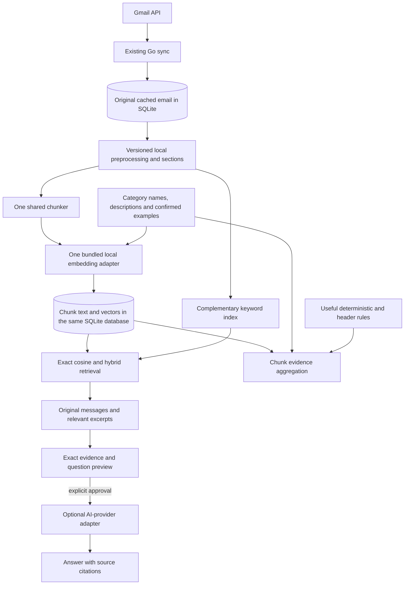

# MailPilot architecture

Reviewed 2026-10-22 against executable composition and call sites. This document
describes implemented runtime/trust boundaries; [PRODUCT_PLAN.md](PRODUCT_PLAN.md)
records product scope and limits. [AGENTS.md](../AGENTS.md) is the engineering
contract, and [VECTOR_ARCHITECTURE_PLAN.md](VECTOR_ARCHITECTURE_PLAN.md) records the
implemented shared-store design. Historical records are evidence under
[archive](archive/LEGACY_FEATURES.md), not active capabilities or instructions.

## 1. Verified implementation baseline

The composition root is the implementation inventory. Qualification limits remain
separate from feature availability; synthetic checks do not establish production
mailbox quality or release approval.

| Area | Implemented now | Limits |
| --- | --- | --- |
| Runtime | React/TypeScript in Tauri, one fixed bundled Go sidecar, private JSON-RPC pipes, health/SQLite startup and graceful lifecycle. | One explicit resumable indexing job uses the cached chunker/store and lazy native provider. One bounded local search worker shares the provider; no raw inference IPC. |
| Gmail | System-browser OAuth/keyring; one account; manual bounded initial Inbox and incremental history sync; normalized local cache. | No complete mailbox/Sent/attachment coverage, background scheduling, thread-fetch operation or second email provider. |
| Reader | `mail.read` returns revision-checked paged escaped text from the same cleaned sections used by chunks, preserving useful image descriptions and omitting transport clutter; metadata and phishing explanations are shown. | No rich HTML sanitizer/renderer, remote content or attachment download. Cold-start restoration checks Gmail online. |
| Categories | Editable definitions, shared category prototypes/confirmed examples, semantic multi-chunk assessment, deterministic rule fallback and explicit primary preferences ([contract/evaluation](SEMANTIC_CLASSIFICATION.md)). | Classification suggests categories locally; cosine is not a probability. The definition-only synthetic precision target remains unmet. |
| Gmail organization | Preview/dry run, explicit confirmation, namespaced label additions, durable journal, reconciliation and verified best-effort undo. | No automatic labels or other mailbox actions. |
| Phishing | Offline bounded feature extraction plus versioned scoring/persistence/display. Authentication header provenance remains unverified. | Risk scores are explanations, not probabilities, authentication verification or safety guarantees. |
| AI | `ai.settings`, provider-scoped OS keys and approved cached-email Summary and source-limited evidence questions through one AIProvider; OpenAI is the only installed functional adapter. | Evidence questions require exact per-request approval and validated citations ([contract](EMAIL_QUESTIONS.md)). No tools, replies, new drafts or general chat. |
| Search/storage | SQLite migrations 001–021, deterministic cached chunk production/persistence, source invalidation and historical derived-row compatibility; migration 020 indexes shared passages with external-content FTS5. | Local vector indexing is active on explicit Start/Resume. Semantic search uses complete compatible chunk generations. Keyword search works without vectors; hybrid fuses email ranks and prioritizes exact literals. Old vector schemas are inert. |
| Historical recovery | GET-only Gmail draft matching and local status/reconcile/resolve/cancel for old journal actions. | No draft creation, resending, remote deletion or reactivation of historical previews. |

Composition is in [main.go](../backend/cmd/mailpilot-core/main.go). Actual command
allowlists and strict fixtures are documented in [contracts](../contracts/README.md).
Old `ask.manage`/`search.semantic` operations remain rejected. Do not reactivate
an archived command or trust an old vector merely because a schema/fixture exists.

## 2. Runtime and package ownership

The installed runtime remains one desktop product. Rust owns windows, packaged
process lifecycle, app-data paths and narrow typed commands. It starts a fixed Go
executable without a shell or frontend-controlled path/arguments. Go owns application
policy, account authorization, SQLite, credentials, Gmail, local indexing/retrieval
and external-provider calls. React has no direct database, keyring, Gmail or AI access.

Private newline-delimited JSON-RPC uses handshake/protocol validation, string IDs,
strict method/field allowlists and 64 KiB frames. The current dispatcher executes
one request at a time; long workflows use bounded application jobs and polling,
not a generic job/RPC framework. Local query inference runs behind the narrow `search.local` start/status/cancel boundary. Most Go calls have a five-second deadline and
classification review has 30 seconds; the native bridge has matching longer waits.
No generic SQL, URL fetch, filesystem or shell bridge; no product HTTP server.
The temporary OAuth callback and development Vite server are separate from this
packaged trust boundary. Parent EOF/shutdown cancels/joins work before SQLite closes;
a crashed sidecar disables actions rather than replaying uncertain writes.

| Existing package/path | Responsibility |
| --- | --- |
| `backend/cmd/mailpilot-core` | Trusted composition, configuration and shutdown ordering. |
| `backend/internal/domain` | Provider-neutral typed account/message/category identities and data; no SDK/SQL/transport types. |
| `backend/internal/app` | Authorized reader/category/review/organization/AI use cases, bounded jobs and consent. Organization logic already lives here; do not invent a parallel package. |
| `backend/internal/auth`, `credentials` | OAuth sessions, serialized refresh, keyring-only tokens/keys and redacted secret handling. |
| `backend/internal/provider/gmail`, `sync` | Gmail translation, bounded network calls, import/history and checkpoint consistency. |
| `backend/internal/embedding` | Lazy local CPU inference and shared model descriptor; no SQLite, mailbox, credentials or product policy. |
| `backend/internal/mail` | Bounded MIME/charset/text utilities, shared source projections/sections/chunks and pinned offline MiniLM WordPiece tokenizer. No inference/network access. |
| `backend/internal/repository`, `store/sqlite` | SQL-free consumer contracts, explicit SQL, embedded immutable migrations and transactional data lifecycle. |
| `backend/internal/classification`, `risk` | Category decisions and independent deterministic risk analysis. |
| `backend/internal/ai`, `ai/openai` | Shared optional generation/consent/settings and isolated provider-specific transport. Local embedding inference is a distinct narrow adapter. |
| `backend/internal/ipc`, `src-tauri/src`, `frontend/src/lib/ipc` | Strict Go/native/TypeScript wire boundaries and response validation. |
| `frontend/src/features`, `scripts` | Accessible presentation; existing build/native smoke preparation. |

The frontend opens a dedicated Gmail landing page until the existing backend
reports an authorized connection. A restored verified session opens the cached-mail
dashboard; transient refresh/network failures retain an already authorized cache
session, while definitive rejection or disconnect clears feature state. Five
feature cards open the existing index, search, evidence questions, categories/review
and organization workflows in a shared shell. Visited pages retain local state;
unvisited feature pages do not poll. Organization and Your Emails reload on return
and suspend list polling while hidden. Your Emails filters current local category
summaries across cached pages and sorts each 25-email display page; classification
review combines five bounded IPC pages into a 25-email display page. The account dropdown provides connection
checks, confirmed disconnect, optional AI settings and historical recovery. The
reader remains shared across dashboard, search and evidence questions. Categories
and classification share a page with collapsed category editors and per-email
review cards. Search loads the complete paginated category source on entry, and
Ask shows the existing provider settings above its independently approved question
workflow. Organization presents selection, read-only/fresh previews, confirmed
application and recorded outcomes/undo in four steps; unresolved outcomes remain
visible. No new backend authorization or IPC boundary is introduced.

Introduce only the small embedding/retrieval components required by an implemented
slice. Transport/adapters depend on application/domain contracts; no service locator,
generic CRUD framework, parallel processing framework, second SQLite owner or
hypothetical multi-provider mailbox abstraction. No separate inference helper is used.

## 3. Shared local pipeline

The diagram shows the implemented cache/chunk/embedding/storage flow and shared
keyword/retrieval/classification/evidence consumers:

Keep a single chunk/source representation and compatible embedding space across
search, classification and evidence retrieval. Category descriptions/examples use
the same adapter/conventions; they are additional source types, not another model
system. External generation is optional and separate from local inference. Email
composition, model-controlled search agents and Chrome are not consumers in this scope.

## 4. Source preservation and chunk contract

Original decoded plain text, HTML, ordered headers, completeness and provider/source
identity remain in cached mail. Never replace them with cleaned text. Reading needs
full quotes/signatures; retrieval needs unique relevant evidence even in forwards;
classification may weight authored/subject sections differently. These are versioned
projections of one source pipeline, not unrelated preprocessing implementations.

`mail.CleanBody` currently strips conventional quotes/signatures and stops at some
forward markers. Reusing it unchanged could erase the only evidence in a forwarded
message. `mail.HTMLText` extracts text but is not an HTML sanitizer. Shared source
preparation must preserve meaningful paragraphs, mark quote/signature/forward
sections, avoid duplicate MIME alternatives and keep offset/source mapping.
No attachment download or hidden body fetch is introduced by local processing.

Source/chunk requirements:

- Account ID, source email ID and composite FK, source/content revision and
  preprocessing version. Provider IDs remain opaque and account-scoped.
- Stable chunk order and section kind/order; offsets into an identified versioned
  text representation. Distinguish decoded plain text from HTML-extracted text.
- Original selected passage text. If embedding normalization changes it, retain
  mapping to the selected passage and distinguish normalized model input. This
  does not replace the cached original body, HTML and header evidence.
- Text/content hash and completeness/omission metadata.
- Model/tokenizer/encoding fingerprint, dimension and associated finite vector.

The implemented chunker budgets 256 total MiniLM WordPiece tokens including
CLS/SEP and bounded subject/section context, with about 32 passage tokens overlap
adjusted to whole words. Paragraph/sentence boundaries are preferred when practical.
Include prefixes within model token limits. Do not split UTF-8, silently truncate
coverage, drop unique quoted content or treat overlapping chunks as corroboration.
Missing/oversized/unsupported mail remains visibly partial or unavailable.

## 5. Local model provider and shared retrieval

The [local embedding contract](LOCAL_EMBEDDING.md) records the implemented single
MiniLM FP32 ONNX provider, explicit model/artifact/encoding descriptor, 384-dimensional
masked-mean/L2 outputs, reused tokenizer, lazy initialization, bounded batches,
native cancellation and cleanup. It is separate from SQL and product services.
`embedding/model` is the shared pure-Go identity consumed by `mail.ChunkModel`.
`app.LocalIndex` now owns one explicitly started resumable job, exposed through
metadata-only `index.local` / Tauri `local_index`. It never calls cloud inference
or external AI. See [LOCAL_INDEXING.md](LOCAL_INDEXING.md).

Apple Silicon builds now enable CGO and bundle checksummed ONNX weights/runtime
and notices in fixed resources. Runtime lookup is based only on the sidecar's
location, with no environment/user-selected path or runtime downloads. Signed
Mach-O verification permits signature-only changes while preserving code identity.
The qualified dylib requires macOS 13.4+; the app retains ordinary features on its
13.0 baseline. Other targets/CGO-disabled builds have an unavailable native provider.
The detailed contract documents the non-preemptible initialization and ad-hoc-signing
qualification limits. Native model bytes/libraries remain ignored by Git.

Start with exact cosine similarity over account/model-filtered SQLite vectors.
Stream bounded batches and retain bounded top-K results rather than loading the
entire corpus. Approximately 10,000 cached emails is the initial target, not a
maximum chunk count. Measure real chunk counts, latency, throughput, RSS, disk and
installer size. Add ANN/vector extensions only after a demonstrated performance
need, dependency review and deletion/account/version-consistency design.

## 6. SQLite, revisions and index lifecycle

### Implemented persistence and immutable history

SQLite is the only database. The Go store uses one pooled connection, foreign keys
on every connection, WAL, FULL synchronization and a five-second busy timeout.
Numbered migrations are checked for sequence/checksum and applied transactionally;
future/altered/incomplete histories reject. SQL/driver handles stay private to the
store. IDs are opaque, account ownership is explicit, and composite FKs protect
message/category/label relationships. UTC timestamps use epoch milliseconds.

Current source-of-truth DDL is [the migrations directory](../backend/internal/store/sqlite/migrations):

| Migrations | Durable responsibility |
| --- | --- |
| 001–003 | Settings, normalized accounts/mail/labels/categories/analysis/journal foundation, cache completeness and provider content identity. |
| 004–007 | Category metadata/defaults, classification review evidence, organization plans/membership recovery and phishing-label compatibility. |
| 008–010 | Historical email/category embedding caches, semantic assessment metadata and vector scan index. |
| 011 | Immutable historical draft journal/source evidence. |
| 012 | Incremental sync checkpoints and confirmed-deletion visibility. |
| 013 | Historical passage-vector/retrieval-index identities. |
| 014 | Selected provider in non-secret historical `reply_ai_settings`; existing OpenAI settings/key identity retained. |
| 015 | Shared `email_chunks`, model-versioned `chunk_embeddings`, per-email `index_state`, composite ownership and atomic source/deletion invalidation triggers. |
| 016 | Named source projections, section indices/spans, bounded context prefix and independent projected-content coverage; existing unknown mappings preserved. |
| 017 | Durable local index job, model fingerprint/dimension registry, per-message attempt/failure metadata and cache-removal publication revocation. |
| 018 | Account-scoped category prototypes and explicit confirmed examples, derived-data invalidation and compatible coordinator recipe. |
| 019 | Versioned semantic assessment evidence, account/email invalidation fences, explicit primary preferences and classifier identity in the shared coordinator. |
| 020 | External-content FTS5 index over shared chunks, backfilled on upgrade and maintained by transactional triggers; no duplicate passage store. |
| 021 | Per-email index revision invalidation for semantic assessments; shared category/example fences and historical evidence remain intact. |

The historical `email_embeddings`, `category_embeddings`, `email_passage_vectors`
and `email_retrieval_indexes` have no active inference/retrieval consumers.
Migration 013 stores vector/input-hash identities but no complete chunk text,
ordinal, section or source-offset representation. It is not the new chunk index.
Preserve migrations byte-for-byte and keep necessary invalidation/trigger behavior.
New schemas require new numbered checksummed migrations after the actual maximum.

### Implemented chunk persistence

`Store.Chunks()` implements the SQL-free `repository.ChunkRepository`: atomic
snapshot replacement, account-scoped paged reads, source/model/generation-bound
embedding batches and index state. It reuses valid unchanged inputs, including moved
chunks, and rejects stale work. Source changes retain inaccessible old chunks only
until refresh for cache reuse; confirmed deletion removes them. Vector BLOBs are
little-endian float32 with dimension/length checks plus Go finite/nonzero validation.
Unknown or unavailable bodies remain partial; an empty projection is unavailable.
The [source lifecycle review](SYNC_LIFECYCLE.md) records bounded incomplete-body
retries after history, idempotent observations and end-to-end synthetic coverage.
Manual sync wires `app.CachedChunker` to the shared `mail.Chunker` before sync
for bounded cache backfill and after each cache/checkpoint commit. Processing errors
retain source mail/checkpoints, report `chunking_failed`, and leave old chunks stale.
Backfill skips current recipes and retries missing/stale work on later manual sync.
It scans at most 10,000 cached summaries and attempts at most the configured sync
limit per run; no full-cache completion is implied by manual sync. Inference runs
only through the separate explicit full-cache index job. See the
[implemented schema and lifecycle](VECTOR_ARCHITECTURE_PLAN.md#implemented-minimal-shared-index-records)
for exact fields, statuses, bounds and timestamp semantics. Historical vectors are
never read as current chunks; no migrations, assignments or journals are rewritten.

The reader and chunker now share [readable text cleanup](CLEAN_TEXT.md), versioned
`readable-v4`: meaningful image descriptions and quoted/forwarded text are kept;
tracking/placeholder artifacts are cleaned without modifying original cached mail.
Reader cursors bind the source hash plus projection version. Old preprocessing
coverage is excluded and the UI requests explicit Resume to rebuild compatible
chunks/vectors. Model/tokenizer identity and existing migrations remain unchanged.

### Implemented local coordinator

`app.LocalIndex` scans live cached Gmail messages in bounded candidate pages without
an Inbox/UI/10,000-row cap. It builds stale/missing chunks, embeds only missing
compatible vectors in batches of four and commits through the existing shared store.
Generation/source/profile checks fence every background write; complete index status
is checked transactionally. Pause/cancel retains batches; startup marks interrupted
runs and requires explicit Resume. Cache removal revokes old jobs before any late
publication. Rebuild reprojects all messages and reuses valid unchanged vectors.
Counts distinguish full-body completion, partial coverage, failures, pending work
and unavailable content. No model/Gmail/network parameters cross IPC. See the
[implemented indexing contract](LOCAL_INDEXING.md) for lifecycle, identity pinning,
verification and synthetic measurements.

### Implemented publication and coverage rules

Source commits invalidate old chunk generations transactionally. Preparation
reuses unchanged compatible inputs; embedding batches recheck source, profile and
job generations before saving. Category edits/examples/prototypes and source/index
changes invalidate dependent assessments. Label-only changes preserve text vectors
while refreshing consumed classification/filter evidence. Confirmed deletion clears
active chunks, FTS entries and examples and revokes in-flight index publication;
immutable journals remain retained. The [source lifecycle](SYNC_LIFECYCLE.md) records
partial imports, bounded retries, cancellation, recovery and synthetic tests.

`IndexRepository.Coverage` reads the job, message/vector counts, category readiness
and assessment coverage in one SQLite transaction. Polling invokes no inference.
Historical sources without a current canonical identity remain unavailable for
indexing and pending assessment until normal Gmail refresh supplies that identity.
Startup never auto-starts a job. Existing assignments and historical codecs remain
independent from current model availability.

## 7. Search and classification consumers

### Semantic search with complementary keyword search

`retrieval.VectorSearch.Search` / `SearchChunks` retain exact cosine retrieval.
`SearchMode` adds keyword-only and hybrid retrieval through `Store.Vectors()` and
the same `app.LocalSearch` / `search.local` / `vector_search` boundary. Keyword
search uses FTS5 candidates and passage-local term scoring over current shared
chunks without requiring vectors or global corpus statistics. Hybrid
uses equal-weight reciprocal rank fusion after email deduplication, with exact
literal identifiers/phrases prioritized. All modes share account/sender/date/assigned
category filters, source revision checks and bounded escaped excerpts. Gmail label
filters and empty-query browsing are not implemented.

The UI shows actual/requested mode, fallback, keyword and semantic coverage,
partial cached content, source navigation, ranks and typed similarity metadata.
Manual sync prepares searchable text without inference. Only explicit semantic or
hybrid submission can embed a query; polling and keyword-only submission never do.
No generative API/key or external search service is used. See [HYBRID_SEARCH.md](HYBRID_SEARCH.md)
for the exact lifecycle, strict contract, held-out quality and latency limits.

### Intelligent classification and local review

Category representations and semantic classification are implemented ([category contract](CATEGORY_VECTORS.md), [classification/evaluation](SEMANTIC_CLASSIFICATION.md)). Classification reads current compatible vectors; it does no inference and grants no Gmail authority.

Embed category names/descriptions and optional confirmed examples with the shared
adapter. Aggregate bounded chunk-level evidence into one or several close category suggestions, with
section/subject weighting so a long quoted chain or duplicate chunk cannot dominate.
Use a category description when examples are absent. The original gates were tuned
on synthetic data; the current 0.03 lead and multiple close suggestions were
explicitly requested by the user. Evaluate the changed policy on held-out mail.
The existing 0.60 rule gate is not a cosine threshold or calibrated probability.

Explicit local corrections take precedence; decisive useful rules/header evidence
can constrain semantic decisions. Conflicting explicit destinations abstain rather
than being silently resolved by a model. Header claims are untrusted organizational
hints, never verified sender/authentication/safety claims. Explanations identify rule,
category/example and semantic evidence/version. Keep uncertain messages unclassified.

A correction does not automatically become an example or change a Gmail label.
Do not self-train on unreviewed predictions or feedback from MailPilot-created labels.
Track source/category/example/model/algorithm and override revisions. Assess the
eligible cache through bounded enabled local jobs, not external classification.
Keep risk extraction/scoring independent of this pipeline.

## 8. Optional retrieval-augmented answers

Implemented through `app.AIService.Answer`, the shared hybrid retriever and the narrow
`email.answer` / `email_answer` start/selection/approval/status/cancel/clear boundary.
See [EMAIL_QUESTIONS.md](EMAIL_QUESTIONS.md) for exact contracts and adversarial tests.
Go selects bounded current SQLite chunk excerpts; users inspect/select and separately
approve exact question/source IDs/revisions/metadata, payload, policy, provider/model
and expiry. No unapproved context, attachment bodies or hidden thread expansion.

`AIProvider` exposes only `SummarizeEmail` and normalized `AnswerWithEvidence`.
Adapters receive approved bounded inputs and provider-scoped OS keys; no repositories,
Gmail credentials/tools, SQL, external search, arbitrary endpoint or action authority.
The existing AIService owns one transient worker shared with Summary. No durable QA
queue/index/database was added. Shutdown joins AI work before closing indexing/provider.

One-use consent binds account/session, exact payload/order, source generations,
settings/provider/model/key and five-minute expiry. Go rechecks before dispatch and
display; the installed adapter checks the actual dispatch key. Cancellation and
relevant changes suppress late results. No automatic paid retry or background generation.
Outputs/previews remain memory-only and escaped. Citations require approved aliases
and exact source quotes; invalid IDs/quotes/unsupported output reject. Provenance is
not factual entailment. Insufficient/conflicting evidence and limited coverage are
explicit. Top-K is never exhaustive; common global aggregate/absence requests are
blocked before paid generation and every answer is scoped to selected excerpts.

Summary remains independent with its existing bounds and approval. Its settings or
old approvals do not authorize questions; historical draft recovery remains unchanged.
No reply/composition/sending or autonomous action capability was introduced.

## 9. Preserve Gmail, risk and reading boundaries

### Gmail authentication, sync and modifications

Keep system-browser OAuth with PKCE/state, bounded loopback callback, required-scope
validation and serialized refresh. Tokens/AI keys are OS-store-only with no fallback.
Developer desktop OAuth client configuration is distinct from user tokens; see
[GMAIL_SETUP.md](GMAIL_SETUP.md). Current restore refreshes credentials and checks the
Gmail profile before establishing a session. Local cache reads in an existing session
are network-free; cold-start offline unlock is a separate design/test gap.

Sync checkpoints and source visibility remain atomic; missing/incomplete listings
never establish deletion. Keep provider pagination opaque, bounded network calls,
cancellation and safe errors. Reading/search/classification never authorize Gmail
writes, sending, archive/delete or mark-as-read.

Preserve organization preview/dry run and separate confirmation before any label
creation/addition. Journal immutable plans and before-state before dispatch. Recheck
source/category/model/example/label evidence before new writes; reject stale previews.
Reconcile uncertain outcomes rather than blindly retry; verified additions alone
confer undo ownership. Undo is compensating/best-effort with partial/conflict reporting,
not a distributed transaction or attribution guarantee. Preserve unrelated labels.
Existing journals recover from saved evidence independently of new model availability.
Historical drafts remain GET-only recovery under [REPLY_DRAFTING.md](REPLY_DRAFTING.md).

### Independent phishing explanations

Keep existing risk feature extraction and scoring, persistence and UI. Header
Authentication-Results/Received-SPF claims remain unverified and contribute no
verified authentication conclusion. Version weights/input hashes; missing data and
parser limits are limitations, never a safe verdict. Default score bands are 30/60;
use existing configuration, not semantic categories or a generative safety judgment.
See [PHISHING_FEATURES.md](PHISHING_FEATURES.md) for exact feature/limit behavior.

### Cached reader

The reader assembles revision-checked escaped text from the same cleaned sections
used by the chunker, retaining useful image descriptions and quoted/forwarded
content. Original source text/HTML remains separately cached. Search excerpts open
the existing reader with the shared projection revision and source checks. Body and
metadata pagination/omissions are explicit. No raw HTML, active links, remote/CID
resource loads, attachment execution or native bridge is exposed through mail.
Rich formatted HTML rendering is absent; this is an escaped text reader.

## 10. Privacy and validation

SQLite/mail/chunks/vectors/FTS/examples and WAL/backups are sensitive unencrypted
local data. Restrict app-data permissions and log only safe operational metadata.
No telemetry, email contents, keys, tokens or callback queries in logs. Clear submitted
key inputs/sensitive session state. Keep cache-clear, disconnect and Gmail deletion
distinct; disclose retained journal evidence and no forensic-erasure guarantee.
No user data, model binaries or generated build outputs are committed.

Verification covers account/source/model isolation, source and
category invalidation, immutable migration/legacy-plan upgrades, crash/stale-worker
publication, zero hidden AI disclosure, citation/injection/disabled-AI cases, local
model corruption/cancellation, safe native rendering, partial Gmail writes/recovery
and undo. Run relevant Go test/vet/race, TS typecheck/lint/tests/build and Rust
fmt/clippy/tests, plus native lifecycle/package smoke for affected boundaries.
Use synthetic fixtures/fake providers; live writes need explicit action authorization.
Measure English search quality/category abstention, 10,000-message performance and
installer resources; publish denominators and misses. Recorded measurements and remaining gaps are in the linked evaluation contracts.

The source/chunk slice is implemented in `internal/mail` and `app.CachedChunker`;
the provider/runtime is qualified in `internal/embedding`, and explicit resumable
indexing is implemented in `app.LocalIndex`. Shared exact retrieval and category prototypes reuse those components. Semantic classification also reuses them. Evidence questions use that same retriever and provider-neutral AI boundary. Preserve
reading, risk and rules' existing cleanup. Do not revive old Ask, add an AI editor
or replace the application architecture. The sole scope authority is
[PRODUCT_PLAN.md](PRODUCT_PLAN.md); further services require explicit authorization.

## Legacy retirement audit and remaining debt

The 2026-10-21 call-site/dependency review found no active earlier embedding
service, Python worker/downloader, single-vector-per-email search cache, duplicate
index coordinator, older semantic classifier, draft editor or draft-creation API.
The single installed native adapter and the shared pipeline above are the runtime.
`ask.manage` and `search.semantic` remain rejected; rejection fixtures are retained.
Every current frontend feature remains accessible, including separately approved
Summary and historical draft recovery. Every direct dependency has a current consumer;
there is no unused model path, interpreter, embedding endpoint or provider stub in
configuration. No dependency was removed merely because it is platform-specific.

The unused generic `MailboxActionRepository.Create` implementation was removed
from runtime. Its historical producer remains only in synthetic compatibility
fixtures; journal reads, outcome transitions and shared organization transition
validators remain. New label plans use `OrganizationRepository.Create` with the
current reviewed workflow. An unused production busy accessor and a redundant
recovery forwarding helper were removed; the recovery UI no longer describes an
operation as updating AI settings. No migration, stored digest or journal changed.

Remaining technical debt is explicit:

- Historical vector tables, classifier candidate codecs and journal shapes remain
  for upgrade/invalidation/recovery compatibility. They are not active indexes.
- The legacy generic label journal has no desktop recovery view; its typed reads
  and recovery transitions remain available for existing evidence. Current
  organization recovery and GET-only historical draft recovery remain exposed.
- Semantic suggestion quality remains below the published 90% precision target;
  exact/hybrid search exceeds the proposed 500 ms p95 target on the dense
  50,000-chunk fixture. See the existing evaluation reports for denominators.
- OpenAI is the only shipped generative adapter. Multi-provider RAG is an implemented
  substitution/settings/consent boundary tested with synthetic adapters.
- Summary is still a live independent workflow. No second generation framework is
  present, and its approvals cannot authorize evidence questions.
- Cold-start authorization still verifies Gmail online. Rich HTML rendering,
  attachment fetching/OCR, a cache-purge UI, other-platform inference qualification,
  real-mailbox factual quality and Developer ID signing/notarization are absent.

## Cleanup validation record

The 2026-10-21 cleanup passed full Go tests and vet, plus the full race suite with
packages serialized (`go test -race -p 1 -timeout 240s ./...`). The initial parallel
race run hit an existing indexing fixture's twelve-second deadline while native
qualifications and the app build competed for CPU; the serialized rerun passed
without a code or test-timeout change. No validation failure remains.

Frontend typecheck, lint, all 101 tests, production build, embedding asset checks
and repository formatting passed. Rust fmt, clippy with warnings denied and all
21 tests passed. Native offline indexing, semantic search, category prototypes,
classification, hybrid retrieval and evidence-answer qualifications passed with
network access denied and strict CGO checks. A fresh macOS app build, ad-hoc signing,
packaged/development-layout offline inference and WebView-to-Go lifecycle smoke
passed. Documentation paths/heading links, Go formatting and diff whitespace pass.
Migrations, dependency manifests/lockfiles and model resources are unchanged.

Validation used synthetic mail and provider/credential fixtures. Live-mailbox and
paid-provider checks, Developer ID release signing/notarization and other-platform
native qualification were not run or claimed.
