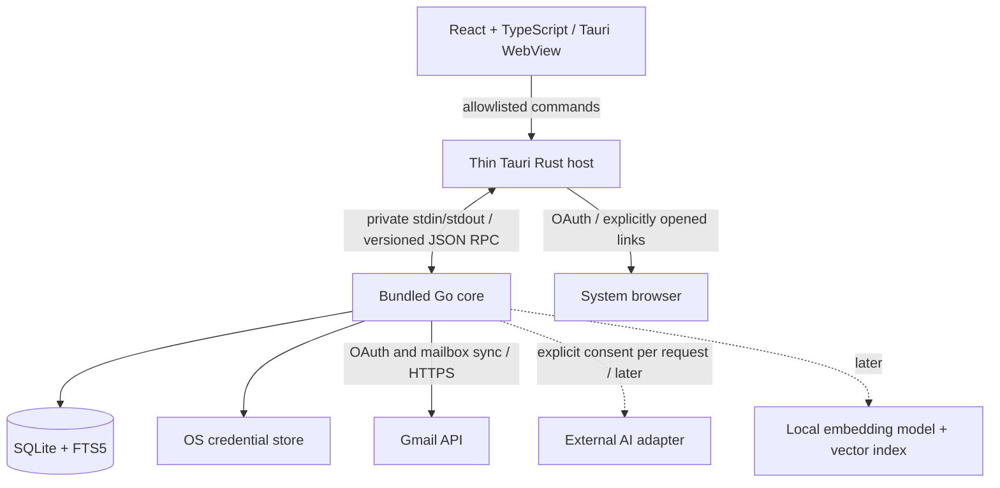

# MailPilot architecture

Status: implementation baseline, initially proposed on 2026-10-10. The desktop bootstrap is now authorized and implemented; later product phases below remain planned.

### Bootstrap implementation status

The current code implements the Go entry point, domain/use-case/adapter boundaries, non-secret configuration, structured stderr logging, React status UI, native Tauri lifecycle, bounded private JSON-RPC handshake/health/shutdown, and SQLite initialization. `config` and `logging` are small supporting packages added to the target layout. Bounded manual Inbox synchronization and a cached mailbox summary view are implemented; incremental history synchronization and other future features remain planned. Gmail OAuth and OS credential storage are implemented as described in section 5.

The subsequent domain phase implements provider-neutral email values and an account-bound `EmailProvider` contract with validation and tests (section 4). The Google OAuth/profile adapter is implemented; the Gmail EmailProvider now implements paginated Inbox listing, message retrieval and label reads, namespaced user-label creation, and narrow message membership changes. Thread retrieval and draft creation remain unsupported.

Schema migration 1 creates the ledger/settings foundation. Migration 2 now adds the local mail, category, analysis and action-journal schema described in section 6. Repository implementations and temporary-database tests are in place; bounded Gmail imports are implemented. Migration 3 adds content_revision and body_state to emails. Migration 4 adds user-defined category metadata and defaults. Migration 5 adds structured classification evidence and complete assessment records, including abstentions; manual rule-based classification and a review UI are implemented. Migration 6 extends mailbox_actions with immutable organization plans, per-write step evidence and account-scoped email/category references. Classification-driven Gmail organization, dry run and confirmed undo are implemented. Database health is a real query, and the frontend exposes connection failures.

The thin Rust host uses `std::process` for its fixed bundled sidecar, avoiding a shell plugin entirely. Only the main window’s allowlisted health, Gmail connection, sync, cached-mail, category management, classification review and Gmail organization commands are permitted. A single-instance plugin controls desktop ownership; standalone Go runs are development tools and should use a separate data directory when running beside the desktop app. The bounded bootstrap protocol is sequential and uses bounded background jobs for authentication, sync and organization, with polling and organization cancellation; it does not implement streaming notifications. See `contracts/README.md` for the versioned wire contract.

Implemented dependencies and native build instructions are in `README.md` and locked manifests. The Go OAuth2 and keyring libraries are now used; unneeded Gmail SDK, AI, vector, query-cache and browser-automation dependencies remain deferred. Generated icons come from a checked-in SVG. Native smoke mode exercises the real WebView-to-SQLite path using a disposable profile and graceful shutdown. Public signing, notarization, installers beyond the tested macOS app bundle, and Windows/Linux qualification remain release work.

## 1. Product and MVP boundary

MailPilot is one local desktop application for reading cached email, organizing it through labels, searching locally, and understanding phishing risk. Gmail is the first provider. AI is optional and must never become a prerequisite for ordinary use.

The MVP includes one connected Gmail account in the UI; secure OAuth; bounded initial import and incremental synchronization; offline reading of downloaded plain-text messages; label browsing; local keyword search; deterministic organization suggestions; explained phishing scores; and explicit preview, apply, and best-effort undo for label changes. Risk analysis only changes local records. Applying a risk label in Gmail requires the same preview and confirmation as other changes.

Non-negotiable behavior:

- Never request or store Gmail passwords. Never persist tokens or AI keys outside OS-secure credential storage.
- Never automatically delete suspected phishing messages or automatically send generated email.
- No message sending, trashing, deletion, archiving, mark-as-read, or attachment execution in the MVP. Opening a message does not change its Gmail read status.
- Mail content stays local except provider synchronization and a later, intentional external AI request showing exactly what will leave the device.
- No cloud backend, microservices, telemetry by default, or background AI uploads.
- Mailbox writes are user-approved, journaled, scoped, and reversible where the provider permits. Undo is a compensating action, not a transactional guarantee across Gmail and SQLite.

## 2. Runtime and trust boundaries



Tauri requires a small Rust host. It owns windows, native menus, application data paths, packaged sidecar startup/shutdown, and a narrow command bridge. All product rules and persistence live in Go. This is one installed desktop product with a child process, not a network service. [Tauri supports bundled sidecars](https://v2.tauri.app/develop/sidecar/); build one Go binary per supported OS/architecture and bundle it with the matching host.

Use inherited stdin/stdout pipes, not a localhost HTTP application server. Only the temporary OAuth callback uses a loopback listener. Rust launches a fixed packaged executable, with no frontend-controlled executable path or arbitrary arguments. No user token goes in arguments or environment variables. Developer-supplied Desktop OAuth client configuration may arrive in the runtime environment; it is not bundled, logged, or exposed to React. Standard output is protocol-only; bounded, redacted diagnostics use standard error. Go exits on parent-pipe EOF; the host requests graceful shutdown, then terminates an unresponsive child. A single-instance host prevents competing owners of the local database. Sidecar crashes disable actions and prompt recovery; they never silently replay uncertain mailbox writes.

Use newline-delimited JSON-RPC 2.0 messages over pipes: protocol handshake, string request IDs, method allowlist, typed params/results, error codes, and notifications for job progress. Define maximum frame sizes, request deadlines, cancellation, bounded concurrent requests, and backpressure. Readers must support frames split across reads. Large lists are paginated; bodies have explicit size limits and truncation indicators. Reject incompatible protocol versions before opening mailbox data. No arbitrary SQL, file path, URL fetch, shell command, or Go method can be invoked from the WebView.

The frontend has no direct database, credential store, Gmail, or external AI access. Apply a restrictive CSP and [Tauri capabilities](https://v2.tauri.app/security/capabilities/) for the main window only, with explicit custom-command permissions. Do not grant generic shell, filesystem, SQL, or network plugins to JavaScript. Treat UI inputs as untrusted even with these controls. Native commands validate payloads again; Go enforces account ownership and application policy.

## 3. Repository and module responsibilities

Create directories only as their phase starts; this is the target layout, not scaffolding to generate immediately. Empty actions/organize/AI/search package stubs were removed during maintainability review; implemented organization behavior remains in the app use case and action journal. Future package paths below are proposals, not parallel implementations.

```text
MailPilot/
├── AGENTS.md
├── README.md
├── docs/
│   └── ARCHITECTURE.md
├── contracts/                  # Versioned wire schemas and sanitized examples
├── backend/                    # One Go module
│   ├── go.mod
│   ├── cmd/mailpilot-core/      # Composition root, lifecycle, dependency wiring
│   └── internal/
│       ├── domain/             # Provider-neutral values and errors
│       ├── app/                # Use cases and small consumer-owned interfaces
│       ├── ipc/                # Framing, dispatch, DTO validation, cancellation
│       ├── auth/               # OAuth sessions, refresh coordination, revocation
│       ├── credentials/        # OS keyring adapter; no file fallback
│       ├── provider/           # Neutral account-bound provider contracts
│       │   └── gmail/          # Google OAuth/profile; future mailbox translation
│       ├── sync/               # Import, delta sync, retries and checkpoints
│       ├── repository/         # SQL-free local persistence contracts
│       ├── store/sqlite/       # Explicit SQL, transactions, embedded migrations
│       │   └── migrations/
│       ├── mail/               # MIME decoding and bounded normalization
│       ├── risk/               # Deterministic local rules and explanations
│       ├── classification/     # Local rule engine and versioned starter rules
│       ├── organize/           # Later label-change plans
│       ├── actions/            # Preview, confirmation, journal, recovery, undo
│       ├── search/             # FTS queries; later hybrid search orchestration
│       └── ai/                 # Later: explicit disclosure and provider adapters
├── frontend/
│   ├── package.json
│   └── src/
│       ├── app/                # App composition and accessible navigation
│       ├── features/           # Accounts, mailbox, search, risk, action review
│       ├── components/         # Shared presentation components
│       └── lib/ipc/            # Typed client, validation and event subscription
├── src-tauri/
│   ├── Cargo.toml
│   ├── src/                    # Host lifecycle and narrow bridge only
│   ├── capabilities/
│   └── binaries/               # Generated sidecar artifacts; do not commit
├── tests/fixtures/             # Synthetic email and provider responses only
└── scripts/                    # Packaging and verification when needed
```

Dependency direction: transport and adapters depend on application contracts and domain types; the domain knows nothing about Gmail, SQLite, React, or Tauri. The composition root wires concrete types. Feature packages expose ordinary Go functions or small services, not interfaces for every struct. Keep repositories concrete until a use case needs a test seam. No generic CRUD repository, service locator, dependency injection framework, plugin loader, event bus, or parallel Rust business layer.

## 4. Component contracts

### Implemented email domain and provider boundary

`backend/internal/domain/email.go` defines `Email`, `EmailAddress`, `EmailThread`, `EmailHeader`, `AttachmentMetadata`, `EmailLabel`, and `EmailCategory`. These internal Go models use only standard-library types. They are neither provider SDK structures nor IPC DTOs/SQL records; future transport code must explicitly map `time.Time` to the documented wire timestamps.

- Local account/message/thread/label/category IDs and opaque provider message/thread/label/attachment IDs have distinct named string types. Provider IDs are scoped to an account and must never be parsed as numbers or confused with RFC Message-ID headers. Adapters receive local account identity during construction, return provider identity, and leave local entity IDs empty until persistence assigns them.
- `Email` includes account identity, internal/provider IDs, provider thread ID, sender, To/CC recipients, subject, text, optional HTML, receive timestamp, ordered headers, labels, attachment metadata, and local categories. Providers without thread semantics may omit the message's thread ID. Adapters preserve receive instants and normalize timestamps to UTC.
- Headers remain an ordered slice, preserving repeated fields. `HeaderValues` performs case-insensitive lookup without collapsing duplicates or marking authentication claims trusted. Incoming address strings and attachment filenames remain untrusted and may be malformed.
- A nil HTML pointer distinguishes missing/not-fetched HTML from present-but-empty HTML. No renderer or external resource fetch is added. Attachment metadata contains no attachment bytes or local path; nil size means unknown, and zero means an explicitly empty attachment.
- Labels describe provider mailbox membership, including user/system kind and account identity. Categories are local application classifications with their own IDs and names; no Gmail category taxonomy or implicit remote label mutation is introduced.
- `Email.Validate` checks identity, receive time, label ownership/kind, and nonnegative known attachment sizes. It deliberately permits empty subjects, bodies, recipient lists, and malformed incoming senders. `EmailThread.Validate` additionally rejects cross-account/thread messages and duplicate provider message IDs in a page. Neither method declares email safe or deliverable.

`backend/internal/provider/provider.go` owns the account-bound `EmailProvider` interface. It composes `Authenticator`, `Reader`, `LabelManager`, and `DraftCreator`; consumers accept the smallest interface they need. The full implemented method set is:

```go
type EmailProvider interface {
    Authenticate(context.Context) (Account, error)
    ListMessages(context.Context, ListMessagesOptions) (MessagePage, error)
    FetchMessage(context.Context, domain.ProviderMessageID) (domain.Email, error)
    FetchThread(context.Context, domain.ProviderThreadID, PageOptions) (domain.EmailThread, error)
    ListLabels(context.Context, PageOptions) (LabelPage, error)
    CreateLabel(context.Context, string) (domain.EmailLabel, error)
    ApplyLabel(context.Context, domain.ProviderMessageID, domain.ProviderLabelID) error
    RemoveLabel(context.Context, domain.ProviderMessageID, domain.ProviderLabelID) error
    CreateDraft(context.Context, DraftInput) (DraftReference, error)
    Capabilities() Capabilities
}
```

Adapters are bound to one configured local account. Authentication accepts no password and returns only identity, never OAuth tokens, credentials or raw SDK responses. The future OAuth adapter obtains browser/credential dependencies through composition. Every operation accepts a context, honors cancellation, validates its options, enforces its account binding and normalizes returned values. Callers validate returned model structure before persistence; value structs do not enforce invariants merely by being constructed.

Message listings contain references, not partially populated emails pretending to have cached bodies. Message, thread and label pagination use opaque next-page tokens, with page sizes from 1 to 100. Reuse a token only with the same account, operation and filters. The neutral listing filters are an inclusive receive-time lower bound and required label IDs; unsupported filters must be rejected, not silently ignored or converted to a public Gmail query string. Page ordering remains provider-defined. Thread pages explicitly carry continuation tokens.

Capabilities distinguish support for thread fetching, label creation/modification and draft creation from granted OAuth permissions. Unsupported semantics return `ErrUnsupported`; missing resources, authentication requirements and invalid inputs have provider-neutral sentinel errors usable through `errors.Is`. Context cancellation/deadline errors remain recognizable. Future adapters must translate provider failures without leaking raw response data; rate-limit/conflict details can be added when synchronization needs them. Outlook folders must not masquerade as label membership if they require moving messages.

Label application/removal is state-idempotent and runs through preview/confirmation/journaling/reconciliation/undo in the application layer. The subsequent safe-organization request explicitly expands runtime scope to creation of missing MailPilot user labels. Draft creation remains unsupported. Draft input is separate from incoming email, allows incomplete drafts, and validates recipient mailbox fields and subject against header injection. The authenticated account determines its sender. Draft creation is a remote write, never sending, and cannot be blindly retried after ambiguous failures. Attachment uploads and reply/thread association are not promised by the initial draft contract. No send, delete, move or arbitrary-provider-request method exists.

The domain phase added no concrete provider implementation, OAuth flow, remote mailbox write or frontend command. Local persistence is now implemented separately in section 6. Gmail API types may only exist in `internal/provider/gmail`; an import-boundary test enforces that rule. Synthetic adapter tests demonstrate interface substitution, neutral errors and cancellation without claiming to validate a real Gmail integration.

### Planned supporting contracts

The following sketches remain future work. Incremental sync cursors and label-state reconciliation will be added as small contracts when synchronization/actions are implemented; the old proposed `MailReader`/`LabelWriter` sketches are superseded by the implemented boundary above.

```go
type CredentialStore interface {
    Get(ctx context.Context, ref string) ([]byte, error)
    Set(ctx context.Context, ref string, secret []byte) error
    Delete(ctx context.Context, ref string) error
}
type RiskAnalyzer interface {
    Analyze(ctx context.Context, mail NormalizedMessage) (RiskAssessment, error)
}
type Searcher interface {
    Search(ctx context.Context, q SearchQuery) (SearchPage, error)
}
// Later, introduced only with the corresponding feature:
type AIAssistant interface {
    Execute(ctx context.Context, request ApprovedAIRequest) (AIResult, error)
}
type Embedder interface {
    Embed(ctx context.Context, texts []string) (EmbeddingBatch, error)
}
type VectorIndex interface {
    Upsert(ctx context.Context, chunks []IndexedChunk) error
    Search(ctx context.Context, q VectorQuery) ([]VectorHit, error)
    DeleteMessage(ctx context.Context, id MessageID) error
}
```

`RiskAssessment` is still planned: a score from 0–100, analyzer version, input hash, evaluation time, and structured findings `{code, severity, explanation, evidence}`. A score is a heuristic, not a probability or guarantee of safety. Missing or untrusted authentication evidence must be marked unknown.

Application commands:

| Command | Contract and behavior |
| --- | --- |
| `accounts.connect`, `accounts.disconnect` | Start cancellable browser OAuth; disconnect revokes when possible, removes credentials and separately offers local-data removal. |
| `sync.start`, `jobs.cancel` | Return job ID immediately; notify progress; no UI thread blocking. |
| `mail.list`, `mail.get`, `labels.list` | Read local state with account-scoped pagination and cached-content status. |
| `search.query`, `risk.get` | Local execution; never trigger remote AI. |
| `actions.preview` | Resolve bounded message IDs and label deltas, store before-state and immutable plan, return counts and readable effects. No provider writes. |
| `actions.apply` | Accept plan ID, plan digest and confirmation; revalidate scope, expiry and remote state; reject stale/conflicting plans. Return job/action ID. |
| `actions.undoPreview`, `actions.undoApply` | Calculate and confirm compensating deltas only for verified applied changes; show conflicts and partial undo. |
| `ai.preview`, `ai.execute` (later) | Show exact payload, destination and model; execute only an unexpired approved payload digest. |

Stable errors include `validation`, `unauthorized`, `reauth_required`, `credential_locked`, `offline`, `rate_limited`, `cursor_expired`, `conflict`, `unsupported`, `cancelled`, and `internal`. Errors contain safe user messages and correlation IDs, never raw provider responses or tokens. Cancellation after a possible remote write yields an uncertain operation requiring reconciliation, not a claim that nothing happened.

Wire DTOs use string IDs/cursors, UTC epoch milliseconds for timestamps, tagged unions for states, and explicit nullability. Never encode Gmail history IDs as JavaScript numbers. Go owns validation and business decisions; TS types and runtime validators must match versioned contract fixtures. Start with a small checked-in contract, not a schema/code-generation platform.

## 5. Authentication, synchronization and actions

### OAuth and credentials

Use a Google Desktop OAuth client, authorization code flow, random one-use `state`, PKCE S256, and the system browser. Bind an ephemeral `127.0.0.1` listener before opening the browser, use an exact callback path, verify state, time out the session, and close the listener immediately afterward. Do not use embedded login, deprecated out-of-band flows, or a public callback service. A distributed desktop client cannot keep its OAuth client configuration secret. [Google documents the desktop loopback and PKCE flow](https://developers.google.com/identity/protocols/oauth2/native-app).

For this explicitly requested read-and-label OAuth phase, request only `gmail.modify` and verify the actually granted scope. This replaces the initially proposed read-only-first incremental-consent schedule; the subsequent organization phase now implements only explicitly confirmed MailPilot label creation and membership changes. The UI explains the broader Google permission before connection. `gmail.labels` alone does not authorize changing a message's labels. Both read-only mailbox access and modification involve restricted scopes; `gmail.modify` also grants broader powers than MailPilot exposes. Never request `https://mail.google.com/`. Public distribution needs scope verification planning; whether further assessment is required depends on data handling and applicable exemptions. Recheck before release or external AI integration. [Gmail scope definitions](https://developers.google.com/workspace/gmail/api/auth/scopes).

Store refresh tokens and any persisted access tokens in the OS keyring; ordinary SQLite rows hold only opaque references. Keep current access tokens in Go memory. Serialize refresh per account, persist rotations safely, preserve an existing refresh token if Google omits a replacement, and turn invalid grants into reauthentication prompts. If keyring access fails, fail closed and explain how to unlock it; no plaintext fallback. AI keys follow the same rule. Credential deletion and database deletion are not atomic: use a recoverable disconnect workflow and clean up orphaned credential references.

### Implemented OAuth boundaries and lifecycle

- `internal/credentials.TokenStore` provides context-bearing Load/Save/Delete for one profile/client credential slot. `credentials.Keyring` implements it now using OS storage, so real-account authentication never needs a plaintext development store. Only tests use an in-memory store. Its opaque reference goes into `accounts.credential_ref`; token values never enter SQLite. No schema change is needed.
- `internal/auth.Manager` coordinates one account, background jobs, state, cancellation, refresh, and disconnect. A small `auth.Provider` interface keeps Google details out of this logic. `internal/provider/gmail.OAuth` uses `golang.org/x/oauth2` for exchange/refresh/PKCE and standard HTTP for exactly the Gmail profile and revocation endpoints. The separate Gmail EmailProvider implements the bounded read and organization operations described below.
- The callback listens only on an ephemeral IPv4 loopback port, validates the exact Host/path, one state value with constant-time comparison, and a single code/error result. It accepts the response once, bounds headers/query/time, serves plain text with no-store/CSP/referrer headers, suppresses raw HTTP diagnostics, and gracefully closes after response delivery. Session state/verifier live only in memory for at most three minutes.
- Short IPC calls start or inspect background work. `auth.begin` supplies a URL only to Rust, which validates Google's exact HTTPS authorization origin/path and invokes a fixed native browser launcher without a shell. React receives only state, a verified address, and safe error codes. Polling uses narrow `gmail_status`; no tokens, callback codes, or URLs are returned to JavaScript. `auth.cancel` is host-only for browser launch failures and preserves previous credentials.
- Closing the authentication manager is terminal: later calls cannot start work or bind a callback listener. HTTP cancellation and deadline errors retain their identity after provider-error redaction. A mutex serializes refresh/store operations; generation checks prevent cancelled workers from restoring connected UI state. Disconnect cancels a pending job and waits for its worker before cleanup. No SQL transaction spans a network or keyring call. A startup check refreshes the saved grant and verifies profile identity; expiring in-memory access tokens trigger refresh while status is polled. Transient failures keep credentials and expose retry; invalid grants require reconnection. Refresh-token rotations are saved before profile checks, and omitted replacements preserve the previous refresh token.
- A successful connection requires valid granted scope, a bearer access token with future expiry, an offline refresh token, a verified Gmail profile, account upsert, and keyring save. Stored identity is the Gmail profile email (no extra identity scopes); address changes require reconnection. SQLite account/reference metadata is not itself proof of connected authorization.
- `credentials.Secret` has private storage and redacts fmt formatting (including `%#v`), slog values, and JSON. Explicit `Reveal` calls are confined to credential persistence and the Google adapter. Raw OAuth errors and HTTP bodies are mapped immediately to fixed errors; never log requests/responses or unwrap provider errors. Tests inject canary values through formatting, JSON and structured logging. This prevents accidental normal logging, not deliberate misuse of Reveal, memory dumps, or a compromised process.
- Disconnect first deletes the OS credential and clears memory, then removes the account reference and attempts Google revocation. Keyring deletion failure is an error, not successful disconnection. Offline revocation failure returns `disconnected` with `revocation_failed` and manual revocation guidance. Cached mail is retained. Credential/reference/revocation updates cannot form one transaction; a crash can leave metadata or an unrevoked Google grant, so fully durable disconnect cleanup is still future work. Changing profile directory/client ID requires disconnecting first to avoid orphaned keyring entries.
- The keyring library cannot interrupt an active native prompt; the background worker keeps the UI responsive but cancellation/cleanup waits for that call. Fail closed if the store is unavailable. There is no runtime memory/file token fallback. A manually opted-in native keyring test uses a synthetic credential only; Google consent is a separate manual test with developer configuration.

Dependencies are pinned: `golang.org/x/oauth2 v0.37.0` (Go-maintained, BSD-3-Clause) handles protocol details; `github.com/zalando/go-keyring v0.2.8` (MIT, with upstream file notices) supports macOS Keychain, Windows Credential Manager and Linux Secret Service without CGO. The macOS adapter passes credential payloads to `/usr/bin/security -i` through stdin, not process arguments. Payloads are capped to fit its command and Windows storage limits. A vulnerability scan prompted requiring patched Go 1.27.2. Platform-native qualification beyond macOS remains release work. [OAuth2 documentation](https://pkg.go.dev/golang.org/x/oauth2), [keyring documentation and platform requirements](https://github.com/zalando/go-keyring).

See [Gmail setup](GMAIL_SETUP.md) for client creation, runtime configuration, testing-mode token expiry, troubleshooting and explicit manual verification. The native desktop smoke test disables OAuth configuration so it cannot touch real-account authorization.

### Authorization failure handling

A credential restoration or on-demand token refresh reporting revoked/missing credentials, denied consent, missing required scope or an unavailable OS store cancels the existing account session before publishing its failure status. Temporary provider/network failure preserves an already authorized session for offline cached reading; remote requests still require successful token retrieval. After definitive credential rejection, cached account operations fail authorization; a successful explicit retry establishes a fresh session. Cached SQLite content is retained. Gmail read/write authentication shares one sanitized token check: empty credentials never dispatch a request, and cancellation during token retrieval remains cancellation. Remote-write uncertainty and reconciliation semantics are unchanged. Synthetic regressions cover revoked/missing/unavailable credentials and UI response races.

### Sync

### Implemented bounded Inbox import

Manual **Sync inbox** imports at most `MAILPILOT_SYNC_LIMIT` messages per run (default 500; 1–10,000; core flag `--sync-limit`). The Gmail adapter alone applies the INBOX label filter. Each run begins a fresh listing, follows opaque page tokens, deduplicates IDs and stops on cycles. A single worker uses a ten-minute deadline and account-session cancellation. No transaction spans a network call. Each normalized email, addresses, labels and attachment metadata commits atomically through EmailRepository.Upsert; account/provider-message identity remains stable on replay. Failed or capped listings never imply deletion. This is a bounded cache refresh, not a durable incremental synchronization algorithm; it may miss concurrent changes until another run.

New/unknown/incomplete messages use Gmail `format=full`; complete cached messages use `format=minimal` and retain their bodies when the opaque content identity matches. Received Gmail message content is tied to its message ID; draft identities additionally include history ID. The Go sync worker does not interpret either value. Label definitions are loaded once per run, and membership snapshots update locally without Gmail writes. Provider GET requests have a 25-second deadline, at most three attempts for 429/5xx, capped backoff and Retry-After handling. Authentication failures stop the run with a reconnect indication.

Gmail response structs remain private to its adapter. MIME walking is bounded to 200 parts, depth 20 and 1 MiB decoded bodies; HTTP responses are capped at 8 MiB. RFC 2047 headers and declared charsets are decoded. Multipart alternatives prefer plain text; HTML-only bodies use a local tokenizer that discards active/hidden elements and emits text without resolving URLs. `golang.org/x/net/html` and `html/charset` provide maintained Go HTML/charset parsing (BSD-3-Clause); no renderer or Gmail SDK is introduced. Raw HTML may be cached but is never rendered. Attachment metadata includes part/provider IDs, filename, MIME type, size and inline content ID; attachment endpoints are never requested. Inline attachment bytes included in a full Gmail response are discarded. A text body supplied only through an attachment ID is explicitly marked unavailable, counted as an error, and retried on later sync; oversized/malformed messages fail individually.

Progress exposes unique messages discovered, newly imported, existing snapshots refreshed (updated includes unchanged replays), errors and a cap indicator. Partial success remains cached. `sync.start` returns immediately; `sync.status` is polled. `mail.list` returns ten account-scoped summary rows plus hasMore, never bodies. Text fields are display-limited to fit the private 64 KiB IPC frame; timestamps use UTC epoch milliseconds. React renders escaped sender/subject text. Disconnect/reconnect cancels imports and clears displayed cache state; stored mail is retained. Cached rows are a historical downloaded subset, not a reconciled live Inbox. Imports do not run classification. Sending, draft creation, label mutation, attachment download, background timer sync and history cursors remain unavailable; classification runs separately on explicit manual review.

Use polling while the app is open plus manual refresh, with capped exponential backoff, jitter, `Retry-After`, cancellation, and bounded fetch concurrency. No Gmail push/Pub/Sub infrastructure. Cached reads work offline; remote label application requires connectivity. The MVP does not queue writes to execute silently later.

The eventual incremental-sync design below is planned, not current behavior. Planned default initial import: most recent 90 days, capped at 10,000 messages; make limits visible and configurable before import. Store scope and completeness in sync state; search results explicitly cover downloaded content only. Fetch normalized bodies within limits, not every attachment or full raw MIME archive. Metadata-only, truncated, malformed, missing, and fully cached are distinct states.

Capture a Gmail history baseline before enumeration, import pages idempotently, then replay history from the baseline to catch concurrent changes. Upsert each page and its checkpoint in one SQLite transaction. Persist a completed history cursor only after all corresponding changes are durable; interrupted pages may replay safely. On expired history (`404`), reconcile the configured scope again. [Gmail sync behavior](https://developers.google.com/workspace/gmail/api/guides/sync).

Never treat an interrupted listing or an out-of-scope message as remotely deleted. Mark remote removals only from explicit provider evidence or a completed reconciliation of the same scope. Use scan generations when reconciling. Refresh labels and message label membership, preserve opaque provider cursors, and serialize same-account sync/action work to avoid local races. External Gmail clients can still race; the UI exposes resulting conflicts. Apply sensible MIME size, part-count, nesting, and text limits before storing or analyzing data.

### Label changes and undo

The implemented organization workflow creates missing MailPilot user labels and adds selected memberships per message; undo removes only its verified additions. System labels such as `TRASH`, `SPAM`, `INBOX`, and `UNREAD` are not mutable through this path. Label rename/deletion remains deferred. Local suggestions can group messages without writing anything remotely.

Persist immutable plans and per-message before-state before any remote call. Applying a plan requires a fresh remote read, matching relevant label state, matching plan digest, a five-minute validity window, and user confirmation. Organization batches contain at most five messages; the foundational known-ID journal repository supports up to 100. Record each step as pending, in-flight, applied, failed, uncertain or conflict. A provider write followed by a crash before the local commit becomes uncertain; reread Gmail to establish postconditions before any retry. Adding/removing labels is state-idempotent but does not prove which actor made a change.

No database transaction stays open across network calls. Record the attempt, call Gmail, reread or otherwise verify the result, then commit cache and journal state. The plan ID is the local idempotency key: repeated apply requests return the existing operation, never start a second batch. Already verified items are not replayed; uncertain items require reconciliation. There is no distributed transaction or exactly-once guarantee. Never describe partial batches as all-or-nothing.

Organization undo removes only labels actually added by its batch and leaves unrelated labels alone. Restoring arbitrary earlier removals is not exposed by this workflow. Recheck affected labels against the recorded after-state and skip conflicting or deleted messages/labels. Show an undo preview and keep item-level results. Gmail lacks compare-and-swap for this workflow, so an external change between read and write cannot be completely prevented. Even matching state cannot reveal another client's identical intent. Explain this limitation instead of promising perfect restoration. Action history currently remains in the local database without automatic pruning. A configurable 30-day retention policy remains planned; unresolved operations must not be purged.

## 6. Implemented SQLite persistence

The local persistence layer is implemented independently of Gmail synchronization. The exact, executable DDL is maintained in [001_settings.sql](../backend/internal/store/sqlite/migrations/001_settings.sql) and later numbered migrations, including [005_classification_review.sql](../backend/internal/store/sqlite/migrations/005_classification_review.sql) and [006_gmail_organization.sql](../backend/internal/store/sqlite/migrations/006_gmail_organization.sql). This schema supersedes the original proposed `messages`, `message_labels`, `risk_assessments`, `actions`, and `action_items` names with the requested `emails`, `email_labels`, `phishing_results`, `mailbox_actions`, and `mailbox_action_items` names. The old mailbox schema was documentation only and was never released as a migration.

### Migrations and storage conventions

- Migration 1 remains unchanged. Migration 2 adds mail persistence. On open, the embedded migration runner checks the complete sequential version history and SHA-256 checksums, rejects future/altered/incomplete histories, and applies pending migrations transactionally. Fresh databases and existing older databases upgrade through all pending migrations (currently version 5). Failures roll back the pending DDL and ledger updates together.
- `schema_migrations(version PK, checksum, applied_at)` and `settings(key PK, value_json, updated_at)` retain their original structure. The repository layer does not offer an arbitrary settings/secret write API.
- All timestamps are integer UTC epoch **milliseconds**. Domain values return as UTC `time.Time`, with sub-millisecond precision intentionally truncated. This includes received, created, updated, assessed, expiration, confirmation and completion times. Optional times are SQL NULL, not sentinel dates.
- Local IDs are opaque cryptographically random strings allocated by Go's standard library, or explicit stable IDs supplied by a trusted caller. Migration 4’s default-category inserts use SQLite randomblob(16) hexadecimal IDs so account creation and seeding remain atomic. Provider identifiers remain opaque text. `(account_id, provider_message_id)` uniquely identifies a remote email; identical provider IDs in different accounts remain independent. An existing identity cannot be rebound to a different local ID.
- SQLite uses one pooled connection, foreign keys configured on every connection, WAL, a five-second busy timeout and FULL synchronization. All multi-table writes and multi-query email/action reads use transactions. No transaction crosses a network call. SQL and driver objects remain private to `internal/store/sqlite`.
- Credentials never appear in database columns: accounts contain only an optional OS credential-store reference. Cached mail, HTML, headers, explanations and action history are sensitive local data. SQLite is **not encrypted**. Restrictive app-data/file permissions and full-disk encryption remain the baseline; WAL and backups need the same protection. Copying a live DB without its WAL is not a valid backup strategy.

### Tables and relationships

| Table | Stored fields and constraints |
| --- | --- |
| `accounts` | `id` PK; provider, opaque provider-account ID, address, display name, nullable credential reference, created/updated times. Unique `(provider, provider_account_id)`. No password or token columns. |
| `emails` | `id` PK; account FK; provider message/thread IDs; subject; plain-text body; nullable HTML body; received time; ordered headers JSON; attachment metadata JSON; SHA-256 content hash; created/updated times. Unique `(account_id, provider_message_id)` and `(account_id, id)`. Indexes support account/date and account/thread retrieval. |
| `email_addresses` | Email FK, role (`sender`, `to`, `cc`), position, display name and mailbox. PK `(email_id, role, position)` preserves recipient ordering/duplicates; sender position must be zero. Addresses are message snapshots, not a global contact directory that could collapse differing names or malformed evidence. |
| `labels` | `id` PK; account FK; provider label ID, display name, `user`/`system` kind. Unique `(account_id, provider_label_id)` and `(account_id, id)`. Label records survive removal from an individual message. |
| `email_labels` | Account, email and label IDs; PK `(email_id, label_id)`; composite FKs enforce that both parents belong to the same account. Label lookup index supports later organization queries. |
| `categories` | `id` PK; account FK; name, description, enabled, created_at and updated_at (migration 4). Unique case-sensitive `(account_id, name)` and `(account_id, id)`. Names are trimmed by the repository. |
| `email_categories` | Local category assignments. PK `(email_id, category_id)` and composite account FKs. Independent of provider labels and analysis suggestions. |
| `classification_results` | Account/email/category references; confidence from 0 to 1; classifier name/version; classification input hash; structured reasons JSON; assessed time. Legacy explanation/assessed_at columns remain for migration compatibility. PK `(email_id, category_id)` keeps the latest result for each category. Composite FKs prevent cross-account results. |
| `classification_runs` | One complete assessment per account/email: classifier name/version, input hash, timestamp. An empty associated prediction set records intentional abstention. Composite email/account FK. |
| `phishing_results` | One latest result per email: account/email reference; score 0–100; analyzer version; input hash; structured findings JSON; assessed time. Composite account/email FK. Findings are data, not instructions or proof that mail is safe. |
| `mailbox_actions` | `id` PK; account FK; `label_delta`/`undo` kind; optional same-account reversal reference; status; immutable plan digest; optimistic revision; created/expiration/confirmation/completion times. The reversal reference is required only for undo. Expiration must follow creation. Account/history and recovery indexes. |
| `mailbox_action_items` | Account/action/email references; preserved provider message ID; requested label delta; before labels; nullable actual delta and after labels; per-message state; attempt count; safe error code; updated time. PK `(action_id, email_id)` and composite account FKs. Referenced emails cannot be hard-deleted while journal items exist. |

JSON columns preserve bounded structured values that are read as a unit: ordered duplicate headers, attachment metadata with nullable sizes, risk explanations, and immutable label snapshots. SQL checks JSON syntax; domain/repository methods validate structure. Empty HTML remains distinct from absent HTML. There are no attachment bytes, raw SDK objects, token payloads, or filesystem attachment paths in these tables.

`EmailCategory` is a neutral `{ID, Name, Description, Enabled, CreatedAt, UpdatedAt}` value; repository methods carry the account explicitly. Category IDs cannot be reassigned across accounts. `Email.Categories` is populated by reads; provider snapshot upserts do not write that field. Use `CategoryRepository.Assign`/`Unassign` for intentional local categorization.

### Repository contracts and consistency

`internal/repository` contains SQL-free `EmailRepository`, `CategoryRepository`, `ClassificationRepository`, `MailboxActionRepository`, and a small supporting `AccountRepository`. Obtain implementations from `Store.Emails()`, `Store.Categories()`, `Store.Classifications()`, `Store.MailboxActions()`, and `Store.Accounts()`. All operations accept a context; reads and writes carry an account ID. The additional OrganizationRepository comes from Store.Organization() and extends mailbox_actions for label creation and membership evidence. Business logic does not receive a database handle. Errors are safe, recognizable sentinels (`ErrNotFound`, `ErrConflict`, `ErrInvalid`, `ErrStorage`) or context cancellation/deadline errors; raw driver messages/SQL values are not exposed.

- **Accounts:** Upsert identity/contact/reference data without changing the existing local ID or creation time; retrieve by local ID. Account upsert is a complete identity snapshot, so callers must retain an existing credential reference if they want to keep it.
- **Emails:** Upsert one complete normalized provider snapshot or an atomic batch of at most 100 in one account. The transaction writes the email, replaces its ordered addresses and label membership, and upserts label definitions. Repeated imports reuse email/label IDs and never duplicate relationships. Existing creation times and local category assignments survive; updated time records the latest cache write. A later failure in a batch rolls back every earlier message and child change. An empty batch is a no-op for an existing account.
- **Retrieval:** Get by local or provider ID, or list a bounded page (1–100 records) ordered by received time descending and ID descending. Reads hydrate bodies, sender/recipients, headers, metadata, labels and local categories without provider calls. Pagination uses offset for local browsing, not as a remote sync checkpoint; a concurrent import can shift later pages. Each call sees one transactional snapshot. Threads can later query the existing account/thread index without a separate threads table.
- **Categories:** Create/edit/disable/delete, get/list, assign/unassign idempotently. Classification assessments now have a separate repository. Category names are unique within an account; the same name in another account is independent. Analysis suggestions do not automatically assign a category or change Gmail labels.
- **Content/risk analysis:** Reject JSON serialization failures instead of hashing empty bytes. Compute a stable content hash over normalized sender, To/CC, subject, bodies, received instant, headers and attachment metadata. Hashing excludes identity, thread grouping, provider label membership and local categories. Results must refer to the currently stored hash; stale asynchronous results are rejected. Changed content invalidates classification results/runs and phishing results in the same email transaction. Label-only updates preserve content-based phishing results, while the classification-specific fingerprint detects label changes and hides stale predictions. Older assessment timestamps cannot overwrite newer results. Future analyzers must either use these hashed inputs or extend the hash/versioning contract.

Snapshot upsert is not a partial-patch API: callers must provide the normalized cached content they intend to retain. Metadata refresh preserves cached bodies through the optional MetadataReader interface. Migration 3 adds opaque content_revision and body_state (unknown empty string, complete, unavailable). Deletion reconciliation and durable remote cursors remain future work.

### Implemented user-defined categories

Migration 4 adds descriptions, enabled state and millisecond timestamps without changing previous migration checksums. Existing categories retain IDs/names and receive an editable description based on their name; migration time is used because their original creation time was not recorded. Seven descriptive defaults are added to existing accounts when their names do not already exist, and an insert trigger seeds new accounts atomically: Job Applications, Job Interviews, School, Finance, Receipts, Newsletters and Personal. Account updates/reconnections do not recreate deleted defaults or overwrite customizations.

The account-scoped category repository requires trimmed nonempty names (100 UTF-8 bytes maximum) and descriptions (1,000 bytes maximum). Duplicate names conflict. Updates preserve creation time and advance updated time; disabling preserves assignments and stored evidence. A database deletion trigger rejects categories referenced by either email_categories or classification_results, including direct SQL attempts that would otherwise cascade through the older foreign keys. Users can disable these categories instead. Category definition changes are local metadata operations, not mailbox membership changes, so they do not invoke the provider action journal.

The narrow `categories_manage` native command maps to `categories.manage` in protocol v1, with operation-specific validation in Rust and Go. Go resolves the authorized session and verifies mutation account identity; the frontend cannot select a different account. Results are paged five at a time. React provides create/edit, enable/disable, confirmed deletion, pagination and readable conflict/errors; disconnect clears the displayed state. As with current cached mailbox access, reconnect the account to manage its retained categories, then use Refresh categories. Category definition changes do not run classification, change assignments, invoke AI or mutate Gmail. The separately implemented manual classifier uses four default category names; see section 7.


### Foundational journal repository

`Create` persists a preview and all items atomically, checks same-account email identity, and permits requested mutations only on known user labels. It rejects plans that cannot be JSON-encoded and computes a digest over the canonical initial plan, normalizes label sets, and rejects contradictory/duplicate items. A repeated action ID conflicts rather than overwriting history. Before-label snapshots are evidence supplied by the future preview workflow; creating a local plan does not establish that Gmail is unchanged.

Parent states are `preview`, `applying`, `applied`, `partial`, `failed`, `cancelled`, `uncertain`, `expired`. Item states are `pending`, `in_flight`, `applied`, `failed`, `uncertain`, `conflict`, `skipped`. Starting a nonexpired preview records confirmation time. Each transition/item update requires the expected parent revision and increments it atomically, preventing competing workers from silently overwriting outcomes. In-flight attempts are counted before future provider calls. Recoverable listings include applying/uncertain actions and preserve in-flight items across restarts; they never execute or retry them.

Applied item results require an actual delta and after-state consistent with the requested delta and the recorded before-state; unrelated label changes cannot be represented as this action's verified effects. Nil result fields mean unknown; non-nil empty fields mean a verified no-op. Immutable requested/before snapshots and plan digests remain unchanged. A batch cannot be reported as fully applied while items are pending, conflicted or uncertain. An uncertain item must be reconciled before completion or cancellation and cannot transition directly to another in-flight retry.

Undo is a separate confirmed action referencing the original action, using verified actual deltas to construct compensating changes and checking live remote state again. This foundational repository remains available for existing-ID label deltas. The implemented organization workflow below extends the same mailbox_actions parent journal to also represent not-yet-created labels. SQLite and Gmail cannot form one atomic transaction.

Email/action deletion APIs are deliberately absent until cache removal, journal retention and recoverable credential cleanup are implemented together. Foreign keys retain journal evidence. FTS/vector indexes, sync cursor tables, full-text search APIs and additional providers remain later migrations rather than unused tables in this phase.

### Implemented safe Gmail organization

The user’s subsequent implementation request authorizes creation of missing user labels, expanding the earlier existing-label-only MVP proposal. Categories map deterministically to `MailPilot/<current category name>`. Existing exact-name user labels are reused; missing labels are created once per previewed name. The initial engine predicts only its four configured category names. Renaming a category or a Gmail label changes the name mapping for future batches; MailPilot never renames/deletes an old Gmail label. A recorded batch retains the category ID and concrete provider ID used, so undo is independent of subsequent category definition edits. Gmail types and POST payloads stay in the adapter. The existing gmail.modify grant suffices for [label creation](https://developers.google.com/workspace/gmail/api/reference/rest/v1/users.labels/create) and [message membership modification](https://developers.google.com/workspace/gmail/api/reference/rest/v1/users.messages/modify); no new scope is requested.

`app.Organization` accepts only selected local email IDs and the current authorized session. Its files separate DTO validation/mapping, job lifecycle, preview construction and journaled apply/reconcile work within the same package; storage/provider contracts and wire behavior are unchanged. Unexpected assessment-read failures are surfaced rather than presented as unclassified mail. UI requests discard older responses after newer user actions, and status polling is sequential. It offers list, dry_run, preview, status, apply, undo_preview, reconcile and cancel through the narrow organization_manage → organization.manage bridge. Selection is limited to five emails per batch; preview displays sender/subject, exact live current labels, proposed label, confidence, no-ops and each label creation/membership operation. Selection initially displays cached labels and says so. Fresh full-message snapshots must match current saved classification fingerprints/version/timestamp and enabled category definitions. Namespaced target IDs must resolve to user labels. Live previews support at most 50 labels per message and 200 bytes per current label name to stay within the bounded IPC frame; unsupported snapshots fail visibly instead of hiding labels. Encoded responses are also capped at 48 KiB, including JSON escaping. Weak/unclassified/stale predictions cannot become an organization selection. No classification is run automatically.

Dry run performs provider reads only, creates no label, writes no action journal and cannot be confirmed. A real preview is persisted with a SHA-256 plan digest and five-minute expiration. Applying requires its action ID and digest plus an explicit UI confirmation. Go rechecks authorization, classification freshness, live message input/labels and target identity before any mailbox write, then rechecks each membership before dispatch. Sync and organization serialize desktop work through a shared cancellable lock; network calls never run inside SQLite transactions. Organization jobs have a three-minute deadline, cancellation, and session-bound access. Shutdown cancels jobs and waits for durable write evidence. There is no background organization, archiving, system-label mutation, label/email deletion, sending, LLM or embeddings.

Migration 6 adds organization_plans under mailbox_actions: immutable preview JSON plus separately updated step outcomes. organization_emails uses composite account/email/category foreign keys to retain referenced evidence and prevent unsafe category/cache deletion. Each remote label creation/add/remove is represented by an explicit step whose in_flight state is committed before dispatch; parent confirmation and completion times, optimistic revisions, partial/conflict/uncertain states and outcomes persist in SQLite. The earlier mailbox_action_items representation remains for known-ID delta plans; it does not represent these name-based organization steps. Known successful additions include the concrete label ID and verified after-memberships. Cache-refresh failures are reported in step codes without losing the remote outcome. POSTs are dispatched once with no adapter write retries.

Interrupted applying/uncertain actions take precedence over newer previews and block subsequent mailbox work. Explicit reconciliation only reads labels/memberships and updates local evidence; it never replays a POST. A response failure or missing readback cannot prove who added a now-present label, so reconciliation reports ownership_unknown and excludes that membership from undo. Remaining undispatched steps are skipped, and users generate a new reviewed batch after reconciliation. This conservatism can leave a real MailPilot change in Gmail after an ambiguous response; it prevents undo from deleting unproven membership. Created labels always remain in Gmail.

Undo previews the last confirmed label-application batch, includes only successful verified additions, reads live state, skips already-absent memberships, and creates a separately confirmed undo action referencing the original. Its only remote write removes the recorded target label ID. Unrelated current labels, including changes made after the undo preview, are preserved. A second confirmed undo of the same batch is rejected to prevent replay; partial/conflicting outcomes are visible. Undo cannot infer external remove/re-add events for the same target membership or guarantee perfect restoration during concurrent Gmail activity. No exactly-once or transactional remote rollback claim is made. Synthetic tests cover change generation, zero-write dry run, journal persistence/restart/CAS/isolation, expiry, stale input, dispatch evidence, uncertain ownership, cancellation, pre-existing memberships, undo preservation, strict IPC and explicit UI confirmations. Native smoke verifies the allowlisted organization command denies access without Gmail configuration.

### Persistence verification

Temporary on-disk SQLite tests start from clean databases and also construct a genuine version-1 database for upgrade testing. Coverage includes clean/repeated migrations, checksum/future-version rejection, migration rollback, private-file/pragma settings, normalized round trips, nullable values, millisecond UTC timestamps, account uniqueness/isolation, batch rollback, concurrent replays, local category preservation, stale-analysis rejection, SQL-level foreign keys, journal restart recovery, immutable previews, optimistic concurrency, partial/uncertain results, expiration and undo provenance. No personal mail or provider credentials are used.

## 7. Risk detection and optional intelligence

### Implemented first classification engine

`internal/classification.ClassificationEngine` exposes classifier name/version and a context-bearing Classify operation. `RuleBasedClassifier` is the first implementation. It returns one complete `ClassificationRun`, containing zero or one `ClassificationResult`. Results contain email_id, category_id, confidence, classifier_name, reasons and timestamp, plus internal account/version/fingerprint fields. Scores express heuristic rule strength, not calibrated probabilities or evidence that mail is safe.

All starter phrases, exclusions, evidence reasons, category mappings, scores and ambiguity policy live in [starter_rules.json](../backend/internal/classification/starter_rules.json). Rules are configurable through validated Go RuleConfig/JSON construction, with no runtime email-controlled configuration, arbitrary regex or UI rule language. Changing a rule configuration requires a new classifier version. The constructor copies configuration to prevent later mutation. Match fields are sender address, exact sender domain, whole-word subject/body phrases and exact mailbox label names; the Go engine never interprets Gmail label IDs. Sender/domain signals are configurable but starter rules avoid assuming a domain proves identity. Only cached plain text marked complete is eligible as body evidence. Input sizes and rule complexity are bounded; cancellation is honored.

Starter Job Applications rules require application acknowledgment/status wording, recipient-directed application wording and hiring context. Job Interviews require an invitation/scheduling subject, hiring context and scheduling/joining details. Receipts require confirmation wording, completed-payment evidence and a transaction/order reference. Newsletters require recurring newsletter/digest language and subscription controls, or a matching existing label with recurring editorial evidence and subscription controls. Exclusions suppress common advice/templates, school/loan applications, non-hiring interviews and incomplete/failed payments. Replies/forwards abstain. Default confidence ranges from 0.55 to 0.65. Competing category scores within the configured 0.15 margin abstain; disabled, missing or ambiguously named categories do not receive predictions. Renamed/custom categories need an explicitly configured name mapping; descriptions are preserved for future semantic classification and are not interpreted by this engine.

Migration 5 retains earlier prediction evidence, adds classifier_name/reasons_json, and adds classification_runs so reviewed-but-unclassified differs from not-yet-reviewed. `ClassificationRepository.Replace` atomically replaces a complete email assessment and its predictions, including removing older predictions when a rerun abstains. It verifies a SHA-256 fingerprint of sender, subject, plain body/completeness, sorted label names/kinds and sorted category definitions (IDs/names/descriptions/enabled/update times) inside the same SQLite transaction. It rejects changed snapshots, cross-account/disabled categories, older assessments, invalid confidence, missing reasons or mismatched result metadata. All classification reads recheck freshness. Category edits intentionally retain earlier evidence and deletion protection but make its run stale; label renames and membership changes do likewise. Existing content-hash rules for phishing remain separate. The all-category fingerprint deliberately favors simple, conservative invalidation: unrelated category edits can require rerunning reviews.

Go’s bounded classification review use case authorizes the current account session, rejects classifier output that changes account/email identity, and processes at most five cached emails per manual request under the existing IPC deadline. It reports successful saves and per-row errors truthfully; partial success persists. `classification_review` maps only to `classification.review` with list/run operations. List operations never execute the engine. Review displays sender/subject, predicted category, confidence, reasons, classifier/version and timestamp; it also shows unclassified, not reviewed, stale and missing-body states. Reads poll local state while the view is open; classification runs only from Classify this page. Disconnect/remount clears displayed mail and ignores late responses.

Classification writes analysis metadata only. It never assigns local categories, changes Gmail labels, sends/deletes mail, accesses an LLM or generates embeddings. Gmail imports remain independent. The heuristics are intentionally narrow and can miss valid messages; no accuracy calibration or production-readiness claim is made. Synthetic unit/integration tests cover positive and false-positive cases, abstention/ambiguity, malformed configuration, exact sender/domain matching, disabled categories, fingerprints, migration/restart, atomic replacement, isolation, stale labels/definitions/versions, partial failures, strict IPC, escaped presentation and disconnect races. Native smoke coverage verifies the new bridge authorization path without a real mailbox.

### Implemented phishing feature extraction; scoring remains planned

`internal/risk.PhishingFeatureExtractor.Extract(ctx, domain.Email)` now returns versioned `domain.PhishingFeatures` as a separate offline stage. It extracts address domains; unverified Authentication-Results/Received-SPF claims; URL domains/counts, displayed-link mismatches, IPv4/IPv6 literals, IDNA/punycode and structural traits; executable attachment suffixes; form tokens; and centralized English urgency/account-security/credential phrases. [Supported signals and limitations](PHISHING_FEATURES.md) define exact semantics, bounds, provenance and synthetic fixtures. Existing pinned x/net HTML/IDNA/public-suffix packages and Go standard libraries are sufficient; no dependency was added.

Extraction retains account/email identity, ordered authentication provenance and incomplete/unknown states. Duplicate conflicting claims remain conflicting, and no familiar authserv-id makes an arbitrary header trustworthy. The Gmail adapter does not currently establish trusted authentication provenance. HTML is tokenized without rendering; malformed data yields bounded partial observations with issue codes, and context cancellation aborts extraction. It does not visit links, perform DNS/authentication verification, inspect attachment bytes, use an LLM/threat API, persist features, expose a risk UI/IPC method or mutate mail. Benign messages can have these same signals; there is no score or phishing verdict in this implementation.

The planned scoring stage will consume features separately, with versioned weights/thresholds and specific reasons tested on synthetic benign and suspicious fixtures. It must treat unverified authentication claims and missing content as unknown, recompute when inputs/version change, and never guarantee safety or trigger automatic quarantine. Mixed-script/brand detection and verified provider authentication remain future work. Existing phishing-result storage is not populated by extraction. Persistent dismissals or feedback require a later schema addition.

Later AI features: summarize selected messages, suggest labels, and compose reply text locally for user review/copy. An explicit preview shows provider, model, selected fields, recipients/addresses included, and exact transmitted text. One confirmation authorizes one immutable payload; selecting new messages or changing content requires a new preview. Do not transmit credentials, whole-mailbox context, attachments, or logs. AI output is untrusted text with no tool privileges and cannot call mutation or send interfaces. Email prompt injection must not override application policy. Avoid retaining prompt/response history by default. External endpoint configuration must be intentional and validated; never derive endpoints from email content. Review provider retention and Google data-use restrictions before enabling this feature. [Google API Services User Data Policy](https://developers.google.com/terms/api-services-user-data-policy).

Later semantic search: default to on-device embeddings, explicit model download, bounded chunking, content hashes, model version/dimensions and account IDs. Store derived vectors locally; deleting a message/account purges its chunks and vectors. Keep SQLite metadata authoritative and rebuild the index after model changes. Choose a vector library only after measuring a representative mailbox; benchmark a SQLite extension against a simple in-process index. Hybrid search combines FTS and vector candidates with deterministic ranking and source excerpts. Without a downloaded model, FTS still works. Any external embedding option requires separate explicit disclosure, including corpus size; it must never become automatic background upload.

## 8. Dependencies and rationale

Select exact compatible versions and commit lockfiles in the implementation phase; no dependencies are installed by this documentation change. Recheck maintenance, licenses, platform support, advisories and API behavior when pinning.

| Dependency | Purpose and reason |
| --- | --- |
| Go standard library | `context`, `net/http`, `database/sql`, `encoding/json`, `crypto/rand`, `log/slog`, `embed`, and testing cover most needs without a web framework. |
| [modernc.org/sqlite](https://pkg.go.dev/modernc.org/sqlite) | SQLite driver without a C toolchain requirement for the Go sidecar; verify FTS5 and target support in packaging tests. Rust still requires its normal build toolchain. |
| [google.golang.org/api/gmail/v1](https://pkg.go.dev/google.golang.org/api/gmail/v1) | Official Go Gmail client; confines provider request/response details to one adapter. |
| [golang.org/x/oauth2](https://pkg.go.dev/golang.org/x/oauth2) | OAuth exchanges, PKCE helpers and refresh integration; wrap persistence and refresh coordination explicitly. |
| [zalando/go-keyring](https://github.com/zalando/go-keyring) | Small Go abstraction over macOS Keychain, Windows credential storage and Linux Secret Service; validate locked/unavailable-store behavior on each supported OS. |
| [emersion/go-message](https://pkg.go.dev/github.com/emersion/go-message) | Maintained MIME/charset parsing rather than custom multipart decoding; combine with Go `net/mail` and explicit resource limits. |
| [golang.org/x/net](https://pkg.go.dev/golang.org/x/net) | HTML tokenization for text/link extraction, IDNA and public-suffix domain handling. Parsing does not make HTML safe to render. |
| [React](https://react.dev/) + [TypeScript](https://www.typescriptlang.org/) + [Vite](https://vite.dev/) | Required UI stack, strict typing and straightforward local build; no SSR or hosted framework needed. |
| [Tauri 2](https://v2.tauri.app/), `@tauri-apps/api`, Rust `serde`/`serde_json` | Desktop packaging, typed bridge serialization, and native lifecycle. Keep Rust's scope narrow. |
| Tauri shell, opener and single-instance plugins | Host-only packaged sidecar lifecycle, validated browser opening, and one data owner. Grant no generic shell invocation to the frontend. |
| [Zod](https://zod.dev/) | Runtime validation at the TS bridge boundary; compile-time TS types do not validate received JSON. |
| [TanStack Query](https://tanstack.com/query/latest/docs/framework/react/overview) | Paginated asynchronous local queries and invalidation after sync events. Do not persist its email cache to browser storage. |
| [Vitest](https://vitest.dev/) + [Testing Library](https://testing-library.com/docs/react-testing-library/intro/) | Focused frontend behavior and accessibility-oriented interaction checks. |
| [Playwright](https://playwright.dev/) | Browser UI tests with a mocked bridge; does not replace real Tauri/WebView packaging and native smoke tests. |

Use Go's built-in tests and fuzzing for parsing, scoring, SQL and recovery. Use `gofmt`, `go vet`, `govulncheck`, strict TypeScript, ESLint, Rust fmt/clippy and dependency audits in CI once manifests exist. Prefer ordinary CSS and React component state initially. No ORM, Redux, GraphQL, gRPC, hosted database, external AI SDK, vector engine, HTML renderer, or migration framework until a demonstrated need justifies it. A small embedded SQL migration runner is sufficient, but its rollback/checksum behavior needs tests.

## 9. Security and privacy release requirements

| Concern | Required control |
| --- | --- |
| Malicious email content / WebView compromise | Render escaped plain text in MVP; never inject email HTML. No remote images, tracking pixels or active content. If rich HTML is added, use a maintained sanitizer plus a capability-free isolated rendering design reviewed for each OS. |
| Link and attachment attacks | Display actual link destinations and confirm opening suspicious links. Allow only deliberate `https`/`http` browser opens; deny executable/custom schemes. Attachment metadata only in MVP. Never use email filenames as filesystem paths. |
| Secret leakage | OS keyring before real-account use; no secrets in SQLite, localStorage, URLs in logs, crash dumps, test fixtures, IPC responses or diagnostics. A key entry form may briefly hold a newly entered key but must clear it after the one-way credential command. |
| Excessive Gmail privileges | Incremental scope consent and backend method allowlists; no send/delete API path even when the OAuth scope would permit it. |
| Inaccurate risk conclusions | Explained, versioned heuristics and unknown states; no guarantee of safety and no destructive response. |
| AI disclosure / prompt injection | Intentional payload preview, minimum context, disabled by default, no action execution from model output. |
| Cross-account leakage | Account-scoped SQL and search, composite constraints, per-account credential refs and adversarial isolation tests even with one account in the UI. |
| Crash / partial write / external races | Durable action journal, uncertain-state reconciliation, bounded retries, conflict-aware undo and restart tests. |
| Local compromise / data retention | Private app-data permissions; no claim of disk encryption; explicit cache removal, backup disclosure, short redacted logs and no default telemetry. An attacker controlling the user's OS session is outside the protection offered by this design. |
| Supply-chain / packaging | Locked dependencies, reviewed upgrades, signed release artifacts and macOS notarization where applicable; never download or execute arbitrary sidecars at runtime. Signed update delivery needs a separate design before enabling auto-update. |

Diagnostics contain operation name, duration, safe error code and random correlation ID, not subjects, addresses, bodies, OAuth callback queries or message URLs. Exports are explicit and previewable. Clear sensitive in-memory UI state on disconnect; avoid persisting mail through browser caches/service workers. Local cache removal is distinct from deleting Gmail mail. Document recovery, consent, privacy and limited-use behavior before a public release.

## 10. Phased implementation and acceptance gates

| Phase | Deliverable | Exit criteria |
| --- | --- | --- |
| 0 — Design (this change) | Architecture and agent rules only. | Reviewable boundaries, schema, dependencies and MVP limits; no app logic. |
| 1 — Desktop foundation | React/Tauri shell, Go sidecar, versioned pipe protocol, app-data paths, synthetic fixture mailbox. | Packaged native smoke test, startup/shutdown and child-crash handling; malformed IPC and capability tests. Start development on macOS, then qualify Windows/Linux explicitly. |
| 2 — Local data | Migrations, repositories, fixture import, plain-text reader and FTS. | Fresh/upgrade database tests, foreign-key and cross-account checks, transactional FTS updates, offline UI, bounded parsing and accessible keyboard navigation. |
| 3 — Secure Gmail read | OS keyring, browser PKCE OAuth, bounded initial/delta sync, disconnect (OAuth and bounded import implemented; delta sync pending). | Real-account testing only after keyring and redaction work; verify consent rejection, refresh, locked store, rate limits, expired cursor, interruption, scope completeness and offline restart. |
| 4 — Safe organization | Built-in suggestions, explicit organization enablement, classification-driven label previews, missing MailPilot label creation, journal and undo. | Dry-run makes zero writes; stale previews rejected; crash-after-remote-write and partial-batch tests pass; undo leaves unrelated labels intact and reports conflicts. |
| 5 — MVP completion | Explained risk rules, cache controls, recovery UX and release packaging. | Synthetic benign/malicious fixtures, parser fuzzing, security-boundary tests, accessibility check, realistic mailbox performance measurements, privacy docs and signed builds for each claimed platform. |
| 6 — Optional AI | One provider adapter, payload approval, selected-message summaries and reply text. | Entire MVP passes with no AI key; no external request before approval; injection cannot trigger actions; credential and data-use review complete. |
| 7 — Local semantic search | Local model, chunk pipeline, benchmark-selected index and hybrid ranking. | Search relevance/latency measured on synthetic corpus; model migration, deletion propagation and offline fallback tested. |
| 8 — Expansion | Additional providers, multiple-account UI, richer organization or rendering. | Add capabilities and migrations for actual needs; preserve existing privacy and action guarantees. |

Meaningful tests target boundaries and failure modes, not getters or implementation mirroring. Provider tests use fakes/recorded synthetic responses; no live personal mailbox in CI. Separate opt-in live Gmail smoke tests use a dedicated test account and deliberately confirmed label changes. Publish measured startup, sync throughput, search latency and memory on a documented fixture corpus before claiming production readiness.

## 11. Explicitly outside the MVP

- External AI summaries/replies, agentic automation, auto-send and Gmail draft creation.
- Semantic/vector search, embedding downloads and external embedding services.
- Outlook/IMAP adapters and simultaneous multi-account UX; the schema and boundaries already isolate accounts.
- HTML email rendering, remote images, attachment download/preview/execution, OCR and malware scanning.
- Autonomous label writes, scheduled mailbox-changing rules, complex rule editors and plugin systems.
- Label deletion/rename, system-label changes, archive/trash/delete and sending. Missing MailPilot label creation was explicitly requested and is now implemented.
- Background daemon while the app is closed, Gmail push notifications, server infrastructure and cloud synchronization.
- Encrypted SQLite, cross-device backup/recovery, mobile/web editions, telemetry and automatic updates.

These are scope exclusions, not permission to weaken credential security, local-only defaults or mutation recovery. The first working release should be useful and trustworthy as a local email organizer before intelligence features are added.
