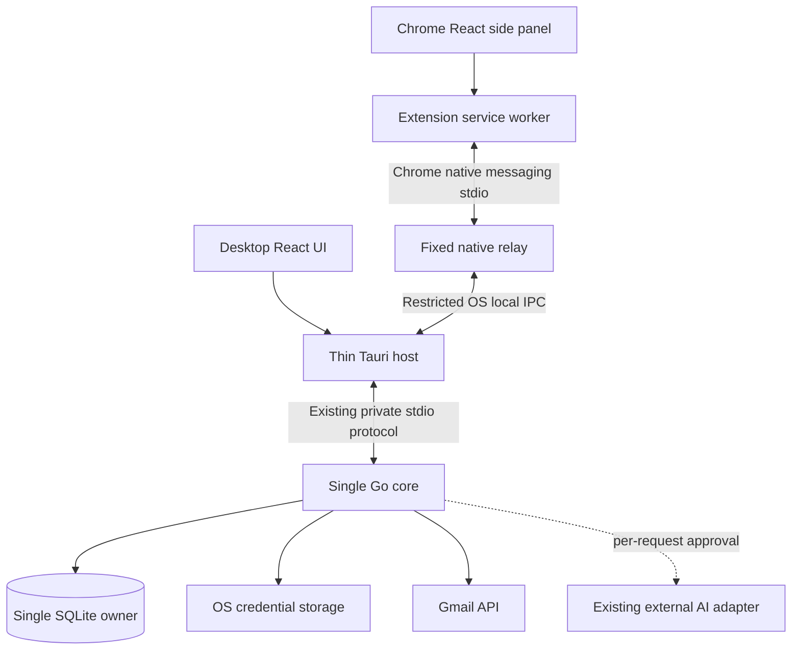

# MailPilot focused product plan

Date: 2026-10-16. Status: proposal for requirements and future implementation.

The user supports the overall direction of a simpler desktop product, a Chrome
companion for Gmail, and a bounded optional AI feature. They requested this plan,
not implementation. The detailed scope, targets, defaults and technical choices
below are recommendations for review, not individually approved requirements.
Nothing in this document claims these changes are already implemented.

## 1. Product purpose and success

MailPilot helps a person organize Gmail deliberately, understand suspicious email,
and get a concise explanation of a selected email. It works as a local desktop
application, with a small Chrome side panel available beside Gmail.

The primary user has one Gmail account, wants useful organization without
automatic mailbox changes, and is willing to install a desktop application.
Initial delivery targets the existing Apple Silicon macOS environment and Google
Chrome. Other operating systems and browsers require separate qualification.

The three jobs are:

1. Find and read downloaded mail without needing AI.
2. Understand a category suggestion or phishing warning before acting.
3. Request a short AI summary and explicit requests/deadlines for one email.

Success means a new tester can connect a dedicated account, sync a bounded set of
mail, find a message, understand a suggestion, preview a label change and undo a
verified addition. A tester can also open the Chrome panel, deliberately select
the intended cached message and use the same summary workflow. No message is
sent, deleted or silently disclosed to an AI provider.

Suggested usability gate: at least four of five representative testers complete
the desktop workflow without developer assistance, and all five can identify
which email an AI approval will disclose. This is a proposed acceptance target,
not a result already measured.

## 2. Release boundary

### Keep, simplify or finish

| Capability            | Proposed release behavior                                                   | Reason                                                   |
| --------------------- | --------------------------------------------------------------------------- | -------------------------------------------------------- |
| Gmail connection      | One account, desktop OAuth and OS credential storage                        | Existing foundation; no second login in Chrome           |
| Synchronization       | Explicit initial and incremental sync; progress, stop and retry             | Avoid background scheduling complexity                   |
| Cached reader         | Escaped plain text, metadata, labels and coverage status                    | Useful without AI; no remote content                     |
| Keyword search        | Local subject/body search and sender/date/category filters                  | Predictable; no model installation                       |
| Categories            | Small editable local category list                                          | Understandable organization vocabulary                   |
| Category suggestions  | Deterministic rules with matching evidence and abstention                   | Remove semantic model dependency                         |
| Gmail organization    | Desktop-only confirmed additions of MailPilot labels, recovery and undo     | Practical value while containing remote-write scope      |
| Phishing assessment   | Local versioned score, reasons and evidence limitations inside reader/panel | Advisory support rather than a separate security product |
| AI assistance         | One selected email: summary, explicit requests and stated deadlines         | Bounded task with no retrieval pipeline                  |
| Chrome companion      | Gmail-only panel, selected cached message, warnings and summary             | Adds convenience without duplicating the desktop client  |
| Settings and recovery | Connection, cache, AI, extension pairing and outstanding actions            | Required to operate and retire features honestly         |

### Remove from active product scope

Retire Ask MailPilot, semantic search, passage/vector indexing, semantic category
classification, local MiniLM/Python runtime setup, AI reply generation and new
Gmail draft creation. Keep narrowly necessary legacy recovery until existing
draft operations have been accounted for. Removal does not authorize deletion of
user databases or journal evidence.

The new product has no model download step, mailbox-wide AI questions, thread
summarization, automatic AI classification or automatic organization. No AI risk
verdict is added; the phishing assessment remains deterministic.

### Explicit exclusions

- Standalone extension operation without the installed, running desktop app.
- A hosted backend, user accounts for MailPilot, subscriptions or shared API keys.
- Multiple connected accounts, other providers, other browsers or mobile clients.
- Sending, draft creation, deletion, trash, archive, mark-as-read or system-label changes.
- Attachment downloads, attachment analysis, rich HTML rendering or link fetching.
- Automatic scans of Gmail pages, background AI, background sync or scheduled writes.
- Calendar/task creation, reply assistance, arbitrary prompts or model tools.
- Extension-side mailbox mutation, full inbox UI or a second local mail database.

These exclusions describe MailPilot actions. Gmail itself may load remote content
or mark a message read when the user operates Gmail; the extension cannot promise
to prevent Gmail's own behavior.

## 3. User experience and workflows

### Desktop structure

Use three main destinations: **Inbox**, **Search**, and **Organize**. Categories,
connection, AI configuration, cache controls and Chrome pairing belong in
**Settings**. Recovery must also be discoverable through a prominent banner when
an operation has an uncertain outcome. Backend/database diagnostics should not
dominate the everyday screen.

The reader is shared by Inbox and Search. It shows sender, recipients, received
time, cached body, attachment metadata, provider labels, category suggestion and
risk explanation. Returning preserves the original list, filters and focus.
**Summarize email** is a deliberate action in this reader.

### First use and sync

1. Explain local storage, one-account support and the scope of Gmail permission.
2. Connect through the system browser. Never ask for a Gmail password.
3. Offer a bounded initial Inbox import; propose retaining the existing 500-message
   default and 1–10,000 per-run limit until performance testing justifies changes.
4. Show progress, cancellation, errors, last successful sync and cache coverage.
5. Later manual syncs use incremental history and existing recovery behavior.

A bounded import is not a complete mailbox backup. Inbox enumeration does not
promise Sent, Spam, Trash or all historical mail. The UI must make this limitation
visible. Uncached email is not found by local search or usable by the extension.

### Find and read

Search cached subject/body text, optionally filtered by sender, receive-date range
and current suggested category. Label that filter **Suggested category**; stale or
absent assessments do not match it. This does not imply accepted local assignment
or actual Gmail label membership. Label filtering can follow if an
existing path makes it inexpensive; it is not required for the first slice.

Proposed search semantics: whitespace-separated literal terms, all terms required,
case-insensitive matching through SQLite's documented tokenizer, no raw SQL or FTS
expression syntax exposed. Document Unicode/tokenization limitations. Sender is a
literal substring. UI dates use the user's timezone and become a start-inclusive,
end-exclusive UTC interval. Sort by relevance, then received time and stable ID.
Use bounded cursor pages. Empty query permits filtered browsing.

Missing bodies are explicitly marked. Subject matches on a message with a missing
body remain useful, but must not imply its body was searched. Reading cached mail
does not fetch a message, open an attachment or modify Gmail.

### Review and organize

1. Manage a small category list. Category names/descriptions alone do not train an AI.
2. Run local suggestion review on a bounded page and see the exact matching rules.
3. Select or deselect suggestions for review; selection is temporary UI state,
   not a persisted category assignment or permission to write Gmail.
4. Request a Gmail preview for the selected suggestions. Dry Run is the default.
5. Review existing labels, proposed MailPilot label additions and any label creation.
6. Confirm a fresh plan. Journal before dispatch and show per-item outcomes.
7. Reconcile uncertain writes before retrying; separately preview and confirm undo.

Propose a small rule editor rather than a general rule language: enabled flag,
destination category, and one condition type: exact sender address, exact sender
domain, or subject terms. Subject terms are literal normalized tokens, all required
within a rule. Any matching rule can suggest its destination; different destinations
produce an explicit conflict and abstention. An exact domain rule does not silently
match subdomains. Rules never apply a label themselves. Retain useful starter rules
only if their semantics can be explained in this model. No regex, scripts, model
training, priority chains or nested conditions in this release.

Keep the existing suggestion-to-label-preview workflow. Persistent local category
overrides and arbitrary manual categorization are deferred, avoiding a second
assignment workflow and new local-action journal. If introduced later, they would
need the same preview/confirm/journal/reconcile/undo discipline. Custom categories
without matching configured rules remain unsuggested; descriptions do not imply
automatic learning. Deferring the editor retains only supported starter mappings.

Propose keeping five-message remote batches initially. Undo removes only verified
memberships MailPilot added, preserving pre-existing/unrelated labels. Created
labels remain. No risk-label application is needed for this release; warnings are
display-only. Preserve recovery for historical risk-label actions.

### Phishing explanation

Display score, qualitative band, assessment version, matching reasons, assessment
time and evidence limitations. Use wording such as **Potential phishing signals**
or **No strong signals found in available evidence**. Never label a message safe.
Missing headers/body produce incomplete-evidence status, not a zero-risk guarantee.
Run only the existing bounded local analysis when requested or the reader needs it;
no external threat lookup, AI call or automatic Gmail action follows.

### Optional AI summary

1. Configure the existing external provider in desktop Settings using the user's
   own API key. Reuse the current adapter where suitable; do not add providers.
2. Select one complete cached message. Refuse missing/incomplete bodies. For an
   oversized body, offer an explicitly bounded excerpt with a partial-source label;
   never silently summarize a truncated input as the whole email.
3. Prepare a preview containing the selected account/message identity, provider,
   model, full policy/instructions and every outbound text field. Include subject,
   sender display/address, received timestamp and bounded plain-text body only.
   Do not include unrelated mail, attachments, hidden headers, URLs fetched from
   the email, recipient lists or previous requests.
4. The user reviews and approves this exact payload. Altering source text, model,
   account or selection invalidates approval. Each attempt requires approval.
5. Display a short summary, requests, stated deadlines and links back to supporting
   source excerpts in the local reader/panel. Provide **Clear** and **Cancel**.

Proposed output: at most three summary bullets, five requests and five deadlines.
Each request/deadline includes a short exact supporting quote. Deadlines preserve
the sender's wording; relative dates such as “Friday” are not converted into an
invented calendar date. No explicit request/deadline produces an empty section with
an honest explanation. Validate output shape, count/length bounds and exact quote
membership in the approved excerpt. This checks provenance, not semantic truth;
summary bullets and extracted interpretations can still be wrong. No new task,
calendar item, label, draft or outgoing message is created.

Use a fixed versioned instruction and bounded structured response, rendered as
escaped text. Proposal: 12 KiB maximum body excerpt, 2 KiB metadata, 4 KiB policy
and framing, with the complete encoded request within the existing adapter limit;
maximum 800 output tokens and 60-second deadline. Make exact constants part of the
future contract and measure real model behavior before freezing them. Do not rely
on character counts for byte/frame enforcement.

Requests, approvals and output remain in memory, with no summary history feature.
Clear on message/account change, panel close, disconnect, AI disable and app exit;
an idle cleanup deadline of 15 minutes bounds abandoned desktop output. Key removal
also invalidates pending approvals. Cancellation suppresses late output but cannot
recall data already sent or guarantee the provider did not charge for it. Failed
requests are not automatically retried. A new attempt needs a fresh preview.

### Gmail companion

Install the desktop app and extension, then explicitly enable the companion in
desktop Settings. Pair the allowed extension with the active desktop profile
through a native confirmation; pairing authorizes a narrow local channel, not AI
disclosure. For the initial release the desktop app must remain running. Closing
it disconnects the panel; Chrome must not start a second mailbox core.

On Gmail, click the toolbar icon to open the side panel. Show connection state,
the MailPilot account, selection identity, cache freshness and whether the selection
was made manually. The panel supports a bounded cached-message picker, a short
source view, local phishing explanations, AI preview/approval and summary output.
It has no connection settings, key input, label-write buttons or second inbox.

Automatic identification of the open Gmail message is a feasibility spike, not an
assumed capability. Gmail UI routes, DOM data and conversation IDs must not be
treated as documented provider message identities. Subject/sender matching alone
cannot establish identity; repeated subjects and multi-message conversations are
common. Gmail tab account indices are not account IDs.

Baseline fallback: the user deliberately chooses the intended cached message from
the connected MailPilot account and confirms sender, subject, timestamp and source
excerpt. Label it **Selected in MailPilot** rather than **Current Gmail message**.
The picker uses the same keyword use case, bounded to ten results, without adding
a full browsing experience. If the message is absent, ask the user to sync in the
desktop app; no hidden fetch, import or DOM-only AI fallback.

Only promote automatic matching if a prototype demonstrates account-bound,
message-specific resolution across Gmail navigation, repeated subjects, collapsed
threads and multiple signed-in Google accounts. Candidates must resolve to the
core's authorized account and cached content revision. Require explicit selection
when ambiguous. If this cannot be established within a short spike, ship the manual
picker or postpone context-aware integration. The release may promise “beside
Gmail” before it can promise “the email currently open in Gmail.”

Tab/message/account navigation clears automatic context and pending consent. A
manually pinned selection remains visibly identified as manual; switching active
tabs clears sensitive panel content and requires reselection. Background Gmail
tabs cannot trigger analysis or AI. Gmail page scripts cannot read the extension
panel's mail or invoke privileged commands. A content script, if introduced by the
matching spike, passes only bounded context hints and receives no mail content.

## 4. Architecture proposal

This preserves Go application behavior, React/strict TypeScript presentation and
a thin Rust lifecycle/transport host. The extension has transport and presentation
code only. Sharing small pure DTO validators/components is useful; do not introduce
a generic multi-platform framework or copy Tauri-specific imports into Chrome.

### Native relay and lifecycle

Chrome starts a registered native messaging executable; it does not attach directly
to the existing Go process. Package a small fixed relay that translates Chrome's
length-prefixed JSON to a restricted local connection owned by the running Tauri
host. It may reuse narrow Rust framing code but has no business logic, database,
credential access, arbitrary process launch or network adapter.

The new host endpoint is a material boundary change. Recommended macOS mechanism:
a Unix-domain socket in a private app-owned directory, restricted to the user,
with peer-user checks, strict protocol validation and native pairing. Future
Windows support would need named pipes and equivalent access controls. This is
local IPC, not an HTTP/WebSocket server. Final path length, stale-endpoint cleanup,
peer verification and pairing design must pass the transport spike before being
committed as an implementation design. No credential or durable bridge secret may
be written to the socket path, host manifest, arguments, environment or browser
storage. Reuse OS credential storage if a durable authentication secret is needed.

The native host manifest allows exact extension origins, never wildcards. Validate
the caller origin at relay startup as well. Use separate explicit development and
release IDs. The native manifest contains executable configuration, not tokens.
Registration/removal is a user-visible desktop operation, handles relocated app
bundles, and never overwrites another product's registration. Browser profiles and
pairing are explicit; do not scan arbitrary Chrome profile directories.

Rust routes both desktop and extension work through the same bounded request
dispatcher. Requests have correlation IDs and separate client/session ownership;
response routing must not leak one client's output to another. Long operations
return bounded job IDs; polling does not hold the sequential core transport open.
Lifecycle initialization/shutdown remains host-only. A relay exit never shuts down
the desktop core. App shutdown closes the local endpoint and all extension sessions.

Start with one paired Chrome session and one pending AI preview or active AI request
across both clients. A second client receives a clear busy/session message and
cannot replace another client's pending approval or cancel its job. Losing the native connection
invalidates its previews, cancels its jobs and clears panel state; nothing replays on
reconnect. An in-flight provider request may already have disclosed approved data.
Protocol-version mismatch disables the bridge and explains which component to update.

### Extension permissions and command surface

Use Manifest V3, packaged scripts and restrictive extension CSP. Proposed permissions:
`sidePanel`, `nativeMessaging`, and the minimum tab/site access needed to enable the
panel on `https://mail.google.com/*`. Validate the exact combination in the spike;
prefer temporary `activeTab` access when sufficient. Do not request `<all_urls>`,
Gmail cookies, browser identity/OAuth, browsing history, arbitrary downloads or
broad persistent script access. No content script is needed for the manual picker.

The proposed extension allowlist is connection/capability status, bounded cached
message selection/read, risk read, summary prepare/approve/status/cancel/clear.
No arbitrary Go method, URL, file path, SQL, shell, OAuth start, key retrieval,
configuration write, organization, sync or recovery mutation is exposed to Chrome.
Extension selection is not authorization: Go rechecks active account/cache access,
message ownership, source revision, client session and approval on every use case.

Propose a 64 KiB encoded application frame cap in both directions, below Chrome's
own host-to-extension limit. Bounded text chunks keep large cached reads under it.
Reject unknown fields, duplicate/malformed request IDs, oversized length prefixes,
invalid UTF-8, unknown operations and incompatible versions before allocation/use.
Before implementation, add versioned synthetic fixtures and Go/Rust/TypeScript
compatibility checks. This plan intentionally adds no executable wire contract.

### Local cache access and offline behavior

Current account restoration refreshes credentials and checks Gmail online before
establishing the session. Therefore cold-start offline reading is a gap, even
though reads within an already authorized session are local.

Proposed separation: Go tracks local cache authorization and remote Gmail readiness
separately. Cold-start cached access requires explicit local unlock using available
OS-stored credentials associated with a previously verified account/profile. Merely
finding an account row is insufficient. This does not establish a fresh remote grant.
Definitive revocation, disconnect, missing/mismatched credentials or a locked store
denies access; transient network failure may preserve local access. Reconnection is
required for remote operations. The precise unlock/session transition contract is
a design gate with negative tests before implementation; no general authentication
framework or new MailPilot password is proposed.

The panel uses that same local authorization and never infers access from being
logged into Gmail in Chrome. Offline mode supports downloaded reading, keyword
search, local rules and risk analysis; external summaries and sync are unavailable.
Warn that a cached risk assessment may be stale relative to Gmail's live content.

### Storage and retention

Keep existing account-scoped SQLite data and immutable migrations. Add explicit new
migrations only where needed, likely for FTS and optional simple rules. FTS must track imports,
body updates, remote-deletion visibility and authorized cache purges transactionally.
An FTS capability probe is not a complete keyword-search implementation.

No vector/model runtime is required at launch or install. Historical vector tables
can remain inert during transition. A later explicit local-cache cleanup may purge
derived vector rows; do not rewrite migrations to erase their history.

Proposed retention: synced cache stays until the user clears it; no summary payload
or output is persisted. Disconnect removes credentials and revokes sessions, hides
the retained cache and offers a separate explanation/action for clearing local data.
Cache removal must account for journal foreign keys. It may remove unreferenced mail
while clearly reporting retained action evidence, rather than deleting recovery
records to satisfy a misleading “everything removed” message. Full profile reset
requires handling unresolved actions and disclosing lost recovery ability.

Treat SQLite, WAL, search indexes, historical reviewed draft bodies and OS backups
as sensitive. There is no SQLite encryption or forensic deletion claim. Data at rest
and Google/Chrome release-policy requirements require an explicit pre-publication
review; existing private permissions alone do not establish policy compliance.

## 5. Candidate functional requirements

These are requirement seeds. “Must” indicates proposed release priority, not user
sign-off. Acceptance checks use synthetic data unless explicitly designated manual.

| ID    | Priority | Candidate requirement                                                            | Observable acceptance check                                                                                                             |
| ----- | -------- | -------------------------------------------------------------------------------- | --------------------------------------------------------------------------------------------------------------------------------------- |
| FR-01 | Must     | Connect one Gmail account using desktop browser OAuth and OS storage             | State/PKCE, denial, timeout, restart and locked-store cases behave safely                                                               |
| FR-02 | Must     | Manually import/sync a bounded account mailbox subset                            | Initial, incremental, cancelled, partial and expired-cursor runs report saved progress truthfully                                       |
| FR-03 | Must     | Display cached coverage and last successful sync                                 | Incomplete imports and missing bodies are visibly different from empty mail                                                             |
| FR-04 | Must     | Read cached text and metadata without changing Gmail                             | Network/write spies see no mail fetch, mark-read, link or attachment request                                                            |
| FR-05 | Must     | Provide local keyword search with sender/date/current-suggested-category filters | Synthetic expected results, stale-assessment exclusion, pagination, Unicode limits, account isolation and update/purge consistency pass |
| FR-06 | Must     | Authorize cached access during offline operation, including restart              | Previously verified local unlock succeeds without network; disconnected/locked/wrong-profile cases deny                                 |
| FR-07 | Must     | Create, edit, disable and safely delete local categories                         | Referenced categories conflict on deletion; changes do not write Gmail                                                                  |
| FR-08 | Must     | Produce deterministic category suggestions and exact matching reasons            | Same inputs/version produce same results; conflicting destinations abstain                                                              |
| FR-09 | Should   | Edit simple sender/domain/subject rules                                          | Invalid/broad inputs reject; rule changes invalidate prior suggestions                                                                  |
| FR-10 | Must     | Select/deselect suggestions and inspect a default dry-run organization preview   | Selection grants no write permission; dry run makes no Gmail or action-journal writes                                                   |
| FR-11 | Must     | Preview and explicitly confirm namespaced Gmail label additions                  | Preview makes no remote writes; stale source/label/category state rejects                                                               |
| FR-12 | Must     | Report per-item success, failure and uncertainty after writes                    | Crash/cancellation-after-dispatch never claims no write occurred                                                                        |
| FR-13 | Must     | Reconcile and separately confirm best-effort undo                                | Only verified added memberships are removed; unrelated labels remain                                                                    |
| FR-14 | Must     | Show local phishing score, version, reasons and limitations                      | Missing/spoofed evidence is disclosed; no safety guarantee or remote action                                                             |
| FR-15 | Must     | Enable/disable optional AI and provision its key only in desktop Settings        | Read APIs return configuration/key-presence only; submitted input clears                                                                |
| FR-16 | Must     | Preview the exact single-email AI request before every dispatch                  | No HTTP request before approval; changed, expired or replayed approval rejects                                                          |
| FR-17 | Must     | Return bounded summary, supported requests and stated deadlines                  | Unsupported quotes/malformed output reject; no deadline is invented from relative wording                                               |
| FR-18 | Must     | Cancel/clear AI work and suppress obsolete results                               | Delayed output after clear, disconnect or selection change is never displayed                                                           |
| FR-19 | Must     | Run ordinary desktop features with AI absent or disabled                         | Core workflow completes without a key, model runtime or inference request                                                               |
| FR-20 | Must     | Register/pair a Gmail-only Chrome companion with the running app                 | Valid origin pairs; wrong origin/profile/version and missing desktop show useful errors                                                 |
| FR-21 | Must     | Let users explicitly select and confirm a cached message in the panel            | Repeated subjects and missing messages never silently select another message                                                            |
| FR-22 | Must     | Show selected-message warnings and the shared summary workflow in Chrome         | Same source/version yields same local assessment; independent AI approval still required                                                |
| FR-23 | Should   | Resolve the current Gmail message automatically after a successful spike         | Account/thread/navigation ambiguity falls back to explicit selection                                                                    |
| FR-24 | Must     | Clear browser-side sensitive state on session/tab/panel changes                  | Navigation, app exit and worker restart cannot expose/replay an old request                                                             |
| FR-25 | Must     | Provide cache removal and truthful retained-evidence reporting                   | No Gmail deletion; FTS/derived rows purge consistently; journal conflicts explain retained data                                         |
| FR-26 | Must     | Remove retired features from active UI, transports and runtime wiring            | Ask, embeddings, reply generation and new draft creation cannot be invoked indirectly                                                   |
| FR-27 | Must     | Preserve necessary historical action recovery during retirement                  | Old uncertain label/draft fixtures reopen and reconcile through a narrow desktop path                                                   |

FR-09 and FR-23 are optional enhancements and are not prerequisites for the first
vertical slice. Deferring FR-09 retains explained built-in rules and deliberate
suggestion selection; it does not reinstate semantic classification.

## 6. Candidate non-functional requirements

Numbers below are initial engineering budgets to validate, not existing benchmarks.
Measure release builds on a documented Apple Silicon Mac with 16 GB RAM, 10,000
synthetic cached messages, average 5 KiB text bodies and a recorded distribution of
larger/missing bodies. Run at least 30 local timing samples; report median and p95,
warm/cold conditions and exact hardware. Network/OS keychain prompts are reported
separately rather than hidden in local latency numbers.

| ID     | Quality attribute    | Proposed measurable requirement                                                                                                                                                                                  |
| ------ | -------------------- | ---------------------------------------------------------------------------------------------------------------------------------------------------------------------------------------------------------------- |
| NFR-01 | Secret protection    | No OAuth tokens/AI keys in files, SQLite, logs, browser storage, arguments or environment; canary tests cover serialization/errors and IPC reads                                                                 |
| NFR-02 | Privacy              | Zero external AI calls without current explicit payload approval; zero default telemetry, remote email-image/link fetches or background embedding traffic                                                        |
| NFR-03 | Isolation            | All queries/actions/previews are account/profile/client scoped; adversarial cross-account/client fixtures return no foreign content                                                                              |
| NFR-04 | Integrity            | One Go database owner, foreign keys on every connection, immutable checksummed migrations and transactional derived-index updates                                                                                |
| NFR-05 | Recovery             | Every dispatched remote write has a durable prior record; injected crashes/cancellation never silently replay uncertain writes                                                                                   |
| NFR-06 | Local responsiveness | p95 cached search first page <=300 ms, selected-message first text <=200 ms, local risk assessment <=500 ms on the fixture corpus                                                                                |
| NFR-07 | Startup/bridge       | p95 desktop usable cached shell <=3 s and panel connection <=1 s when the app is running; external auth/prompts excluded and disclosed                                                                           |
| NFR-08 | Bounded work         | UI acknowledges long operations within 200 ms; Go contexts, capped concurrency/retries, frame/text limits and explicit deadlines bound external work                                                             |
| NFR-09 | AI availability      | Single active AI job; 60 s maximum request deadline, no automatic retry, visible failure/cancel states; provider latency has no guaranteed completion SLO                                                        |
| NFR-10 | Resource use         | Initial investigation budgets: desktop+core <=300 MiB idle RSS, extension processes <=100 MiB incremental RSS where attributable; report measured methodology and revisit before acceptance                      |
| NFR-11 | Accessibility        | Main workflows meet WCAG 2.2 AA intent; keyboard-only operation, visible focus, focus restoration, screen-reader status, readable contrast and no color-only risk states verified manually                       |
| NFR-12 | Compatibility        | Qualify a named macOS/Apple Silicon baseline and current Chrome stable at release; reject incompatible bridge versions; make no untested Windows/Linux/browser claims                                            |
| NFR-13 | Maintainability      | Business logic remains Go; thin Rust transport; strict TS/runtime DTO validation; no model worker, hosted backend or generic invocation surface                                                                  |
| NFR-14 | Diagnostics          | Allowlisted error codes/correlation IDs only; no mail content, identities or sensitive paths in logs; diagnostic export requires explicit review                                                                 |
| NFR-15 | Retention            | Summary content is memory-only with documented cleanup; cache retention, WAL/backups, historical journals and deletion limitations are explained accurately                                                      |
| NFR-16 | Quality evaluation   | Before release, a fixed >=60-message synthetic AI corpus gets >=90% reviewer-approved faithful summaries and >=95% explicitly supported request/deadline items; publish denominators, misses and model/version   |
| NFR-17 | Risk evaluation      | Publish confusion counts and limitations on a separate versioned benign/suspicious/malformed synthetic corpus; no universal accuracy or safety claim                                                             |
| NFR-18 | Distribution         | Reproducible locked builds, native smoke test and upgrade fixtures pass; public delivery additionally requires reviewed signing, host registration, privacy disclosures and applicable Google/Chrome obligations |

AI quality rubric: a faithful summary preserves actor, intent and uncertainty,
introduces no material fact absent from the approved source, and does not obey
instructions embedded in mail. Score empty requests/deadlines separately from
missed ones; do not inflate precision by omitting every item. Use two reviewers
for disputed examples. These are controlled evaluation targets, not guarantees
for arbitrary personal mail. Phishing thresholds should be tuned against measured
false positives, not a marketing accuracy percentage.

## 7. Failure and threat cases to design first

| Situation                           | Required behavior                                                                                           |
| ----------------------------------- | ----------------------------------------------------------------------------------------------------------- |
| No internet                         | Local authorized cache works; remote features show unavailable; no credential loss from a transient failure |
| Missing/revoked/locked credentials  | Fail closed with specific recovery guidance; no plaintext or browser-token fallback                         |
| Partial sync or uncached message    | Report coverage; offer desktop sync; never pretend an empty body is complete                                |
| Gmail and desktop accounts differ   | Show the desktop account and require deliberate matching/selection; never infer access from tab state       |
| Multiple messages share subject     | No automatic identity decision from subject/sender; explicit picker/disambiguation                          |
| Stale cached content                | Show sync timestamp; a cached warning/summary does not claim to cover live Gmail changes                    |
| App/relay/worker restart            | Clear session, previews and results; reconnect without replaying operations                                 |
| Desktop and panel use AI together   | One active job; deterministic busy response, no overwritten consent or cross-client output                  |
| Selection changes during generation | Cancel/suppress old result and revoke its preview; do not attach it to the new message                      |
| Provider timeout/rate limit/refusal | Fixed safe error, no partial success claim or automatic retry; fresh approval for another attempt           |
| Email contains prompt injection     | Treat text as data, provide no tools, validate output; never access extra mail or secrets                   |
| Fake extension/page sends messages  | Origin/session/schema/capability checks reject; no generic bridge forwarding                                |
| Malformed native frame              | Reject before unbounded allocation; close offending channel, preserve desktop availability                  |
| Write dispatched but result lost    | Mark uncertain; read-only reconcile before retry; no exactly-once claim                                     |
| Cleanup meets journal references    | Explain retained evidence or block destructive cleanup; do not erase the recovery trail silently            |

## 8. Transition from the existing implementation

The repository already contains broader functionality. This is an incremental
contraction, not a rewrite. Preserve unrelated uncommitted work and review current
call sites/contracts before each retirement.

| Existing area                                             | Proposed treatment                                                                                      |
| --------------------------------------------------------- | ------------------------------------------------------------------------------------------------------- |
| Go core, Tauri lifecycle, OAuth, keyring, sync and reader | Retain and harden affected boundaries                                                                   |
| Existing category/rule/risk code                          | Reuse deterministic behavior; expose simpler explanations and optional bounded rule management          |
| Organization journal and recovery                         | Preserve existing suggestion-to-preview path and all remote validation                                  |
| Embedding/classifier/search runtime                       | Stop composing/launching vector workers; remove UI/commands after replacement keyword path exists       |
| AI provider, consent and shared settings                  | Reuse for selected-email summary; move settings out of reply-centric UI                                 |
| Ask and reply generation                                  | Disable/remove entry points and transport permissions, then remove unused application code/tests        |
| Gmail draft creation                                      | Deny new creation; preserve narrowly needed read-only legacy reconciliation and user guidance           |
| Existing migrations and draft journal rows                | Retain immutable history, account scope and sensitive-data disclosures                                  |
| MiniLM downloads and semantic setup docs                  | Mark historical/retired after runtime retirement; remove active install prerequisites                   |
| Versioned contracts                                       | Keep historical fixtures needed for migration/recovery; add new compatible or explicitly versioned DTOs |

Before deleting draft code, inventory preview, in-flight, uncertain, conflict and
completed rows. New creation is disabled first. Read-only legacy reconciliation
must not call AI or recreate a draft. Gmail draft removal remains a manual Gmail
action, not a new destructive MailPilot capability. Only remove the compatibility
path after an explicit data/version-support decision; no migration-history edits.

Cache purge/profile reset needs its own small design review. It should not become
a reason to build a universal action engine. Persistent local assignment changes
remain deferred; retain necessary historical assignment data without adding a new UI.

## 9. Delivery phases and exit gates

No code is authorized by this plan. Each phase is a bounded future coding request.
Suggested spike budgets are limits on investigation, not delivery estimates.

| Phase                           | Scope                                                                                                                     | Exit evidence                                                                                                                |
| ------------------------------- | ------------------------------------------------------------------------------------------------------------------------- | ---------------------------------------------------------------------------------------------------------------------------- |
| P0: Requirements/design         | Review this proposal, settle scope and initial platform, approve requirement IDs/targets                                  | Written decisions and explicit deferrals; no implementation                                                                  |
| P1: Feasibility spikes          | Timebox native relay/single-owner routing and Gmail context mapping to 1–2 focused engineering days each                  | Real Chrome-to-core round trip, no second DB owner, negative origin/version tests, documented mapping/manual-fallback result |
| P2: Desktop contraction         | Move settings, simplify navigation, stop new Ask/reply/draft/indexing operations, preserve historical recovery            | Retired commands inaccessible; old database/action fixtures reopen; no local model startup                                   |
| P3: Complete the local workflow | Keyword search/index consistency, cache authorization/offline restart, deterministic suggestion review, risk presentation | Desktop end-to-end synthetic workflow without AI; stale/partial/recovery/accessibility checks                                |
| P4: Selected-email summary      | Shared bounded use case, desktop settings, exact consent and supported output                                             | Disabled-AI path, consent/replay/isolation tests, adversarial fixture evaluation and no mailbox writes                       |
| P5: Chrome companion            | Native registration/pairing, manual selection, warnings and same summary use case; automatic mapping only if spike passed | Real Gmail/Chrome/native smoke with dedicated account, tab/client isolation, reconnect and panel-clear checks                |
| P6: Qualification               | Packaging/upgrade/uninstall, recovery, privacy/retention review, performance and user task checks                         | Measured targets and documented exceptions; public release obligations resolved before publication                           |

P1 can validate transport before feature retirement, so a failed extension
experiment does not destabilize the existing app. P2 must preserve AI foundations
needed by P4 and keep necessary compatibility code even after retiring its UI.
P3 is the useful desktop milestone; P4 adds the one AI capability; P5 completes the
desktop-plus-Gmail experience. Do not add optional rules or automatic matching to
a phase whose required workflow is unfinished.

Testing is proportional to changed boundaries: Go tests/vet/race for core changes;
frontend typecheck/lint/behavior/build; Rust fmt/clippy/tests for native changes;
real packaged/native lifecycle checks and real extension native messaging checks.
Browser mocks cannot validate native registration, OS access controls or Tauri.
Automated tests use synthetic mail and fake AI, no personal mailbox writes or paid
calls. Dedicated-account/real-provider evaluations are opt-in and separately recorded.

## 10. Decisions for the requirements exercise

The recommended defaults make the plan actionable; disagreements can be resolved
before the corresponding coding phase rather than blocking this documentation.

| Decision          | Recommended default                                                   | Consequence/alternative                                                                    |
| ----------------- | --------------------------------------------------------------------- | ------------------------------------------------------------------------------------------ |
| Product form      | Desktop app plus companion requiring it to be running                 | Standalone Chrome would require a separate architecture and secret/lifecycle model         |
| Platform          | Existing Apple Silicon macOS first, Google Chrome                     | Cross-platform targets add installer, keyring and local-IPC qualification                  |
| Extension context | Manual cached-message picker is acceptable baseline                   | Automatic open-message support remains a spike-gated enhancement                           |
| Mail coverage     | Bounded Inbox snapshot plus subsequent incremental changes            | Full historical/all-folder sync is a separate scope increase                               |
| AI task           | Single-email summary, explicit requests and stated deadlines          | No replies, thread expansion, chat or mailbox retrieval                                    |
| AI provisioning   | User's own key for the existing external provider, desktop entry only | Hosted billing/key proxy is excluded                                                       |
| AI persistence    | No saved summaries; explicit per-request disclosure                   | History/background automation would change retention and consent requirements              |
| Rules             | Explainable built-ins first; small editor is optional                 | Do not retain semantic classification merely to support custom categories                  |
| Organization      | Desktop-only MailPilot label additions and best-effort undo           | No browser writes or system-label operations                                               |
| Offline unlock    | Separate locally authorized cache access from remote readiness        | Requires explicit authorization state design and tests before implementation               |
| Legacy actions    | Preserve read-only draft reconciliation and existing label recovery   | Cannot delete every old draft/action module immediately                                    |
| Release audience  | Dedicated-account development pilot before public distribution        | Public rollout needs reviewed policies, verification and packaging beyond functional demos |

## 11. External constraints and sources

Checked against official documentation on 2026-10-16. Recheck at implementation
and before distribution. These sources constrain the proposal; they do not prove
the current application or proposed release complies with every applicable policy.

- [Chrome side panel](https://developer.chrome.com/docs/extensions/reference/api/sidePanel):
  supports extension UI beside a webpage and site-specific availability; opening
  programmatically is tied to user interaction. Plan toolbar activation, not an
  unsolicited auto-opening panel on every Gmail visit.
- [Chrome native messaging](https://developer.chrome.com/docs/extensions/develop/concepts/native-messaging):
  requires registered native hosts, exact allowed extension origins and a distinct
  length-prefixed stdio protocol. Chrome starts a separate host process; content
  scripts must relay through extension contexts. Hence the proposed fixed relay
  and single-owner desktop routing, rather than launching another mail core.
- [Chrome content scripts](https://developer.chrome.com/docs/extensions/develop/concepts/content-scripts):
  DOM access does not establish a supported Gmail message identity contract. The
  requirement to prove identity or use manual selection is an engineering inference.
- [Gmail scopes](https://developers.google.com/workspace/gmail/api/auth/scopes):
  existing `gmail.modify` is restricted and broader than the label operations this
  product exposes. Do not add scopes for summarization or Chrome pairing. Review
  applicable verification/security-assessment obligations before wider distribution,
  particularly when forwarding selected content to an external AI service.
- [Google Workspace user-data policy](https://developers.google.com/workspace/workspace-api-user-data-developer-policy):
  review permitted transfers, Limited Use, model-training restrictions, cache
  retention and data-at-rest obligations against the concrete deployment/provider.
  User consent alone is not a blanket exemption. Existing indefinite local-cache
  retention and lack of SQLite encryption need a documented assessment; do not
  claim private file permissions settle these requirements.
- [Chrome Web Store privacy and secure handling](https://developer.chrome.com/docs/webstore/program-policies/user-data-faq):
  local-only handling still calls for privacy disclosures; data handling and
  consent must match actual behavior. Review encryption, native-companion handling
  and user-facing disclosures before publication rather than promising store approval.

For the existing implementation boundaries, consult [ARCHITECTURE.md](ARCHITECTURE.md),
[Gmail setup](GMAIL_SETUP.md), [AI foundation](GENERATIVE_AI.md) and
[IPC contracts](../contracts/README.md). Those documents describe the broader
current system until future implementation and documentation retirement occurs.
