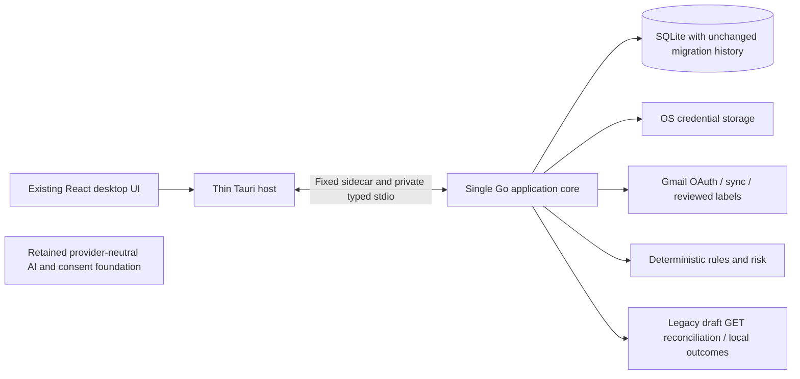

# MailPilot contraction record — 2026-10-16

Historical record preserved during the 2026-10-19 documentation reset. This is not
an active product plan or an instruction to remove/restore features. Its inventory
records paths and scope at the time, including paths since removed or consolidated.
Current authority: [product plan](../PRODUCT_PLAN.md), [architecture](../ARCHITECTURE.md)
and [engineering contract](../../AGENTS.md). The original record follows; linked
current documents may now have different scope.

Successor planning update (2026-10-16): the user has requested a future retrieval,
header/semantic categorization and formatted-reader design, replacing standalone
Summary with evidence-based answers/composition. See [PRODUCT_PLAN.md](../PRODUCT_PLAN.md)
and [RETRIEVAL_READER_PLAN.md](LEGACY_FEATURES.md#superseded-intermediate-plans). This document remains a
historical contraction/compatibility record; its retirement inventory and old
future-scope recommendations do not override that new proposal. The new request
authorizes documentation only, not restoring deleted code or changing the runtime.

Status: execution plan authored 2026-10-16. The inventory below records the
pre-contraction repository; deleted paths remain here as historical disposition
records. Subsequent implementation requests authorized active-entry-point
contraction and semantic/model deletion, now implemented.

Completed: Ask/search application and UI code, embedding/MiniLM/Python/ONNX,
semantic/hybrid classifiers, vector/passage adapters, downloader, Python dependency
locks and their exclusive tests/corpora are removed. Pure text cleanup was moved to
`internal/mail`; deterministic classification directly enforces the existing 0.60
gate. All 13 migrations, historical vector schemas, cached mail, journal evidence,
AI provider/consent/settings foundation and narrow draft recovery remain.
Generative contraction is also implemented: only `SummarizeEmail` remains on the
provider interface; desktop provider selection, consented selected-email summary
and migration 014 are in place. Generic AI/reply/draft creation code is removed,
with only journal codecs and GET-only historical draft recovery retained.
Keyword search, additional concrete adapters and Chrome remain future work.
See [ARCHITECTURE.md](../ARCHITECTURE.md) for the current composition.

## Basis and scope precedence

Reviewed the repository text inventory, including tracked and untracked source,
configuration, manifests/locks, documentation, fixtures, migrations and current
tests. Traced composition, imports, consumers, command validation, persisted state
and shared test helpers. Excluded `.env`/credentials, mailbox data, `.git` internals,
installed dependencies, downloaded models, generated assets and build outputs;
these are not application source to read or delete. The exact file disposition
inventory appears at the end of this document. This review does not claim that
application tests or native integration checks were run for a documentation change.

Read [AGENTS.md](../../AGENTS.md), [ARCHITECTURE.md](../ARCHITECTURE.md),
[PRODUCT_PLAN.md](../PRODUCT_PLAN.md), [IPC/contracts](../../contracts/README.md), the
actual frontend composition, Go composition, Tauri routing and migrations 001–013.
Some older documentation reports schema 10/12; the current embedded migration set
ends at **013_retrieval_passages.sql**. Source and migration checksums, rather than
old status prose, determine compatibility.

The latest instructions supersede the focused plan's single-provider assumption:
**multiple AI providers behind a shared abstraction stay in the target scope**.
Only OpenAI currently has a concrete adapter. Preserving that boundary is part of
contraction; implementing another provider is future work. Similarly, keyword
search and a single-selected-email summary are target capabilities, not existing
features that can simply be switched on.

Keep one Gmail account; desktop OAuth/keyring; bounded initial/incremental sync;
SQLite/cache reading; editable categories; deterministic suggestions/risk; reviewed
Gmail label additions with dry-run, journal, reconciliation and undo. Retire Ask,
semantic retrieval/classification, embeddings/passages, MiniLM/Python/ONNX, reply
generation, new Gmail drafts, thread summaries, chat/arbitrary prompts and autonomous
AI operations. Retain narrow legacy recovery and historical evidence. Chrome is
later work using the same running core; do not scaffold it during contraction.

## 1. Exact packages/files to keep

The appendix lists every inspected file individually. “Keep” preserves ownership
and behavior; “rework” preserves the file/package but removes specified responsibilities.
A retained package does not mean all its existing methods remain exposed.

| Area                              | Exact production files to retain                                                                                                                                                                                                                              | Responsibilities                                                                                                                     |
| --------------------------------- | ------------------------------------------------------------------------------------------------------------------------------------------------------------------------------------------------------------------------------------------------------------- | ------------------------------------------------------------------------------------------------------------------------------------ |
| Composition and application shell | `backend/cmd/mailpilot-core/main.go`; `backend/internal/app/app.go`; `backend/internal/app/categories.go`; `backend/internal/app/classification.go`; `backend/internal/app/mailbox.go`; `backend/internal/app/reader.go`; `backend/internal/app/ai_errors.go` | Keep lifecycle, health, auth, mailbox, category/review/reader and safe errors; contract fields/wiring as detailed below              |
| Organization                      | `backend/internal/app/organization.go`; `organization_dto.go`; `organization_preview.go`; `organization_apply.go`; `organization_risk.go` in that same directory                                                                                              | Retain the complete write/recovery/undo path; no semantic inference required                                                         |
| Authentication                    | `backend/internal/auth/doc.go`; `loopback.go`; `manager.go`; `provider.go` in that directory                                                                                                                                                                  | Keep PKCE/state, refresh serialization, session cancellation and fail-closed credentials                                             |
| Credentials                       | `backend/internal/credentials/doc.go`; `keyring.go`; `secrets.go`; `token.go` in that directory                                                                                                                                                               | Keep Gmail tokens and provider-scoped AI secrets in OS storage                                                                       |
| Domain                            | `backend/internal/domain/email.go`; `health.go`; `organization.go`; `persistence.go`; `phishing.go` in that directory                                                                                                                                         | Keep account/provider identities, mailbox/action evidence and historical semantic fields where needed for decoding                   |
| Gmail/provider contracts          | `backend/internal/provider/provider.go`; `changes.go`; `backend/internal/provider/gmail/doc.go`; `oauth.go`; `provider.go`; `normalize.go`; `history.go`; `labels.go`                                                                                         | Keep imports/history/labels and neutral capabilities; remove the active draft-creation contract                                      |
| Deterministic suggestions         | `backend/internal/classification/engine.go`; `rules.go`; `starter_rules.json` in that directory                                                                                                                                                               | Keep engine contract, fingerprints, rules/exclusions, ambiguity and explanations; detach preprocessing and direct-rule helpers first |
| Mail/risk                         | `backend/internal/mail/doc.go`; `text.go`; `backend/internal/risk/doc.go`; `features.go`; `engine.go`; `headers.go`; `authentication.go`; `domains.go`; `urls.go`; `html.go`; `attachments.go`; `language.go`                                                 | Preserve bounded local decoding, text extraction and deterministic risk analysis                                                     |
| Sync and repositories             | `backend/internal/sync/doc.go`; `service.go`; `incremental.go`; `backend/internal/repository/repository.go`; `content.go`; `sync.go`                                                                                                                          | Keep consumer-owned persistence, checkpoint atomicity, idempotence and tombstones                                                    |
| SQLite active storage             | `backend/internal/store/sqlite/sqlite.go`; `repositories.go`; `accounts.go`; `emails.go`; `categories.go`; `classifications.go`; `actions.go`; `organization.go`; `sync.go`; `ai_settings.go`                                                                 | Keep migrations, storage/security, classification/risk and journals; replace vector-aware invalidation without inference             |
| Shared optional AI foundation     | `backend/internal/ai/provider.go`; `service.go`; `settings.go`; `backend/internal/ai/openai/provider.go`                                                                                                                                                      | Keep redaction, provider neutrality, bounded transport, consent and non-secret settings; contract the operation vocabulary           |
| Configuration/logging             | `backend/internal/config/config.go`; `backend/internal/logging/logging.go`                                                                                                                                                                                    | Keep all non-model settings and redacted diagnostics                                                                                 |
| Legacy draft recovery             | `backend/internal/reply/reply.go`; `backend/internal/app/replies.go`; `replies_actions.go`; `replies_dto.go` in app; `backend/internal/store/sqlite/replies.go`; `backend/internal/provider/gmail/drafts.go`                                                  | Keep only historical values/digests/validation, account-scoped journal reads/transitions and read-only Gmail reconciliation          |

Retain all 13 migration files byte-for-byte, all migration ledger checks and current
database identities. Retain `src-tauri/src/main.rs`, `bridge.rs`, `replies.rs`,
`src-tauri/build.rs`, `capabilities/main.json`, `tauri.conf.json`, `Cargo.toml`,
`Cargo.lock` and `icons/source.svg`; most routing files need a narrow edit.

Retain React entry/build files, accounts, mailbox, reader/workspace, categories,
classification and organization components. Keep reader/organization/classification
IPC modules and the common client; remove only retired exports/fields. Keep
`package.json`, `package-lock.json`, `frontend/package.json`, `backend/go.mod`,
`backend/go.sum`, lint/format/type/build configuration and the four JavaScript build,
Rust-environment, launch and smoke scripts. Their installed toolchains remain useful.

## 2. Exact packages/files to retire

Delete only after consumers and protected responsibilities have been removed or
relocated in the sequence in section 10. The appendix expands each directory into
exact files, including tests and fixtures.

| Retire                                     | Exact production files                                                                                                            | Preconditions                                                                                                                                                |
| ------------------------------------------ | --------------------------------------------------------------------------------------------------------------------------------- | ------------------------------------------------------------------------------------------------------------------------------------------------------------ |
| Ask application/domain                     | `backend/internal/app/ask.go`; `backend/internal/ask/context.go`                                                                  | Remove `App.Ask`, composition, lifecycle, transports and frontend calls; do not reuse mailbox retrieval for summaries                                        |
| Semantic search application                | `backend/internal/app/search.go`                                                                                                  | Remove `App.Search`, jobs, status/index/query/cancel handlers and clearing hooks                                                                             |
| Retrieval package                          | `backend/internal/search/search.go`; `passages.go`; `indexing.go`; `excerpt.go` in that directory                                 | Ask and semantic search must no longer import it; later keyword search gets a distinct contract                                                              |
| Embedding package                          | `backend/internal/embedding/provider.go`; `service.go`; `categories.go`; `preprocess.go`; `html.go`; `passages.go`                | First preserve deterministic `CleanBody`/HTML cleanup semantics in the existing mail package; replace vector invalidation consumers                          |
| MiniLM adapter/worker                      | `backend/internal/embedding/minilm/provider.go`; `worker.py`; `requirements.in`; `requirements.txt`; `scripts/download-minilm.py` | Remove configuration/composition/setup references; do not uninstall user's Python or remove external model directories                                       |
| Semantic/hybrid classifier implementations | `backend/internal/classification/semantic.go`; `hybrid.go`                                                                        | Move `configVersion` out of hybrid.go; settle the deterministic direct-rule gate; mark old assessments stale                                                 |
| Vector/retrieval SQLite adapters           | `backend/internal/store/sqlite/embeddings.go`; `category_embeddings.go`; `passages.go`; `search.go`                               | Replace `emails.go` calls to `invalidatePassages`/`embedding.Prepare`; retain simple transactional cleanup of inert rows                                     |
| Ask frontend                               | `frontend/src/features/ask/AskMailPilot.tsx`; `frontend/src/lib/ipc/ask.ts`                                                       | Remove workspace import/mount and reader citation integration                                                                                                |
| Semantic search frontend                   | `frontend/src/features/search/SemanticSearch.tsx`; `frontend/src/lib/ipc/search.ts`                                               | Remove workspace import/mount and client reexports; do not rename this UI to Keyword Search                                                                  |
| Reply drafting frontend                    | `frontend/src/features/replies/ReplyDrafts.tsx`                                                                                   | Preserve access to legacy recovery in a restricted desktop view before deleting the mixed component; no editor/tone/thread/generation/create controls remain |
| Ask Rust module                            | `src-tauri/src/ask.rs`                                                                                                            | Remove module/import, handler, bridge method, command manifest, permission and smoke dependency together                                                     |

`frontend/src/lib/ipc/reply.ts`, `src-tauri/src/replies.rs`, and all Go `reply` files
are **not wholesale deletions**: narrow them for recovery first. Their historical
names can remain to avoid a needless rename/refactor. Delete `GenerateDraft`,
`AnswerWithContext`, thread summarization and their instructions/dispatch branches
from the AI foundation after callers are gone. Remove the Gmail `CreateDraft`
implementation, `DraftCreator` interface and `EmailProvider` embedding; preserve
only the draft matching values and `DraftFinder` recovery seam. Remove or report
false for `CreateDrafts`; no active path can advertise true.

Do not delete historical migrations, action evidence, credentials, mail caches,
downloaded user assets or unrelated files as part of source contraction. Historical
docs/fixtures remain explicitly marked historical rather than being bulk-deleted.

## 3. Runtime composition changes

### Go composition: `backend/cmd/mailpilot-core/main.go`

1. Remove `embedding`, `embedding/minilm`, `search` imports and construction of
   `minilm.New`, `NewLocalClassificationService`, `NewSemanticClassifier`,
   `NewHybridClassifier`, `PassageEmbeddings`, `search.New`, `NewMailboxSearch` and
   `NewAskService`. Remove their variables, assignments and deferred shutdowns.
2. Preserve auth/keyring, SQLite, `SyncCheckpoints`, risk engine, categories,
   classification store, organization and cached reader. Compose one deterministic
   rule engine for review, reader freshness checks and organization validation.
3. Retain the capacity-one operation gate shared by sync and organization. Narrow
   legacy draft reconciliation joins appropriate session/shutdown handling; it
   must not start a second provider writer or block the sequential IPC for a network call.
4. Replace the full reply service construction with its restricted recovery form:
   it needs session, journal and `DraftFinder`, not AI provider/key/settings, source
   gathering, draft construction or a creation-capability factory.
5. Keep provider factories/key-store abstractions available independently of replies.
   Current `keys(account)` hardcodes `"openai"`, and `aiFactory(account, model)`
   selects only `openai.New`. Do not claim this already supports multiple providers.
   During contraction retain the shared boundary and existing adapter; no provider
   switcher, new adapter, SDK or summary use case is implemented.

### Application shell and lifecycle

Remove `App.Ask` and `App.Search`; replace the broad responsibility of `App.Replies`
with recovery only. Remove their `AuthBegin`/`AuthDisconnect` clearing calls as the
services disappear, keeping cancellation/clearing for remaining services and later
summary work. Keep `Close`/wait-group ordering so no job outlives SQLite. Recovery
journal persistence after a dispatched legacy write must remain independent of
UI cancellation; no new legacy write can be dispatched.

### Rules and storage detachment

- `rules.go` imports `embedding.CleanBody`; move the pure bounded cleanup into the
  existing `internal/mail` package, along with needed HTML pruning and neutral
  errors. Do not replace it with the reader's full-text behavior: quoted/signature
  filtering affects rule decisions. Do not copy retrieval passage generation.
- `configVersion` is declared in `hybrid.go` but used by `rules.go`. Move it to
  `engine.go` or rules.go before deleting hybrid.go. `finite` and `newRun` currently
  serve semantic/hybrid code; delete them when those consumers disappear rather
  than preserving an unused cosine utility.
- Current no-model `HybridClassifier` rejects rule strength below **0.60**. Directly
  composing the existing raw rules can activate **0.55** matches. Preserve the
  conservative no-model gate explicitly in deterministic policy, version it, and
  test weak-newsletter/competing-rule cases; do not silently broaden organization.
- `app/classification.go` maps embedding errors and exposes candidate/cosine DTOs.
  Remove active semantic error/result production, retaining historical storage
  decoding. Rule/version changes naturally make old semantic/hybrid reviews stale;
  require explicit re-review before new previews, not a mass startup rewrite.
- `sqlite/emails.go` currently invokes `invalidatePassages` from `passages.go` and
  `embedding.Prepare`. Replace them with account-scoped transactional deletion of
  obsolete derived vector/manifests on source changes. No normalization, inference
  or new vector production is necessary after retirement. Keep analysis invalidation.
- `sqlite/sync.go` already removes derived data on confirmed remote deletion and
  tombstones the email rather than breaking journal references. Keep that behavior.

Remove `Config.EmbeddingPython`, `Config.EmbeddingModelDir`,
`MAILPILOT_EMBEDDING_PYTHON`, `MAILPILOT_EMBEDDING_MODEL_DIR`, `--embedding-python`
and `--embedding-model-dir`. Delete their validation/tests and current setup guidance.
Remaining stale environment values must not launch or require a worker; document
that retired command-line flags are unsupported. Keep sync/risk/OAuth/data/log settings.

## 4. Frontend routes/components to remove

There is **no frontend route table or router dependency**. `frontend/src/main.tsx`
mounts `App`; `App.tsx` stacks feature components; `MailWorkspace.tsx` switches the
reader with local React state. Contract those actual mounts; do not invent route
files, install a router or rebuild the navigation as part of this task.

| File                                                            | Exact future change                                                                                                                                                                                                                                   |
| --------------------------------------------------------------- | ----------------------------------------------------------------------------------------------------------------------------------------------------------------------------------------------------------------------------------------------------- |
| `frontend/src/app/App.tsx`                                      | Remove `ReplyDrafts` import/mount. Keep GmailConnection, MailWorkspace, Categories, ClassificationReview, Organization, health and disconnect remount behavior. Retain a discoverable restricted legacy-recovery view when needed.                    |
| `frontend/src/features/reader/MailWorkspace.tsx`                | Remove `AskMailPilot`, `SemanticSearch` imports/mounts and citation navigation. Keep Mailbox, MailReader, source identity, preserved list state and focus restoration. No fake keyword replacement.                                                   |
| `frontend/src/features/classification/ClassificationReview.tsx` | Keep review/paging/reasons/abstention. Remove ranked cosine `Candidates` presentation and embedding/corroboration copy; keep accurate rule strength, not probability wording.                                                                         |
| `frontend/src/features/replies/ReplyDrafts.tsx`                 | Remove the mixed UI only after isolating its status/reconcile/manual-resolution/undo-unavailable recovery presentation. Remove optional AI settings, key entry, thread/tone/instruction/body editing and draft-creation controls from this component. |
| `frontend/src/lib/ipc/client.ts`                                | Remove semantic-search reexports. Keep categories/classification/organization and health/auth/sync/mail. Restrict or relocate recovery-only reply exports.                                                                                            |
| `frontend/src/lib/ipc/classification.ts`                        | Stop accepting/expecting active semantic candidates and `embedding_unavailable`; align with narrowed Go/Rust DTOs. Historical JSON parsing belongs in storage compatibility, not a live feature UI.                                                   |
| `frontend/src/lib/ipc/reply.ts`                                 | Keep only strict recovery requests/responses. Reject configure, disable, prepare, generate, preview_draft, create, arbitrary body/instruction/thread/key inputs. Clear late responses on account/session changes.                                     |
| `frontend/src/app/styles.css`                                   | Delete a selector only if its final JSX consumers are gone; retain shared cards/forms/progress/reader/accessibility styles.                                                                                                                           |

Keep accounts, mailbox, reader, categories and organization components and their
authorization/late-response handling. Do not remove a source selector or reviewed
phishing label additions merely because semantic features retire: those use the
same deterministic organization path and were not in the user's retirement list.
The older focused plan suggested display-only risk; retain existing reviewed
behavior unless a later scope instruction explicitly removes new phishing-label
proposals. Regardless, old risk-label reconciliation/undo remains supported.

AI settings must not disappear permanently with ReplyDrafts. Their neutral Go
settings/key storage stays; a standalone settings view and summary integration are
future authorized feature work. During contraction an intentionally dormant AI
foundation is preferable to retaining a generation path to keep its settings UI alive.

## 5. IPC/Tauri commands to remove or restrict

For each change update all actual layers atomically: frontend invoke/schema,
`src-tauri/src/main.rs` handler and `generate_handler!`, `src-tauri/src/bridge.rs`,
`src-tauri/build.rs` command list, `src-tauri/capabilities/main.json`, Go
`internal/ipc/server.go` service interface/switch, application handler and tests.
Do not hand-edit generated `src-tauri/permissions/autogenerated` output.

| Go method                                                    | Tauri command                                                      | Disposition                                                                                                                                                                                                                                     |
| ------------------------------------------------------------ | ------------------------------------------------------------------ | ----------------------------------------------------------------------------------------------------------------------------------------------------------------------------------------------------------------------------------------------- |
| `health`                                                     | `health`                                                           | Keep                                                                                                                                                                                                                                            |
| `auth.status`, `auth.begin`, `auth.check`, `auth.disconnect` | `gmail_status`, `gmail_connect`, `gmail_check`, `gmail_disconnect` | Keep narrow lifecycle; no token-returning commands                                                                                                                                                                                              |
| `initialize`, `shutdown`, `auth.cancel`                      | Host-only                                                          | Keep private bootstrap/browser-failure/termination responsibilities                                                                                                                                                                             |
| `sync.start`, `sync.status`, `sync.cancel`                   | `sync_start`, `sync_status`, `sync_cancel`                         | Keep                                                                                                                                                                                                                                            |
| `mail.list`, `mail.read`                                     | `mailbox_list`, `mailbox_read`                                     | Keep account isolation and bounded cached-body revisions                                                                                                                                                                                        |
| `categories.manage`                                          | `categories_manage`                                                | Keep list/save/delete; no classification/mutation side effects                                                                                                                                                                                  |
| `classification.review`                                      | `classification_review`                                            | Keep list/run with deterministic engine; no semantic configuration/evidence generation                                                                                                                                                          |
| `organization.manage`                                        | `organization_manage`                                              | Keep list/status/dry_run/preview/apply/reconcile/undo_preview/cancel with existing validation; apply includes separately confirmed undo                                                                                                         |
| `ask.manage`                                                 | `ask_manage`                                                       | Remove completely; old operation/prompt payloads reject                                                                                                                                                                                         |
| `search.semantic`                                            | `semantic_search`                                                  | Remove completely; status/index/query/cancel all retire                                                                                                                                                                                         |
| `reply.manage`                                               | `reply_manage`                                                     | Temporarily/finally recovery-only: status, reconcile, explicitly confirmed resolve, and cancel for an owned recovery job. Retire generation/configuration/create operations and no-op undo preview; display truthful undo-unavailable guidance. |

There is no current keyword-search or selected-email-summary IPC to retain. Add
neither during contraction. Future contracts must be explicitly named/versioned;
do not reuse `search.semantic` for keywords or `summarize_thread` for one email.
Multiple providers do not justify an arbitrary provider URL or generic execution API.

Removing live DTO fields/commands is a compatibility change even though durable
database data stays readable. Core, Rust and frontend ship together; keep existing
retained fixtures valid or explicitly version their changes. Persisted plan JSON
has a separate compatibility lifetime. Future independently updated Chrome requires
a supported protocol/version handshake, but no extension endpoint is added now.

The Go classifier deadline is currently 30 seconds and the native request wait is
32 seconds, with other calls at five/seven seconds. After inference removal,
measure the bounded rule review before shortening these; do not change unrelated
transport deadlines or framing behavior merely to simplify a constant.

## 6. Dependencies that become unused

| Manifest/tool                                                           | Actual dependency consequence                                                                                                                                                                                                                                                                                                  |
| ----------------------------------------------------------------------- | ------------------------------------------------------------------------------------------------------------------------------------------------------------------------------------------------------------------------------------------------------------------------------------------------------------------------------ |
| `backend/internal/embedding/minilm/requirements.in`, `requirements.txt` | Retire the optional Python environment specification: direct `onnxruntime`, `numpy`, `tokenizers`, and all pinned transitive packages in requirements.txt become unnecessary to MailPilot. No system/user-environment uninstall is authorized.                                                                                 |
| `backend/go.mod` / `go.sum`                                             | No direct module becomes demonstrably unused: `go-keyring` protects credentials, `x/oauth2` handles Gmail, `modernc.org/sqlite` stores mail, and `x/net` remains used by mail HTML/charset and risk HTML/IDNA/publicsuffix. Recompute indirect requirements only after actual source removal; do not guess lockfile deletions. |
| `frontend/package.json` / root manifest / npm lock                      | No direct dependency is feature-exclusive: React/DOM, Tauri API, Zod, Vite/TS and test/lint/format tools remain. No router, vector library or AI SDK is installed to remove.                                                                                                                                                   |
| `src-tauri/Cargo.toml` / `Cargo.lock`                                   | Tauri, single-instance, Serde/JSON and tauri-build all remain. Removing ask.rs is not grounds for deleting Serde or the lockfile.                                                                                                                                                                                              |
| Model acquisition                                                       | Remove `scripts/download-minilm.py` and active setup instructions. Do not remove arbitrary downloaded model directories, virtualenvs or global packages.                                                                                                                                                                       |

There is no hosted service, vector database dependency or external AI SDK to
replace. The existing AI HTTP adapter uses the Go standard library. Future provider
adapters need their own authorized implementation/dependency review.

## 7. Historical/inert database tables and schema

**Keep every migration file 001–013 unchanged and applied in order, including fresh
installs.** No DROP/recreate/renumber/checksum repair, table rename, schema downgrade
or new migration is needed merely to disable application features. New keyword or
provider-settings schemas, if needed later, start at the next valid migration.

| Tables/schema objects                                                                                                    | Contraction treatment                                                                                                                                                                                                                      |
| ------------------------------------------------------------------------------------------------------------------------ | ------------------------------------------------------------------------------------------------------------------------------------------------------------------------------------------------------------------------------------------ |
| `schema_migrations`, `settings`, `accounts`                                                                              | Active lifecycle/compatibility; retain checksums and non-secret metadata                                                                                                                                                                   |
| `emails`, `email_addresses`, `labels`, `email_labels`, `sync_checkpoints`                                                | Active cached mail and sync, including remote-deleted tombstones and account FKs                                                                                                                                                           |
| `categories`, `email_categories`                                                                                         | Active definitions; keep historical assignments and reader display; no new unjournaled assignment UI                                                                                                                                       |
| `classification_runs`, `classification_results`                                                                          | Active deterministic assessment storage; preserve old semantic/hybrid rows until ordinary invalidation/explicit re-review. Retain candidates_json/used_classifier/reason/score_kind columns and historical validation needed to read them. |
| `phishing_results`                                                                                                       | Active deterministic risk cache, including version/input hash and evidence                                                                                                                                                                 |
| `mailbox_actions`, `mailbox_action_items`, `organization_plans`, `organization_emails`                                   | Active label journal plus historical/recoverable actions. Keep category-null risk rows, immutable plan/digest/revision, before/after/ownership evidence and references.                                                                    |
| `email_embeddings`, `category_embeddings`                                                                                | Inert derived legacy data: no production inference/read/index jobs. Preserve tables and model-scan index; existing update/delete cleanup may remove stale rows transactionally.                                                            |
| `email_passage_vectors`, `email_retrieval_indexes`                                                                       | Inert derived legacy data; no passage generation/index manifests or retrieval. Preserve tables/index; keep minimal account-scoped invalidation/purge rather than retaining vector code.                                                    |
| `reply_ai_settings`                                                                                                      | Still useful non-secret settings despite historical name. Current columns are account_id/model/enabled, **not provider selection**. Preserve data now; multi-provider settings need a later additive schema/compatibility decision.        |
| `reply_draft_actions`, `reply_draft_sources`                                                                             | Legacy recovery only; no new plans. Preserve immutable plan trigger, unresolved unique index, reviewed bodies and source FKs. Permit only justified outcome/reconciliation/manual-resolution metadata transitions.                         |
| `account_default_categories`, `categories_restrict_delete`, `invalidate_category_embeddings`, draft immutability trigger | Keep existing migration-defined behavior. Category edit may delete inert vectors; this does not reactivate embeddings.                                                                                                                     |

“Inert” means not used for active inference/retrieval, not exempt from deletion
propagation or sensitivity. Content updates and confirmed remote deletion must
not leave stale sensitive derived data merely because vector code was removed.
No broad vector purge or journal purge is authorized by this plan.

No persistent FTS virtual table or keyword query implementation exists in the
current migrations. `sqlite_test.go` creates **temp.fts_probe** to test FTS support;
that is not a complete search feature. Do not claim semantic search removal leaves
keyword search implemented. Cold-start offline access similarly still depends on
online account restoration; preserve current authorization until a separately
designed offline-access change is authorized.

## 8. Tests to remove, preserve or rewrite

The appendix classifies every test file. Preserve safety/failure-boundary coverage
when moving it; delete only tests whose behavior is intentionally retired.

### Preserve

Keep auth/keyring/redaction/provider boundaries, Gmail OAuth/history/normalization/
label mutation tests, sync service/incremental tests, mail/risk tests and fuzzing,
health/config tests unrelated to model paths, all SQLite migration/checksum/FK/
account isolation/rollback/reopen coverage, deterministic rules/classification
persistence, journal/CAS/uncertainty/undo and reader coverage. Retain synthetic
Gmail/risk fixtures. No live personal-mailbox mutations or paid AI calls are routine tests.

### Remove feature-specific suites after transferring shared checks

- `backend/internal/app/ask_test.go`, `search_test.go` and
  `backend/internal/ask/context_test.go` retire with those use cases.
- Every embedding/minilm test retires after moving pure deterministic cleanup
  tests. `backend/internal/store/sqlite/embeddings_test.go`, `passages_test.go`,
  `passages_benchmark_test.go`, `search_test.go`, `retrieval_evaluation_test.go`,
  `semantic_test.go`, `semantic_evaluation_test.go` retire active model/vector tests;
  preserve derived-cleanup, historical-schema and shared-fixture coverage first.
- `backend/internal/classification/semantic_test.go` retires.
  `hybrid_test.go` retires **after** moving `TestStarterRulesWorkWithoutEmbeddings`,
  `TestRuleConfigContentAndAlgorithmAreVersioned`,
  `TestRulesIgnoreQuotedAndSignatureEvidence`, `TestRulesRejectDuplicateCategoryIDs`
  and `TestPositiveRuleSignalsMustNotBeImmediatelyNegated` into rule-only coverage.
- Remove `frontend/src/features/ask/AskMailPilot.test.tsx`,
  `frontend/src/features/search/SemanticSearch.test.tsx`,
  `frontend/src/lib/ipc/ask.test.ts`, and `backend/internal/ipc/ask_test.go` positive
  feature tests. Preserve tests that old IPC names/operations are now rejected.
- Retire the mixed `ReplyDrafts.test.tsx` only after moving recovery, secret-input
  clearing, account-isolation and stale-response protections to their surviving
  owner. No replacement positive generation/create tests remain.

### Rewrite mixed suites, not whole-file deletion

| Exact test file                                                                      | Keep/change                                                                                                                                                                                                                             |
| ------------------------------------------------------------------------------------ | --------------------------------------------------------------------------------------------------------------------------------------------------------------------------------------------------------------------------------------- |
| `backend/internal/config/config_test.go`                                             | Remove `TestLocalEmbeddingPaths`; retain all other configuration precedence/validation coverage                                                                                                                                         |
| `backend/internal/app/classification_test.go`                                        | Remove fake embedding/`TestHybridReviewStoresAndExposesSemanticEvidence`; preserve rules, bounds, partial storage failures, identity and stale assessment cases                                                                         |
| `backend/internal/app/replies_test.go`                                               | Extract legacy recovery fixtures and tests for uncertain outcomes/restart/no-match/manual resolution/cancellation/authorization. Retire generation, tones, draft preview/create and settings-through-reply success paths.               |
| `backend/internal/reply/reply_test.go`                                               | Remove `Build`/tone/thread context tests; retain frozen Plan.Hash/Valid/source/recipient validation for historical records                                                                                                              |
| `backend/internal/provider/gmail/drafts_test.go`                                     | Split mixed MIME/create/reconcile test; keep FindDraft identity/thread/header/body/duplicate/missing/edited/cancel/error checks using synthetic raw fixtures. Retire POST/MIME-generation assertions, add no-write recovery assertions. |
| `backend/internal/provider/provider_test.go`                                         | Remove active DraftCreator fake/consumer expectations; retain legacy draft-value validation and explicit no-create/send/delete capability assertions                                                                                    |
| `backend/internal/store/sqlite/replies_test.go`                                      | Preserve journal integrity/reopen/FK/account/CAS/unresolved ordering; seed synthetic historical actions without retaining production Create. Remove new thread gathering and new-plan success requirements.                             |
| `backend/internal/store/sqlite/ai_settings_test.go`                                  | Keep settings/cancellation/account persistence and draft read cancellation. Remove thread Sources assertion only after that method retires.                                                                                             |
| `backend/internal/store/sqlite/persistence_test.go`, `sync_test.go`                  | Retain/update content invalidation, tombstones, historical FK protections and checkpoint atomicity; assert inert derived rows are purged without model code                                                                             |
| `backend/internal/ipc/server_test.go`                                                | Remove positive semantic routes and fake search service; retain all active contracts, validation and framing. Add denied Ask/search/create/generate/thread/arbitrary-prompt cases without weakening retained service checks.            |
| `backend/internal/ipc/replies_test.go`                                               | Replace prepare/generate fixture with recovery-only cases; assert all new-work operations reject                                                                                                                                        |
| `backend/internal/ai/service_test.go`, `backend/internal/ai/openai/provider_test.go` | Keep disabled/key/consent/expiry/replay/redaction/cancel/bounds/HTTP failure protections; retire positive draft/answer/thread operation tests. Future selected-email/multi-adapter behavior needs separately authorized tests.          |
| `frontend/src/features/reader/MailWorkspace.test.tsx`                                | Remove Ask/SemanticSearch mocks and citations; preserve mailbox state/focus tests, add keyword return-state checks only with later keyword work                                                                                         |
| `frontend/src/features/classification/ClassificationReview.test.tsx`                 | Keep deterministic reasons/stale/partial/paging/escape/disconnect; remove semantic candidates/corroboration expectations                                                                                                                |
| `frontend/src/lib/ipc/client.test.ts`                                                | Keep health/auth/categories/classification/organization/phishing/incremental tests; remove active semantic rankings/request/passage expectations. Keep old storage fixture checks separate if needed.                                   |
| `frontend/src/lib/ipc/reply.test.ts`                                                 | Recovery-only strict DTO and blocked-generation/create/configuration requests; no API-key read or editor body inputs                                                                                                                    |
| Rust inline tests in `src-tauri/src/bridge.rs`                                       | Keep auth/framing/categories/rule-review/organization/risk/reader/sync; remove `semantic_classification_contract` and `search_tests` active expectations                                                                                |
| Rust inline tests in `src-tauri/src/replies.rs`                                      | Narrow to historical recovery DTOs and rejection of retired operations                                                                                                                                                                  |
| `scripts/smoke-desktop.mjs`, `src-tauri/src/main.rs`                                 | Remove frontend_ask_ok/frontend_search_ok and matching complete flags; replace frontend_reply_ok with recovery authorization check. Update smoke initializer, completion conjunction, event checks and frontend calls together.         |

Important shared helpers: `sqlite/replies_test.go:draftPlan` calls
`retrievalEmail` declared in retiring `sqlite/search_test.go`, and `draftPlan`
also calls retiring `reply.Build`. Replace both before deleting their files.
`app/ask_test.go` depends on `replyFixture` from `app/replies_test.go`; it goes away
with Ask. Move only helpers that surviving tests actually need. Preserve useful
rule-only synthetic corpus cases from classification testdata; do not keep MiniLM
evaluation machinery merely to load them.

## 9. Legacy recovery paths that must remain

### Drafts: read Gmail, update local outcome evidence, never recreate

The existing path is `reply.manage` → `ReplyService.Handle` → `reconcile` in
`app/replies_actions.go` → `Provider.FindDraft` in `gmail/drafts.go` →
`sqlite/replies.go:Transition`. Preserve its guarantees while removing creation:

- Authorize the active account and load the plan **from its journal ID**. Do not
  accept a browser/frontend-supplied DraftInput, raw Gmail query or edited body.
- Retain historical `reply.Source`, `Plan`, `Action`, `Hash`, `Valid`, provider
  `DraftInput`, `DraftReference`, `ValidMessageID`, `DraftFinder`, Gmail `draftWire`,
  `validReply`, `canonicalBody` and strict plan scanning. `FindDraft` still needs
  these validators even after `CreateDraft`, `draftMIME` and `draftSubject` are gone.
- Preserve JSON field names/types and digest serialization. The plan currently
  serializes exported Go fields without explicit JSON tags; casual renaming or
  changing DraftInput shape can invalidate stored `Plan.Hash()`/`Plan.Valid()`.
- Existing `in_flight` reads display as uncertain. Reconciliation accepts existing
  in_flight/uncertain/conflict records and uses GET-only Gmail draft lookup with
  app-generated Message-ID, then verifies thread, recipients, subject, reply
  headers, content type/encoding and exact body.
- No match remains uncertain; duplicate/edited drafts remain conflict. Failed or
  cancelled provider reads do not claim a completed reconciliation. Outcome
  metadata is persisted with a bounded cancellation-independent DB context.
- Manual resolve needs explicit confirmation and evidence of a completed
  reconciliation attempt. It records acknowledgment, not deletion/restoration.
  Existing `preview` rows remain inert; never restore `reviewID`/skeleton state
  allowing them to dispatch. Created/resolved rows remain historical records.
- Undo stays unavailable. The user handles the draft in Gmail. No DELETE, POST,
  sending or “retry creation” option is added by recovery.

Retain `Get`/`Latest`/restricted `Transition` and narrow their interface to existing
records. Retire `Sources`, `Create`, preview→in_flight transitions and all
generation/creation skeletons. `Latest` intentionally prioritizes unresolved
records; it is not an all-history recovery browser. Do not add a general history
product during contraction or claim Latest already lists everything.

### Labels: preserve confirmation, provenance and best-effort undo

Keep `app/organization*.go`, `domain/organization.go`, SQL organization/action
repositories and provider `CreateLabel`/`ApplyLabel`/`RemoveLabel`. **RemoveLabel is
required for confirmed undo**, despite forward operations being additions only.
Keep synthetic partial/uncertain creation and membership recovery tests.

The application uses `organization_plans` plus `mailbox_actions`; the older generic
`MailboxActions` repository also supplies helpers (`encode`, `allowedItemTransition`,
`validErrorCode`) used by `organization.go`. `mailbox_action_items` is historical
evidence, not permission to delete `actions.go` as unused. Older generic rows
without organization_plans are not discovered by `Organization.Latest`; preserve
their repository ListRecoverable/read/transition compatibility and accurately
document that a general UI recovery path for those rows is not currently present.
Do not invent remote replay for records whose semantics cannot be established.

Old semantic/hybrid **unconfirmed** previews must fail fresh engine/version
validation, not gain permission to apply after contraction. Already-dispatched
plans must reconcile from immutable evidence without requiring the retired model.
Undo uses actual verified additions, not a new classifier decision. Preserve old
risk-label evidence and nullable category rows; changing rule/risk policy does not
justify losing their undo/reconciliation. Never rewrite old plan JSON/digests.

## 10. Exact safe deletion order

Execute in small buildable changes only after a future coding instruction. Each
batch preserves unrelated work; review the complete current diff, including
untracked extractions. Do not use reset/clean or a bulk directory delete command.

1. **Record the baseline.** Capture current file status, migration hashes, command
   inventory and test inventory. Establish a separate synthetic upgrade fixture
   containing legacy vectors, classifications, label journals and draft states;
   inspect no personal database. Record existing test failures separately.
2. **Fence retired work and remove Ask as one vertical change.** Disable retired
   work in Go with matching Rust/TS validation. Remove Ask's frontend mount/module,
   app/domain/composition, IPC interface/switch, Rust module/bridge/handler,
   manifest/capability and smoke expectations together. Retain negative method
   tests; archive its docs/fixture. This removes Ask's dependency on replyFixture
   before narrowing that fixture. Fence semantic calls and reply new-work operations;
   prevent restoration of old draft previews as creatable sessions.
3. **Separate protected mixed responsibilities.** Narrow reply application/DTO/
   provider/storage/UI to recovery; preserve digest decoding/GET matching and
   restricted transitions. Decouple shared AI settings/key/error foundations from
   replies. Preserve recovery access and shutdown/cancellation without generation.
   Remove reply.Build, ToneValid, thread Sources, production journal Create and
   Gmail draft POST/MIME generation once recovery-only consumers compile. Replace
   recovery-test helpers with frozen synthetic legacy values and a neutral mail
   fixture helper before deleting search_test.go. Update reply smoke checks with
   its recovery view. No summary/settings/provider-selection UX is implemented.
4. **Detach deterministic code from semantic packages.** Move CleanBody/HTML
   cleanup and relevant tests into existing mail ownership; move configVersion;
   preserve/version the 0.60 direct-rule gate and abstention policy. Compose
   deterministic review/organization/reader. Rewrite vector invalidation in
   emails.go to simple transactional cleanup. Keep historical classification decode.
5. **Remove semantic retrieval consumers as one vertical change.** Remove semantic
   UI/client/tests and search.semantic routing, application service/clearing/closing,
   retrieval construction and search smoke requirements. Remove semantic-only
   classification UI/DTO production and mixed test expectations. Keep producer
   packages temporarily until the remaining SQLite adapters/tests stop importing them.
6. **Remove SQLite vector/retrieval adapters and exclusive tests.** After the
   step-4 invalidation rewrite and shared-fixture transfers, delete embeddings.go,
   category_embeddings.go, passages.go and search.go in sqlite. Remove/rewrite
   associated vector/retrieval tests, retaining scalar historical-schema/purge/FK
   assertions. Keep simple invalidation and confirmed remote-deletion cleanup.
7. **Delete orphaned model/vector packages.** Remove internal/search and its
   retrieval-only fixtures; semantic.go/hybrid.go after retained helpers/rule tests
   have moved; embedding/minilm and remaining exclusive suites. Remove Python/model
   download setup and model config/env/flags. Verify no retained app, recovery,
   SQLite or test imports those packages. Keep every historical migration intact.
8. **Finish AI and creation surface cleanup.** Verify Build/thread gathering/journal
   creation/draft MIME/POST/DraftCreator/CreateDrafts advertisement are gone. Remove
   old AI Draft/Answer/thread operation dispatch and instructions after their final
   callers/tests disappear. Retain the optional shared AI/consent/adapter foundation
   for a later bounded single-email capability, with no newly enabled workflow.
   Finish mixed test/DTO cleanup and remove the old ReplyDrafts component/test only
   after its necessary recovery behavior has been transferred in step 3.
9. **Reconcile manifests, contracts and documentation.** Archive obsolete positive
   fixtures without presenting them as active API; add/update recovery-only
   compatibility fixtures. Update all smoke gates atomically. Run Go module tidy
   only if the import graph warrants it; preserve lockfiles. Mark historical docs
   and update active scope/setup in README/architecture/product plan, explicitly
   including the multiple-provider requirement. No schema cleanup migration.
10. **Verify contraction and record gaps.** Run affected Go test/vet/race/build,
    frontend typecheck/lint/tests/build, Rust fmt/clippy/tests and packaged native
    smoke against disposable data. Check old schemas/journals/recovery, stale
    previews, account isolation, disabled AI and absence of retired calls/processes.
    Compare migration hashes and evidence fixtures. Report keyword search,
    selected-email summary, extra providers and Chrome as future work, not completed.

Steps 2–8 are coordinated compilation batches; never delete a
producer of retained types/helpers before its consumers are rewritten. Step 2's
boundary restrictions stay in force throughout. Native smoke changes belong to the
same batch as removed mounts/commands; otherwise the app waits for events that no
longer exist. Do not test removed commands through the live Rust Bridge after
packaging: its current request error handling kills the sidecar on any RPC error;
use direct Go IPC negative tests and native allowlist validation instead.

## 11. Expected architecture after contraction

### Immediately after contraction



The AI foundation is intentionally dormant until the selected-email workflow is
implemented. No Ask, model worker, vector production, reply generator or draft
writer is composed. Core reading/sync/organization behavior is retained, not
rewritten. Keyword search and complete cold-start offline authorization still need
their explicit future implementation; contraction must not weaken authorization
to disguise those gaps.

### Target after separately authorized feature work

React desktop and later Chrome side panel use one running desktop-owned Go core.
Go owns keyword queries, deterministic review/risk, confirmed label actions, local
storage and single-selected-email summary consent. AIProvider exposes one bounded
summary capability; adapters for multiple explicitly supported providers implement
that same contract. A fixed policy extracts summary/explicit requests/stated
deadlines from one cached email, with exact payload review, no thread expansion,
arbitrary prompt, chat, tools, classification or mailbox action rights.

Provider ID/model/enabled settings are non-secret. Keys remain scoped by profile,
account and provider in OS storage; retain the current OpenAI slot interpretation
for existing users. Switching provider/model revokes pending consent; no fallback
to another provider after failure or implied consent to a different destination.
Choosing supported additional providers and a settings migration is future work,
not a reason to add generic plugins/endpoints now.

Chrome later uses a fixed native messaging relay and restricted desktop-owned local
IPC, as proposed in the focused plan. It never opens SQLite, launches another mail
core or stores API/OAuth keys. Registration, pairing, message/account selection,
client isolation and compatibility require dedicated design/native tests. None is
implemented or scaffolded by this contraction.

## 12. Risks and hidden couplings

| Coupling/risk                                   | Concrete location and required handling                                                                                                                                         |
| ----------------------------------------------- | ------------------------------------------------------------------------------------------------------------------------------------------------------------------------------- |
| Rules import the retiring package               | rules.go → embedding.CleanBody → embedding/html.go; preserve cleanup behavior and neutral errors first                                                                          |
| Shared function hidden in retired file          | rules.go constructor → configVersion in hybrid.go; relocate before deletion                                                                                                     |
| Raw rule composition broadens acceptance        | Current Hybrid(nil) gates at 0.60; raw rules can emit 0.55. Preserve conservative policy/version and tests                                                                      |
| Persisted classifier identity changes           | classification repository, reader.category, organization.prediction/checkProposal require name/version/hash; old reviews become stale and old previews cannot apply             |
| Store upserts call retired code                 | sqlite/emails.go → invalidatePassages and embedding.Prepare; replace with SQL cleanup before removing those files                                                               |
| Inert derived rows still contain sensitive data | sync.go and emails.go must continue account-scoped invalidation/tombstone cleanup without a model                                                                               |
| Legacy digest depends on Go JSON layout         | reply.Plan.Hash/Valid plus provider.DraftInput; preserve historical exported field names/types/serialization                                                                    |
| Recovery validator is shared with creation      | gmail.FindDraft still calls validReply/canonicalBody and needs draftWire; retain matching, remove MIME/POST only                                                                |
| New-work state resurrects on status             | ReplyService.Handle(status) restores reviewID/skeleton for old preview rows; disable this, not just create buttons                                                              |
| Settings are neutral only in storage            | ai.Settings/store.AISettings exist, but configuration UI/service and factory still live in replies and hardcode OpenAI; do not delete the foundation or claim multiple adapters |
| Recovery reads currently load AI settings first | ReplyService.Handle queries settings before all operations; narrow recovery must work with AI disabled/unconfigured and not load its key                                        |
| Narrow store is not currently narrow            | reply.Store includes Sources/Create; Transition allows preview→in_flight. Remove these capabilities from runtime, not only caller code                                          |
| Journal helpers live in apparent old code       | sqlite/organization.go uses helpers from actions.go; retain helpers, old mailbox_action_items and generic repository compatibility                                              |
| General historical recovery has UI limits       | Organization.Latest joins organization_plans; reply.Latest returns one prioritized record. Do not promise all historical records already have a browser                         |
| Thread identity is not thread AI                | Gmail sync/history/reader/legacy plans still use provider_thread_id and Message-ID headers. Retiring summaries does not authorize dropping those values/columns                 |
| Tests borrow retired helpers                    | replies_test.go uses retrievalEmail and reply.Build; helper/fixture migration precedes search/reply deletion                                                                    |
| Smoke requires removed UI actions               | Rust SmokeTest complete() and JS event list include Ask/search/reply; adjust both alongside feature mount removal                                                               |
| Bridge treats application RPC errors as fatal   | bridge.rs:request marks failed/kills child on error; no retained UI should poll a removed endpoint                                                                              |
| Existing dirty work is substantial              | Shared AI settings/error extraction, split TS IPC and reply actions are already uncommitted; preserve/review them rather than checking out HEAD versions                        |
| Dependency savings are mostly Python            | No direct Go/npm/Cargo dependency is clearly removable; do not invent savings or delete x/net/keyring/Serde                                                                     |
| Historic SQL is intentionally present           | Keeping inert schemas does not mean feature scope remains active. Delete runtime behavior without rewriting 001–013                                                             |
| Requirements exceed current implementation      | Keyword search, selected-email summary, additional providers, Chrome and cold-start offline authorization need later work with explicit acceptance checks                       |

No production-readiness, Google/Chrome policy approval, encryption, perfect risk
detection, exactly-once remote writes or perfect undo is established by this plan.
Preserve the existing documented privacy/recovery limitations.

## File disposition inventory

The following exact paths refer to the current working tree, including untracked
files. Paths listed for retirement are future changes only. Test rewrites preserve
the safety behaviors identified above; historical artifacts are retained with an
explicit inactive status. This inventory is a review aid, not a deletion script.

### Keep (139 files)

```text
.gitignore
.prettierignore
AGENTS.md
backend/go.mod
backend/go.sum
backend/internal/ai/settings.go
backend/internal/app/ai_errors.go
backend/internal/app/app_test.go
backend/internal/app/categories.go
backend/internal/app/categories_test.go
backend/internal/app/mailbox.go
backend/internal/app/organization.go
backend/internal/app/organization_apply.go
backend/internal/app/organization_dto.go
backend/internal/app/organization_preview.go
backend/internal/app/organization_risk.go
backend/internal/app/organization_risk_contract_test.go
backend/internal/app/organization_risk_test.go
backend/internal/app/organization_test.go
backend/internal/app/reader.go
backend/internal/app/reader_test.go
backend/internal/app/risk_test.go
backend/internal/auth/doc.go
backend/internal/auth/loopback.go
backend/internal/auth/manager.go
backend/internal/auth/manager_test.go
backend/internal/auth/provider.go
backend/internal/classification/starter_rules.json
backend/internal/classification/testdata/README.md
backend/internal/classification/testdata/expanded_emails.json
backend/internal/classification/testdata/labeled_emails.json
backend/internal/credentials/doc.go
backend/internal/credentials/keyring.go
backend/internal/credentials/keyring_integration_test.go
backend/internal/credentials/secrets.go
backend/internal/credentials/secrets_test.go
backend/internal/credentials/token.go
backend/internal/credentials/token_test.go
backend/internal/domain/email.go
backend/internal/domain/email_test.go
backend/internal/domain/health.go
backend/internal/domain/organization.go
backend/internal/domain/persistence.go
backend/internal/domain/phishing.go
backend/internal/logging/logging.go
backend/internal/mail/doc.go
backend/internal/mail/text.go
backend/internal/mail/text_test.go
backend/internal/provider/boundary_test.go
backend/internal/provider/changes.go
backend/internal/provider/gmail/credentials_test.go
backend/internal/provider/gmail/doc.go
backend/internal/provider/gmail/history.go
backend/internal/provider/gmail/history_test.go
backend/internal/provider/gmail/labels.go
backend/internal/provider/gmail/labels_test.go
backend/internal/provider/gmail/normalize.go
backend/internal/provider/gmail/normalize_test.go
backend/internal/provider/gmail/oauth.go
backend/internal/provider/gmail/oauth_test.go
backend/internal/provider/gmail/sync_test.go
backend/internal/provider/gmail/testdata/html.json
backend/internal/provider/gmail/testdata/multipart.json
backend/internal/repository/content.go
backend/internal/repository/repository.go
backend/internal/repository/sync.go
backend/internal/risk/attachments.go
backend/internal/risk/authentication.go
backend/internal/risk/doc.go
backend/internal/risk/domains.go
backend/internal/risk/engine.go
backend/internal/risk/engine_test.go
backend/internal/risk/features.go
backend/internal/risk/features_test.go
backend/internal/risk/headers.go
backend/internal/risk/html.go
backend/internal/risk/language.go
backend/internal/risk/testdata/legitimate.json
backend/internal/risk/testdata/malformed.json
backend/internal/risk/testdata/suspicious.json
backend/internal/risk/urls.go
backend/internal/store/sqlite/accounts.go
backend/internal/store/sqlite/actions.go
backend/internal/store/sqlite/actions_test.go
backend/internal/store/sqlite/ai_settings.go
backend/internal/store/sqlite/categories.go
backend/internal/store/sqlite/categories_test.go
backend/internal/store/sqlite/classifications.go
backend/internal/store/sqlite/classifications_test.go
backend/internal/store/sqlite/organization.go
backend/internal/store/sqlite/organization_test.go
backend/internal/store/sqlite/repositories.go
backend/internal/store/sqlite/risk_organization_test.go
backend/internal/store/sqlite/sqlite.go
backend/internal/store/sqlite/sqlite_test.go
backend/internal/store/sqlite/sync.go
backend/internal/sync/doc.go
backend/internal/sync/incremental.go
backend/internal/sync/incremental_test.go
backend/internal/sync/service.go
backend/internal/sync/service_test.go
contracts/categories-v1.json
contracts/classification-v1.json
contracts/mail-reader-v1.json
contracts/organization-phishing-v1.json
contracts/organization-v1.json
contracts/phishing-v1.json
contracts/sync-incremental-v1.json
docs/ENGINEERING_REVIEW.md
docs/GMAIL_SETUP.md
docs/PHISHING_FEATURES.md
frontend/eslint.config.js
frontend/index.html
frontend/package.json
frontend/src/features/accounts/GmailConnection.test.tsx
frontend/src/features/accounts/GmailConnection.tsx
frontend/src/features/categories/Categories.test.tsx
frontend/src/features/categories/Categories.tsx
frontend/src/features/mailbox/Mailbox.test.tsx
frontend/src/features/mailbox/Mailbox.tsx
frontend/src/features/organization/Organization.test.tsx
frontend/src/features/organization/Organization.tsx
frontend/src/features/reader/MailReader.test.tsx
frontend/src/features/reader/MailReader.tsx
frontend/src/lib/ipc/organization.ts
frontend/src/lib/ipc/reader.ts
frontend/src/main.tsx
frontend/src/test-setup.ts
frontend/tsconfig.json
frontend/vite.config.ts
package-lock.json
package.json
scripts/build-sidecar.mjs
scripts/rust-environment.mjs
scripts/tauri.mjs
src-tauri/Cargo.lock
src-tauri/Cargo.toml
src-tauri/icons/source.svg
src-tauri/tauri.conf.json
```

### Rework in place (58 files)

```text
README.md
backend/cmd/mailpilot-core/main.go
backend/internal/ai/openai/provider.go
backend/internal/ai/openai/provider_test.go
backend/internal/ai/provider.go
backend/internal/ai/service.go
backend/internal/ai/service_test.go
backend/internal/app/app.go
backend/internal/app/classification.go
backend/internal/app/classification_test.go
backend/internal/app/replies.go
backend/internal/app/replies_actions.go
backend/internal/app/replies_dto.go
backend/internal/app/replies_test.go
backend/internal/classification/engine.go
backend/internal/classification/rules.go
backend/internal/classification/rules_test.go
backend/internal/config/config.go
backend/internal/config/config_test.go
backend/internal/ipc/replies_test.go
backend/internal/ipc/server.go
backend/internal/ipc/server_test.go
backend/internal/provider/gmail/drafts.go
backend/internal/provider/gmail/drafts_test.go
backend/internal/provider/gmail/provider.go
backend/internal/provider/provider.go
backend/internal/provider/provider_test.go
backend/internal/reply/reply.go
backend/internal/reply/reply_test.go
backend/internal/store/sqlite/ai_settings_test.go
backend/internal/store/sqlite/emails.go
backend/internal/store/sqlite/persistence_test.go
backend/internal/store/sqlite/replies.go
backend/internal/store/sqlite/replies_test.go
backend/internal/store/sqlite/sync_test.go
contracts/README.md
docs/ARCHITECTURE.md
docs/GENERATIVE_AI.md
docs/PRODUCT_PLAN.md
docs/REPLY_DRAFTING.md
frontend/src/app/App.test.tsx
frontend/src/app/App.tsx
frontend/src/app/styles.css
frontend/src/features/classification/ClassificationReview.test.tsx
frontend/src/features/classification/ClassificationReview.tsx
frontend/src/features/reader/MailWorkspace.test.tsx
frontend/src/features/reader/MailWorkspace.tsx
frontend/src/lib/ipc/classification.ts
frontend/src/lib/ipc/client.test.ts
frontend/src/lib/ipc/client.ts
frontend/src/lib/ipc/reply.test.ts
frontend/src/lib/ipc/reply.ts
scripts/smoke-desktop.mjs
src-tauri/build.rs
src-tauri/capabilities/main.json
src-tauri/src/bridge.rs
src-tauri/src/main.rs
src-tauri/src/replies.rs
```

### Retire after extraction/consumer removal (53 files)

```text
backend/internal/app/ask.go
backend/internal/app/ask_test.go
backend/internal/app/search.go
backend/internal/app/search_test.go
backend/internal/ask/context.go
backend/internal/ask/context_test.go
backend/internal/classification/hybrid.go
backend/internal/classification/hybrid_test.go
backend/internal/classification/semantic.go
backend/internal/classification/semantic_test.go
backend/internal/embedding/categories.go
backend/internal/embedding/html.go
backend/internal/embedding/minilm/provider.go
backend/internal/embedding/minilm/provider_test.go
backend/internal/embedding/minilm/requirements.in
backend/internal/embedding/minilm/requirements.txt
backend/internal/embedding/minilm/worker.py
backend/internal/embedding/passages.go
backend/internal/embedding/passages_test.go
backend/internal/embedding/preprocess.go
backend/internal/embedding/preprocess_test.go
backend/internal/embedding/provider.go
backend/internal/embedding/query_test.go
backend/internal/embedding/service.go
backend/internal/ipc/ask_test.go
backend/internal/search/excerpt.go
backend/internal/search/indexing.go
backend/internal/search/passages.go
backend/internal/search/search.go
backend/internal/search/testdata/README.md
backend/internal/search/testdata/retrieval.json
backend/internal/store/sqlite/category_embeddings.go
backend/internal/store/sqlite/embeddings.go
backend/internal/store/sqlite/embeddings_test.go
backend/internal/store/sqlite/passages.go
backend/internal/store/sqlite/passages_benchmark_test.go
backend/internal/store/sqlite/passages_test.go
backend/internal/store/sqlite/retrieval_evaluation_test.go
backend/internal/store/sqlite/search.go
backend/internal/store/sqlite/search_test.go
backend/internal/store/sqlite/semantic_evaluation_test.go
backend/internal/store/sqlite/semantic_test.go
frontend/src/features/ask/AskMailPilot.test.tsx
frontend/src/features/ask/AskMailPilot.tsx
frontend/src/features/replies/ReplyDrafts.test.tsx
frontend/src/features/replies/ReplyDrafts.tsx
frontend/src/features/search/SemanticSearch.test.tsx
frontend/src/features/search/SemanticSearch.tsx
frontend/src/lib/ipc/ask.test.ts
frontend/src/lib/ipc/ask.ts
frontend/src/lib/ipc/search.ts
scripts/download-minilm.py
src-tauri/src/ask.rs
```

### Keep as historical reference (8 files)

```text
contracts/ask-v1.json
contracts/classification-semantic-v1.json
contracts/reply-drafting-v1.json
contracts/search-semantic-v1.json
docs/ASK_MAILPILOT.md
docs/SEMANTIC_CLASSIFICATION.md
docs/SEMANTIC_EVALUATION.md
docs/SEMANTIC_SEARCH.md
```

### Keep immutable migrations (13 files)

```text
backend/internal/store/sqlite/migrations/001_settings.sql
backend/internal/store/sqlite/migrations/002_mail_storage.sql
backend/internal/store/sqlite/migrations/003_sync_cache.sql
backend/internal/store/sqlite/migrations/004_category_management.sql
backend/internal/store/sqlite/migrations/005_classification_review.sql
backend/internal/store/sqlite/migrations/006_gmail_organization.sql
backend/internal/store/sqlite/migrations/007_risk_organization.sql
backend/internal/store/sqlite/migrations/008_embeddings.sql
backend/internal/store/sqlite/migrations/009_semantic_classification.sql
backend/internal/store/sqlite/migrations/010_semantic_search.sql
backend/internal/store/sqlite/migrations/011_reply_drafts.sql
backend/internal/store/sqlite/migrations/012_incremental_sync.sql
backend/internal/store/sqlite/migrations/013_retrieval_passages.sql
```

## Concise execution sequence

1. Preserve the dirty baseline and capture migration/journal compatibility fixtures.
2. Fence retired IPC operations, prevent old previews from dispatching, and remove Ask across all layers.
3. Isolate GET-only legacy draft recovery and retain the full label recovery/undo path.
4. Detach deterministic rules and SQLite invalidation from embeddings; preserve the direct-rule gate.
5. Remove semantic UI/routes/composition and vector storage consumers, updating native smoke gates together.
6. Delete orphaned model/vector/reply-creation code and exclusive tests; retain schemas/evidence and shared AI foundations.
7. Verify compatibility, security boundaries and native lifecycle; document remaining gaps.
8. Implement keyword search, single-email multi-provider summaries and Chrome only in separately authorized future work.
